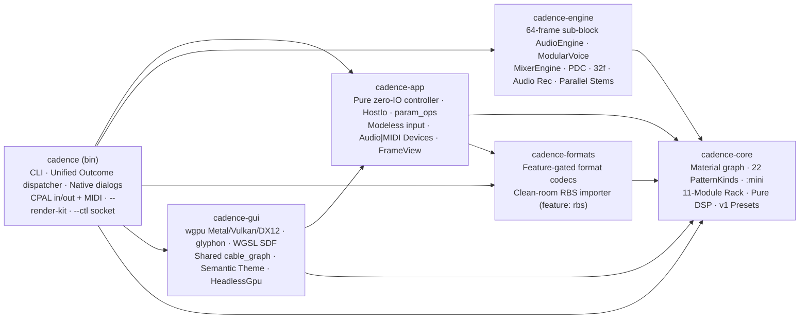

# Cadence Architecture

Cadence is a strict 6-crate Rust workspace separating the pure musical/DSP domain, feature-gated format codecs, real-time 32-bit float audio engine, zero-I/O headless controller, theme-tokenized GPU renderer, and thin host binary.

## Workspace Crates

### `crates/core` (`cadence-core`)
Single source of truth for the domain model and pure DSP — zero audio I/O, MIDI I/O, GUI, or third-party song-format importer dependencies.
- **Material & timing:** `v1` `Project` graph (`material/`), 22 composable `PatternKind` variants, inline `:mini` notation (`mini.rs`), stateless SplitMix64 evaluator with fractional sub-step timing (`evaluate.rs`), flat `ScoreWindow` (`score.rs`), live ring compiler (`live.rs`), and crash-safe Take journal (`take.rs`).
- **Pure DSP (`dsp/`):** 16 zero-allocation composable DSP modules (`math`, `gain`, `biquad`, `noise`, `osc`, `env`, `filter`, `saturate`, `lofi`, `resonator`, `sampler_voice`, `dynamics`, `chorus`, `delay`, `reverb`, `resample`) plus the `StereoEffect` trait (`process_block`, `is_quiet`, `advance_silent_frames`) and exhaustive contract test suite (`contract_tests.rs`).
- **Rack, mixer & assets:** Unified Eurorack `rack/` (11 orthogonal modules, bipolar cables, Kahn `CompiledZoneGraph` with `z-1` feedback, 32 zones, 8 choke groups, 4 bare `RackTemplate`s), universal sample decoding with RIFF `smpl`/`inst` metadata (`sampler.rs`), 8-FX nested-group `mixer.rs`, 8×16 `macros.rs`, external `presets.rs` and `filter_patterns.rs`, `midi_map.rs`, `bundle.rs`, `store.rs`, and `config.rs`.

### `crates/formats` (`cadence-formats`)
Feature-gated third-party song-format importers and exporters behind a format-agnostic façade (`supported_import_formats`, `import_bytes_with_presets`, `import_file_with_presets`). Currently houses the clean-room ReBirth `rbs/` importer behind `feature = "rbs"`, constructing strictly public `cadence_core::material::Project` values with zero runtime hooks into `cadence-core` or `cadence-engine`.

### `crates/engine` (`cadence-engine`)
Real-time lock-free audio orchestration composing `cadence_core::dsp::*` exclusively — never duplicating DSP math.
- **Sub-block audio runtime (`audio/`):** Event-split 64-frame sub-block `Engine` (`engine.rs`), zero-alloc 256-slot sub-step `StepScheduler` (`scheduler.rs`), 256-voice pool (`voice_pool.rs`, `voices.rs`) of heap-boxed `ModularVoice` (`modular_voice/`), 128-byte cache-line-isolated `Shared` atomics (`shared.rs`), CPAL device/hot-plug runtime preserving transport step across reconfigures (`runtime.rs`), lock-free SPSC audio input monitoring & 24-bit WAV capture (`input.rs`), and work-stealing parallel offline stem export (`render.rs`).
- **Mixer & PDC (`mix_engine.rs`):** Dense active channel/effect/duck lists, causal topological `Group → Group` routing, lookahead `Limiter` Plugin Delay Compensation (`pdc_lines`), silent/muted channel sleeping, Option A off-RT `PreparedEffect` / `Box<ActiveEffect>` slots with pre-sized off-RT retirement queues (`0` bytes across unused slots), 32-bit float metering (`hot` vs. Master `clipped`), and `CheckedAllocator` zero-RT-allocation proofs.

### `crates/app` (`cadence-app`)
Pure zero-I/O headless session controller. `Cargo.toml` depends only on `anyhow`, `cadence-core`, `cadence-formats` (feature-gated `rbs`), `serde`, and `serde_json`.
- Routes all filesystem/library/preset/config/take I/O through `HostIo` (`CoreHostIo` on disk, `MemoryHostIo` in tests), all `ParamAddress` handling through `param_ops.rs`, and live Macro/Modulation resolution through `view/live_params.rs`.
- Implements the 4-tier modeless keyboard router (`input/`), 3-tab Eurorack Rack controller (`rack.rs`), unified `Audio | MIDI` Devices deck (`devices.rs`, `midi/`), live 24-bit recording (`recording.rs`), Fuzzy Action Palette (`palette.rs`), live Preset & Filter Groove browsers, Song Properties, Mini-Notation Editor, File Hub, and immutable `FrameView` projection (`view/`).

### `crates/gui` (`cadence-gui`)
Pure native GPU renderer (`winit` + `wgpu` + `glyphon` + WGSL SDF/scope/bloom shaders in `gpu/`) consuming `FrameView` and `&Theme`.
- Embeds the cross-platform app icon (`icon.rs`) and hermetic 2-face `JetBrains Mono` Regular (400) + Bold (700) typography with coding ligatures disabled.
- Shares `decks/cable_graph.rs` across the Signal Graph and Rack Patchbay, renders into one painter-ordered `DisplayList` with balanced clip stacks and zero hardcoded RGBA outside `theme.rs`, and provides `HeadlessGpu` (`headless.rs`) for automated Metal/Vulkan GPU regression tests.

### `src/` (`cadence`)
Thin host binary owning CLI & `cadence ctl` parsing (`main.rs`), one authoritative `Outcome` dispatcher (`src/host/mod.rs`) shared across GUI, `--script`, `--stdio`, and `--ctl`, native OS dialogs, CPAL/midir host threads (`src/host/gui.rs`), `--render-kit`, `--import-rbs`, script runners, and the live Unix `--ctl` socket (`src/host/ctl.rs`).

---

## Core Architectural Invariants

1. **Single Pure Evaluator & Fractional Sub-Step Timing (`crates/core/src/evaluate.rs`):**
   Offline WAV rendering, the live 64-bar ring window (`LIVE_RING_BARS = 64`), and GPU UI projection evaluate patterns through `evaluate_notes_into` and `det_hash`, preserving exact fractional `offset ∈ [0.0, 1.0)` timing.
2. **Native Flat `ScoreWindow` & Compile-Time Invariance (`crates/core/src/score.rs`, `material/mutate.rs`):**
   `Project::compile()` and `compile_live_window()` emit a flat `ScoreWindow` directly consumed by `Engine` and `MixerEngine`. Live sound edits use `patch_score_sound` without recompiling patterns. Rack mutations protect each zone's singular `Out` module and atomically prune stale references; mixer/effect edits enforce `ChannelKind` and `EffectKind` invariance.
3. **Single Mathematical DSP Source of Truth (`crates/core/src/dsp/`) & Strict Value Rule:**
   All synthesis, filter, EQ, waveshaping, dynamics, spatial, pan, and fader math lives once in `cadence_core::dsp::*` and is composed by both `cadence-engine` and `cadence-app::view`. Unmodulated parameters read native patch values directly with zero normalize/denormalize round-trips.
4. **Zero Audio-Thread Allocations, 64-Frame Sub-Blocks & Unclipped 32-Bit Float Chain (`crates/engine/`):**
   Callbacks split cleanly on step boundaries, sub-step events, and control ticks (`<= 64` frames, zero added latency). Active `MixerEngine` inserts own off-RT prepared `Box<ActiveEffect>` instances retired strictly off-RT via `AtomicBoxSlot<ProjectPublication>`; `Shared` isolates hot thread-owned atomics and SPSC cursors on 128-byte cache lines. Internal buses preserve unrestricted float headroom (`hot` when `> 1.0`); `clipped` fires strictly on Master post-fader `> 1.0` or non-finite samples anywhere, and `[-1.0, 1.0]` clamping happens strictly at final DAC/WAV output.
5. **Bounded Authoritative Capacities & Bounded I/O:**
   Every collection carries validated hard caps (`2048` bars/patterns, `16` instruments/lanes, `32` Rack zones, `24` modules and `64` cables per zone, `24` mixer channels, `24` FX devices, `8` Macros × `16` bindings, `128` filter grooves). Disk reads enforce `store::read_bounded`, bounded directory scans, and atomic writes.
6. **Single Clock, Bit-Identical Take Parity & Crash-Safe Journal:**
   Live playback, offline WAV/parallel stem export, bounce resampling, `cadence ctl listen`, and recorded take rendering share one `Engine` + `MixerEngine` + `ScoreWindow` pipeline. Armed takes (`tr`, default OFF) stream off-thread through `TakeJournalSink` (`crates/core/src/take.rs`).
7. **Zero-I/O Controller & Theme-Tokenized GPU Presentation:**
   `cadence-app` routes all external I/O through `HostIo`; `cadence-gui` draws strictly from `&Theme` tokens into one painter-ordered `DisplayList` with balanced clip stacks.

---

## Further Reading

- [Decks, Keymap & Interaction Specification](docs/spec/decks-and-interaction.md)
- [Material & Timing Specification](docs/spec/material-and-timing.md)
- [DSP & Audio Engine Specification](docs/spec/dsp-and-audio-engine.md)
- [Protocols & Live `--ctl` Specification](docs/spec/protocols.md)
- [Design Decisions](docs/design-decisions.md)
- [Verification & Testing](docs/verification.md)
