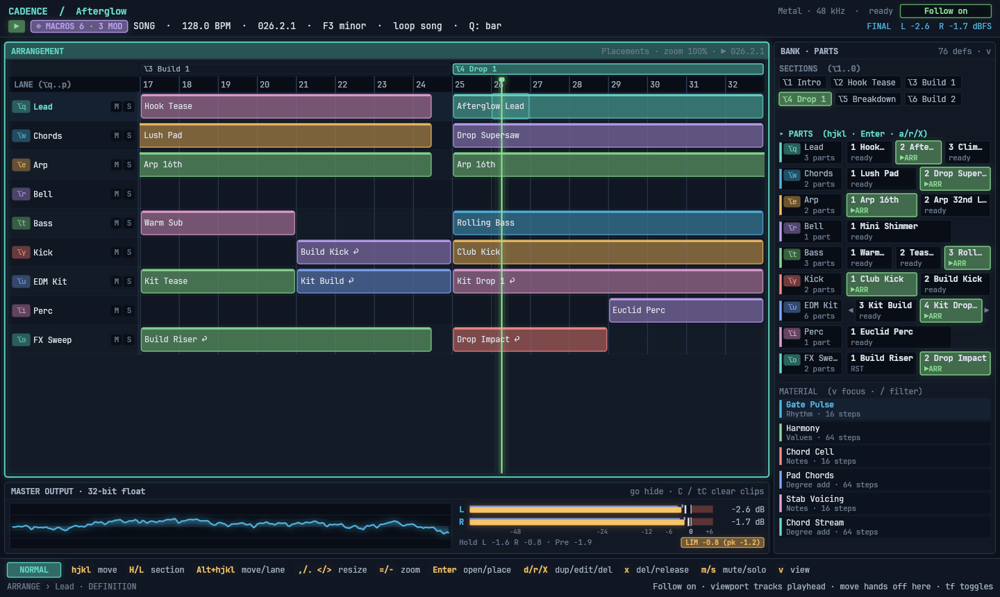
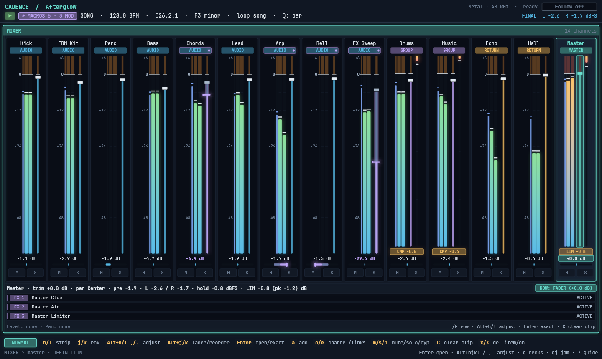
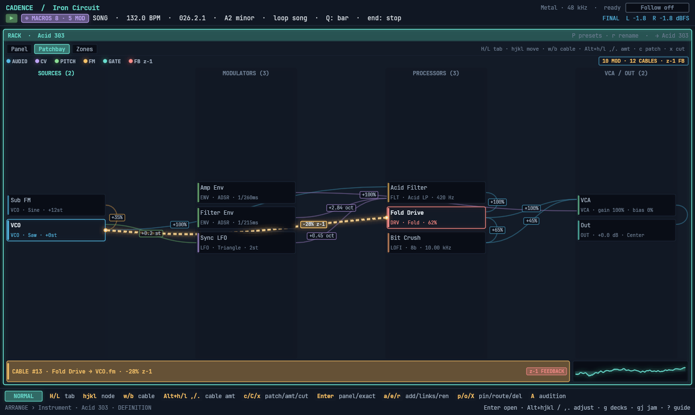
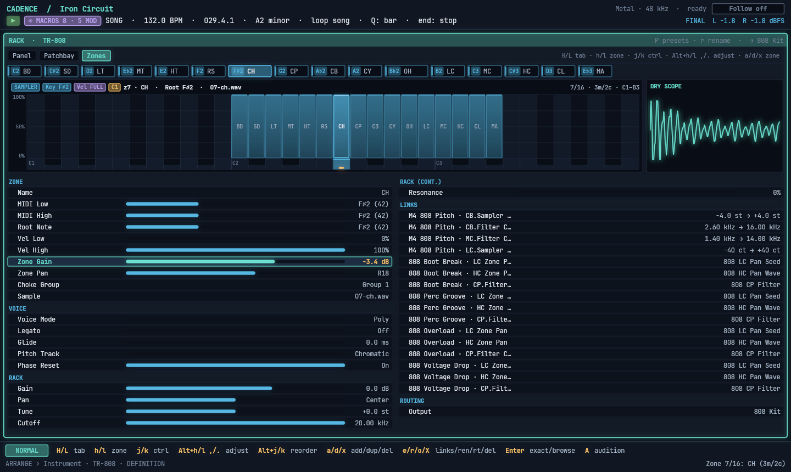
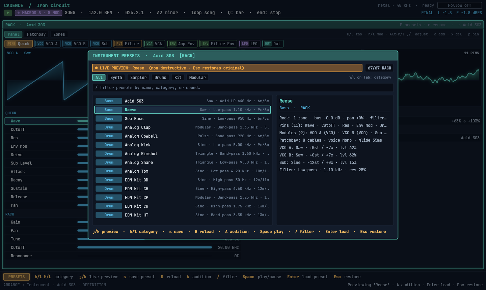
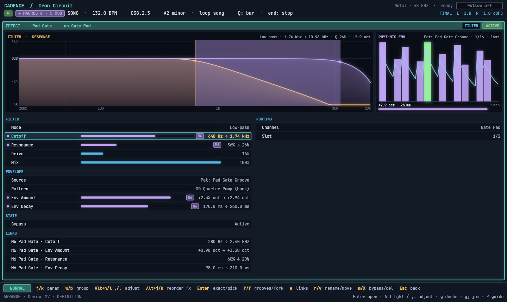
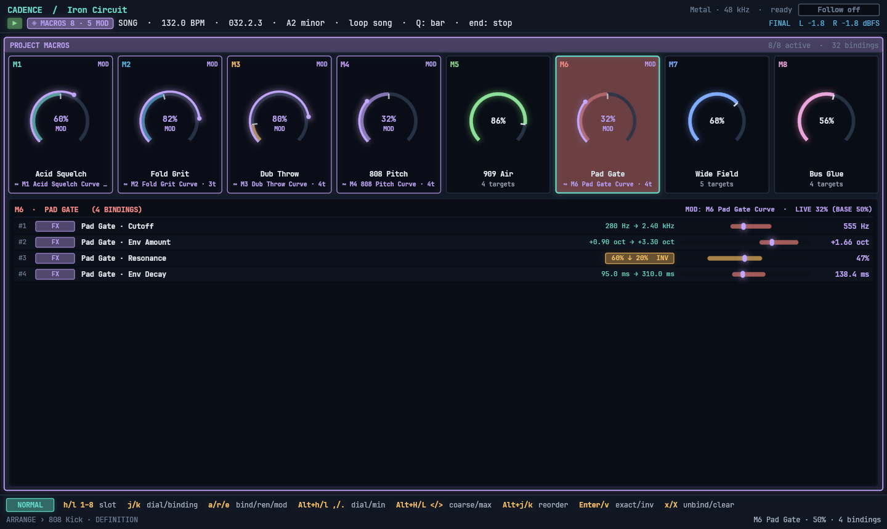
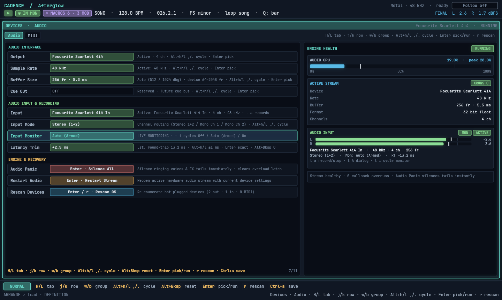
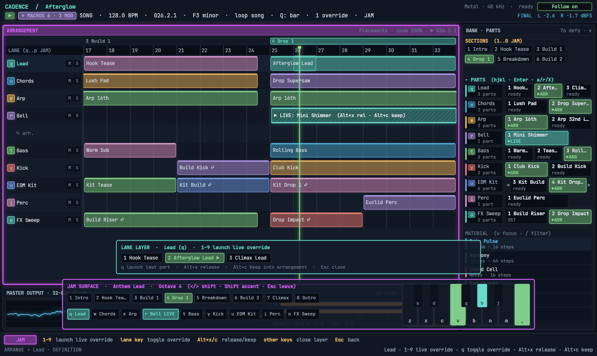
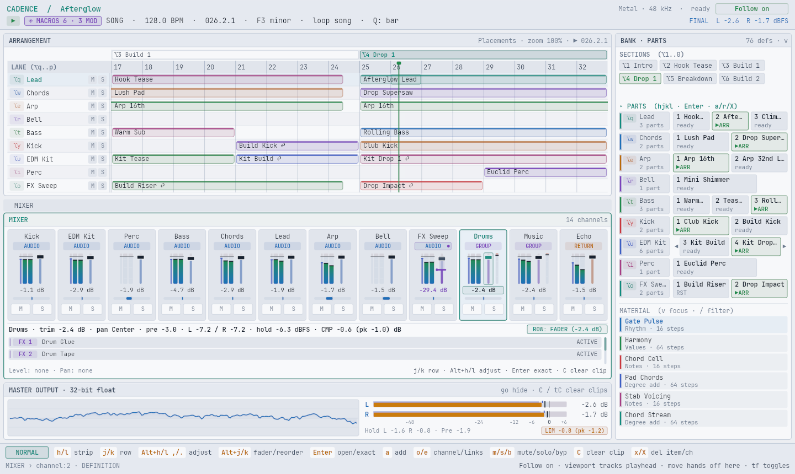

# Cadence

**A fast, keyboard-driven musical studio where your synths, drum machines, studio effects, audio recording, and live performance live in one native binary — and musical relationships stay alive instead of flattening into frozen copy-paste clips.**

Built on a native `wgpu` GPU canvas (`Metal` / `Vulkan` / `DX12`) and a zero-allocation 32-bit float audio engine, Cadence lets you compose, sound-design, mix, record, and perform without plugin overhead or mouse fatigue. Change one chord in a 4-bar progression and your pads, stabs, arpeggios, and bassline follow together in lockstep — while you ride macros, sculpt studio FX, and launch live lane overrides on exact bar boundaries.

> Documentation & site: **[cadence.fm](https://cadence.fm)** (built directly from `docs/` via `mdBook`).



---

## Built for Three Kinds of Musicians

1. **Coming from a standard DAW** *(Ableton, Logic, FL Studio, Bitwig)*
   Arrangement timeline, live clip/lane launching, 24-bit WAV live audio recording into project samplers, a 32-bit float mixer console with `+6 dB` fader headroom and equal-power stereo panning, nested `Group → Group` bus routing, parallel sends, sidechain ducking, 8 assignable project macros, and 8 native studio effects — all keyboard-first with zero VST plugin maze and live-linked musical parts instead of duplicated clips.
2. **Coming from hardware grooveboxes, modular synths & trackers** *(Eurorack, Elektron, 808/909/303, Renoise, M8)*
   A tactile all-in-one laptop rig powered by a **unified Eurorack Modular Rack** (11 patchable audio/CV modules, bipolar attenuverters, 1-sample `z-1` feedback, 7-voice unison, 2× oversampled through-zero FM, 32-mode physical `Resonator`, and 4-pole `AcidLowPass` ladder with velocity accents), `TR-808` / `TR-909` / `EDM Kit` multi-zone baked & live-synth drum kits with per-zone P-locks and choke groups, extensible rhythmic filter groove banks (24 clean-room factory grooves, up to 128 slots), 1-key MIDI Learn with bi-directional OLED/LED controller feedback, and crisp modeless keyboard control.
3. **Coming from live coding** *(Strudel, TidalCycles, Sonic Pi)*
   22 composable retained pattern operations plus inline `:mini` notation with exact fractional sub-step timing (`offset ∈ [0.0, 1.0)`) and deterministic seeded randomness — **without writing code under stage lights**.

> **Open, scriptable, and agent-ready:** Projects, presets, and takes use clean human-readable `v1` JSON/JSONL with deterministic 48 kHz WAV and per-channel stem renders, an external 100% MIT preset and drumkit library (`presets/`, `factory-samples/`, `--render-kit`), clean-room ReBirth `.rbs` import (`--import-rbs`), and a live `--ctl` Unix socket (`cadence ctl`) for scripting and AI/agent-in-the-loop co-production.

---

## Highlights

- **Unified Modeless Keyboard Grammar & Fuzzy Action Palette (`:` / `Ctrl+Shift+p`):** Direct, spatial, zero-friction control with consistent four-tier directional axes across every deck. **`h/j/k/l`** strictly navigates (`H/J/K/L` coarse jumps & tabs — never mutates); **`Alt+h/j/k/l`** (`Alt+H/J/K/L` coarse) directly sculpts notes, placements, knobs, faders, cables, and reorders items along their visual axis with coalesced single-gesture undo; **`, / .`** (`< / >` coarse) adjusts any focused scalar one-handed; **`Enter`** opens links or exact **Value Entry** (`Alt+Backspace` resets); **`i`** enters **Step Insert** piano entry on Pattern Notes; **`gj` / `Ctrl+Shift+j`** toggles modal **Jam Mode** (`1–0` sections, `q–p` lanes, `z–,` piano, `Tab`/`Shift-Tab` bank). Unshifted **`Ctrl+<key>`** jumps to all 10 docked decks (`Ctrl+a/p/b/m/i/k/t/g/d/o`) while **`Ctrl+Shift+<key>`** opens modals/overlays (`Ctrl+Shift+p` Palette, `Ctrl+Shift+f/o/s/e` File Hub, `Ctrl+Shift+i` Song Properties, `Ctrl+Shift+,` Settings, `Ctrl+Shift+b` Sample Browser, `Ctrl+Shift+n` Create New, `Ctrl+Shift+/` Help).
- **11-Module Unified Eurorack Modular Rack, Live 6-Category Preset Browser (`P`) & External MIT Library:** Every instrument (`Project` v1, `InstrumentPreset` v1) is one unified **`Rack`** (`Rack → Zones → Modules [Panel] + Patchbay`) built from **11 orthogonal audio/CV modules** (`Vco` with up to 7-voice stereo unison & 2× through-zero FM, `Sampler` with automatic RIFF `smpl`/`inst` loops, `Noise`, `Env` with `Adsr`/`HoldDecay` + pre-delay + 1–8 multi-bursts, `Lfo`, `Filter` incl. `LowPass6` & 24 dB/oct `AcidLowPass`, `Vca`/4-quadrant RingMod, `Drive`, `LoFi` bitcrusher/decimator, `Resonator` 32-mode physical String/Bar/Membrane/Plate bank, and `Out`), bipolar attenuverter cables, and sample-accurate `z-1` feedback loops — spanning 1-zone synths and samplers to 32-zone note/velocity-layered drum kits with 8 choke groups and per-zone P-locks. Switch across **3 Instrument Deck tabs** (`Panel` | `Patchbay` | `Zones` via `H`/`L`) with 12 live GPU visualizers and customizable Quick Panel pins. Press **`P`** on any Instrument deck for the unified **Preset Browser** (`All` / `Synth` / `Sampler` / `Drums` / `Kit` / `Modular`), 4 bare templates (`Init Synth`, `Blank Sampler`, `Blank Kit`, `Blank Modular`), live non-destructive audio preview on scroll (`Esc` restores with zero undo trace, `Enter` commits once), and preset save — backed by an external MIT catalog (`6` kits — baked & live-synth `TR-808`, `TR-909`, `EDM Kit` — `46` single-voice drum presets, `11` synth presets, and `factory-samples/`; zero hardcoded patches compiled into the binary).
- **8 Zero-Alloc Studio Effects, Nested Routing & 32-Bit Float Mixing:** Native **`Eq`**, **`Filter`** (LP/BP/HP/Acid LP + extensible 128-slot rhythmic `FilterEnv` groove bank with live Groove Browser `P`, Fork-to-Pattern `f`, Save-to-Bank, and custom project pattern triggers), **`Compressor`**, **`Limiter`** (with lookahead Plugin Delay Compensation), **`Drive`** (`Tape` / `HardClip` / `Fold`), **`Chorus`**, **`Delay`** (`PingPong` / `Stereo`, `0.5..=32` sixteenth steps), and **`Reverb`**. Navigate every Mixer channel slot (`Fader`, `Pan`, `Inserts`, `Sends`, `Output`, `Duck`) vertically in `NORMAL` and sculpt directly with `Alt+h/j/k/l` or `,`/`.`, route channels through nested `Group → Group` buses, automate parallel `Send` levels, trigger sidechain `Duck` envelopes, pan with equal-power stereo balance, push faders up to `+6 dB`, and mix on unclipped 32-bit float meters (`-60..+6 dBFS` scale with `0 dB` hairline, amber `HOT` headroom indicator, red `!CLIP` strictly on Master post-fader `> 1.0` or non-finite samples, and live GR bars).
- **8 Assignable Project Macros (`gk`), Unified `Audio | MIDI` Devices Deck (`gd` / `Ctrl+d`) & Live 24-Bit Audio Recording (`ta` / `tA` / `ti`):** Bind up to 8 song-level Macros (up to 16 targets each, including inverted `min > max` ranges) across synths, kit zones, effects, sends, and mixer channels. Open the unified **Devices** deck (`gd` / `Ctrl+d`, `H`/`L` between `Audio` and `MIDI`) to configure audio output/input devices, sample rate, buffer size, mono/stereo input mode, live input monitoring (`Off | Auto | On`, `ti`), latency trim, audio panic/restart (`:audio` / `:panic`), plus hot-plug MIDI ports, soft-pickup takeover, built-in controller profiles (`Generic MIDI`, `Standard CC`, `Arturia MiniLab 3 (DAW)`), and bi-directional OLED/LED feedback. Press **`ta`** (or **`tA`** for the Record Audio dialog / `:rec`) to capture live 24-bit WAV audio directly into a project Sampler, Part, and Placement; press **`M`** on any parameter for 1-key MIDI Learn (`M` then `x` unlearns) and **`R`** for live MIDI Note, CC, and Macro recording.
- **Interactive 5/6-Column Signal Graph (`gG`) & Retained Pattern Algebra:** Traverse and patch `SOURCES` → `DERIVED` → `PARTS` → *(optional `MACROS`)* → `INSTRUMENTS` → `MIXER / FX` with glowing cubic-Bezier cables and direct cable editing (`o` route, `a`/`s`/`m`/`d` connect, `e` edit cable, `x`/`X` unlink, `Enter` jump to deck). Compose 22 retained `PatternKind` operations (`AddDegrees`, `Mask`, `Transpose`, `NotesFromValues`, `Arp`, `Euclidean`, `TimeScale`, `Swing`, `Ratchet`, `Shift`, `Reverse`, `Chance`, `Every`, `RangeFold`, `Concat`, `Stack`, `Shape`, `SeededValues`, and inline `Mini` edited in the live-validated **Mini-Notation Editor**) with fractional sub-step timing and 2D polyphonic chord editing (`j/k` voice, `o` stack, `Alt+j/k` pitch, `Alt+h/l` gate, `,`/`.` velocity).
- **Live Keyboard Performance, Staging & Explicit Take Arming (`tr` / `gt`):** Launch parts on exact bar boundaries from the row-oriented Bank Launchpad (`gb`), lock into modal **Jam Mode** (`gj` / `Ctrl+Shift+j`), queue multi-gesture drops with **Stage Mode** (`S` / `Alt+Enter`), arm `'` (*"From here"*) to auto-fork patterns from the current bar onward, commit live overrides into the arrangement with `Alt+c` / `Alt+C`, and explicitly arm crash-safe off-thread performance takes with **`tr`** (default OFF; opt-in `Auto-Record Takes` in Settings `g,`; `TAKE ARM` / `● REC TAKE` / `● TAKE CAPPED` chrome badges) to mark with **`v`** Visual selection, keep (`Enter` / `Alt+c`), save (`Ctrl+s`), or discard (`X`) in the **Take Deck (`gt`)**.
- **File Hub (`gf`), Sample Browser (`B` / `gS`), Clean-Room `.rbs` Import & Hermetic GPU Themes (`g,`):** Unified File Hub (`Ctrl+Shift+o` Open / Recent, `Ctrl+s` Save / `Ctrl+Shift+s` Save As & Portable Bundle, Import presets, MIDI profiles, and ReBirth `.rbs` songs via `crates/formats`, `Ctrl+Shift+e` Master WAV or Master + Per-Channel Stems export with Peak/RMS/Clips report, plus native OS dialogs via `F`), hermetic embedded `JetBrains Mono` Regular (400) + Bold (700) typography with coding ligatures disabled, embedded cross-platform app icon, and persisted Settings (`g,`) with live GPU themes (`Cadence Dark`, `Midnight Neon`, `Studio Light`).

---

## Visual Tour

The hero image at the top shows [*Afterglow 3.0*](examples/demo/README.md) in the **Arrange + Bank + 32-bit float Output** workspace (`docs/screenshots/01-arrange.png`). Below are sixteen more live `1440×860` Metal GPU captures across *Afterglow 3.0*, *Iron Circuit*, and *Fivefold Live* (automatically rendered with live 48 kHz engine telemetry via `tests/docs_screenshots_gpu.rs`).

| Interactive 6-Column Signal Graph (`gG` · *Iron Circuit*) | 32-Bit Float Mixer Console (`gm` · *Afterglow 3.0*) |
| --- | --- |
|  |  |

| `Anthem Lead` Eurorack Quick Panel (`gi` · *Afterglow 3.0*) | Eurorack Patchbay & `z-1` Feedback (`gi` · *Iron Circuit*) |
| --- | --- |
|  |  |

| `TR-808` 2D Key×Velocity Zones Map (`gi` · *Iron Circuit*) | 6-Category Live Preset Browser (`P` · *Iron Circuit*) |
| --- | --- |
|  |  |

| Rhythmic `Filter` (PCF) & Response Curve (*Iron Circuit*) | 8 Project Macros with Native Units & Sweeps (`gk` · *Iron Circuit*) |
| --- | --- |
|  |  |

| Inline `:mini` Editor & Sub-Step Roll (`gp` · *Afterglow 3.0*) | Fuzzy Action Palette (`:` / `Ctrl+Shift+p` · *Afterglow 3.0*) |
| --- | --- |
|  |  |

| `Devices · Audio` Interface & Input Meters (`gd` / `Ctrl+d`) | `Devices · MIDI` MiniLab 3 DAW & RGB Pads (`gd` / `Ctrl+d`) |
| --- | --- |
|  |  |

| Live Jam Mode HUD & Bank Launchpad (`gj` · *Afterglow 3.0*) | Armed Take Deck & Visual Range (`gt` · *Fivefold Live*) |
| --- | --- |
|  |  |

| `Studio Light` Semantic Theme (`g,` · *Afterglow 3.0*) | Settings & `Midnight Neon` Theme (`g,` · *Afterglow 3.0*) |
| --- | --- |
|  |  |

---

## Quick Start & Included Showcase Projects

```sh
# 1. Play the flagship 64-bar modern melodic EDM track ("Afterglow 3.0")
cargo run --release -- --project examples/demo/project.json

# 2. Play the 48-bar Acid Electro & hardware groovebox showcase ("Iron Circuit")
cargo run --release -- --project examples/iron-circuit/project.json

# 3. Explore the 32-bar generative ambient / IDM showcase ("Glass Cathedral")
cargo run --release -- --project examples/glass-cathedral/project.json

# 4. Perform the live keyboard set & replayable take ("Fivefold Live")
cargo run --release -- --project examples/fivefold-live/project.json

# 5. Start from a blank canvas
cargo run --release -- --empty
```

Requires a current stable Rust toolchain. macOS uses `Metal` + `CoreAudio` + `CoreMIDI`; Linux uses `Vulkan` + `ALSA` (`libasound2-dev`). Pass `--silent` to run without an audio device, or `--no-default-features` for headless CLI builds.

| Showcase | Length & Style | What It Demonstrates |
| --- | --- | --- |
| [**Afterglow 3.0**](examples/demo/README.md) (`examples/demo/`) | 64 bars · 128 BPM · F minor · Modern EDM | Shared 4-bar harmony driving supersaws, hooks, 32nd arps, and bass; 9 instruments/lanes (incl. `FX Sweep`); MIT `EDM Kit` multi-zone Rack with per-zone P-locks; 6 Macros; rhythmic gate filter; 5 sidechain ducks; 20 studio FX. |
| [**Iron Circuit**](examples/iron-circuit/README.md) (`examples/iron-circuit/`) | 48 bars · 132 BPM · A minor · Acid Electro | Unified Modular Racks across every role (`TR-808` + `TR-909` multi-zone kits, Detroit chord `Sampler` Rack, `AcidLowPass` 303 & wavefolded bass), nested `Group → Group` routing, all 8 FX & modes (22 devices), and all 8 Macros. |
| [**Glass Cathedral**](examples/glass-cathedral/README.md) (`examples/glass-cathedral/`) | 32 bars · 108 BPM · D Dorian · Generative Ambient / IDM | 100% synthesis, `7 × 11` polymetric phasing, `Every(3)` reverse canon, `3:2` triplet random arp, `:mini` celesta chimes, 4 ambient Macros, and automated spatial `Send` swells. |
| [**Fivefold Live**](examples/fivefold-live/README.md) (`examples/fivefold-live/`) | 60-bar song / 62-bar take · 136 BPM · D minor · Live Acid Set | Live keyboard performance in Jam Mode (`1–9` sections, `q–i` lane builds, live mid-set harmony edit & `:undo` on bar boundaries) captured into a bit-identical recorded take. |
| [**Signal Garden**](examples/material-lab/README.md) (`examples/material-lab/`) | 10 bars · 136 BPM · D minor · Authoring Lab | Compact composition and 6 headless key-script sessions exercising retained derivations, forks vs. frozen snapshots, placement-local exceptions, and mixer ducks. |
| [**Agent Session**](examples/agent-session/README.md) (`examples/agent-session/`) | JSONL scripts · Headless & Live Control | Typed JSONL automation with revision guards (`--script` / `--stdio`) and entry point into live `--ctl` control. |

---

## Core Keyboard Grammar

Cadence uses a unified **modeless keyboard grammar** with four consistent directional tiers (`hjkl` navigate · `HJKL` coarse/tabs · `Alt+hjkl` direct 2D manipulation/reorder · `,/.` `</>` one-hand scalar adjust), plus genuine input modes only where needed (`Insert` on Pattern Notes, modal `Jam`, `ValueInput`, `MiniEditor`). Every shortcut below is verified directly against Cadence's input router. Press `?` at any time for the tabbed, `/` searchable in-app reference.

| Keys | Action |
| --- | --- |
| `h/j/k/l` · `H/J/K/L` · `w/b` | Strictly navigate/select — NEVER mutate audio (`H/L` switch Rack/Devices/Modal tabs, bars `±16`, sections, Mixer pages · `w/b` jump groups, events, breakpoints, or attached cables) |
| `Alt+h/j/k/l` (`Alt+H/J/K/L`) · `,`/`.` (`<`/`>`) | Directly manipulate, move, or reorder the focused item along its visual axis (fine / coarse, with coalesced undo) · `,`/`.` `<`/`>` one-hand scalar adjust · `Alt+Backspace` reset |
| `Enter` / `i` *(on Pattern Notes)* | Open link, launch Part, toggle Rhythm/bool, or open exact **Value Entry** (`ValueInput`) / **Mini Editor** · `i` enters **Step Insert** (`1–8`, `z–,`, `Shift` accent, `<`/`>` oct, `.` rest) |
| `:` or `Ctrl+Shift+p` | Open the **Fuzzy Action Palette** (search any action, deck, FX, section, pattern, or instrument · live top-slot Ex passthrough) |
| `Space` / `Home` / `\` / `tl` / `tx` / `tr` / `tR` | Play/pause · stop · toggle loop · loop section · clear loop · **arm/disarm Take (`tr`)** · restart loop (`tR`) |
| `ta` / `tA` / `ti` / `:rec` | **Toggle 24-bit WAV audio recording** (`ta`) · open **Record Audio** dialog (`tA`) · cycle live input monitor `Off\|Auto\|On` (`ti`) |
| `ga` `gp` `gb` `gm` `gi` `gk` `gt` `gG` `gd` `go` | Jump to **Arrange**, **Pattern**, **Bank**, **Mixer**, **Instrument Rack**, **Macros**, **Take**, **Signal Graph**, **Devices (`Audio \| MIDI`)**, toggle **Output** *(direct `Ctrl+a/p/b/m/i/k/t/g/d/o`)* |
| `gP` `gf` `B`/`gS` `g,` `n` | Open **Song Properties**, **File Hub**, **Sample Browser**, **Settings**, **Create New Menu** *(direct `Ctrl+Shift+i/f/b/,/n`)* |
| `P` / `r` / `a` / `x` / `c` / `p` *(in `gi`)* | Open 6-category **Preset Browser** (live preview + Save Preset) · Rename · Add module/zone · Remove/disconnect · Patch cable · Pin Quick Panel control |
| `z1`..`z4` / `zz` / `zp` / `Tab` | 1-key workspace layouts (`Compose`, `Perform`, `Sound Design`, `Mix`) · zoom focused deck · pin/unpin deck · cycle open decks |
| `gj` / `Ctrl+Shift+j` *(then `Tab`/`Shift-Tab`)* | Toggle **Jam Mode** (`1–0` sections · `q–p` lane layers · `z–,` 13-key piano · `Tab`/`Shift-Tab` bank paging) |
| `S` / `Alt+Enter` | Start **Stage Mode** to queue multi-gesture changes, then fire atomically on the next bar boundary |
| `Alt+c` / `Alt+C` / `Alt+x` / `Alt+X` | **Keep** focused lane override (or Take range) / **Keep all** overrides · **Release** focused lane / **Release all** |
| `'` | Arm **"From here"** scoped fork (next pattern edit forks cleanly from the current bar onward) |
| `v` / `Enter` / `Ctrl+s` / `X` *(in `gt` Take Deck)* | Visual range mark (`h/l` extend, `v` lock) · keep range into arrangement · save `.take.jsonl` · discard take |
| `M` / `M` then `x` / `R` | 1-key **MIDI Learn** / unlearn on any parameter · toggle **Live Note, CC & Macro Recording** |
| `o` · `a`/`s`/`m`/`d` · `e` · `x`/`X` *(in `gG`)* | Signal Graph cable editing: route output · add connection/send/mod/duck · edit cable · unlink one/all |
| `Ctrl+s` / `Ctrl+Shift+o` / `Ctrl+Shift+s` / `Ctrl+Shift+e` / `F` | Quick Save · File Hub (`Open`, `Save As & Bundle`, `Export Audio` + Stems) · `F` opens native OS file dialog |
| `:derive NAME <op> ...` / `:mini NAME [STEPS] <code>` | Compose derived patterns (`add`, `mask`, `transpose`, `from`, `arp`, `swing`, `ratchet`, `every`, `fast`, `slow`, `fold`, `shape`, `stack`, `concat`, `reverse`, `shift`, `chance`) or create inline `:mini` |
| `:new synth\|sampler\|kit\|rack\|modular [NAME]` | Create a new Rack instrument from a bare template (`:kit NAME tr-808` / `:preset acid-303` loads an external v1 preset) |
| `:mod add\|del\|rename` · `:patch` / `:unpatch` · `:pin` / `:unpin` | Add/remove/rename Eurorack modules · patch/cut bipolar attenuverter cables · pin/unpin Quick Panel controls |
| `:fx eq\|filter\|comp\|limiter\|drive\|chorus\|delay\|reverb` | Insert a native zero-allocation studio effect on the selected mixer channel |
| `?` (with `/` search) / `:tutorial` | Tabbed & `/` searchable keyboard reference overlay / interactive first-session walkthrough |

---

## Headless CLI, Audio Export & Live `--ctl` Control

Cadence's audio and controller engines run natively headlessly for CI validation, deterministic audio rendering, kit baking, ReBirth `.rbs` import, and live external scripting:

```sh
# Validate score integrity and sample readiness (JSON summary)
cadence --project examples/demo/project.json --check

# Deterministic 48 kHz stereo WAV render (plus optional telemetry report)
cadence --project examples/demo/project.json --render afterglow.wav --render-report afterglow.report.json

# Export Master + isolated per-channel stereo WAV stems
cadence --project examples/demo/project.json --stems afterglow-stems/

# Bake every Audio channel of a sound-design project into trimmed WAVs + a v1 Rack kit preset JSON
cadence --render-kit factory-sources/tr-909/project.json --out-samples factory-samples/tr-909/ --out-preset presets/kits/tr-909.json

# Clean-room import a ReBirth RB-338 .rbs song directly into Cadence
cadence --import-rbs song.rbs

# Inspect and connect hardware MIDI ports
cadence --list-midi
cadence --midi-in "Minilab3" --midi-out "Minilab3" --project examples/demo/project.json
```

### Live `--ctl` Control Socket (Scripting & Agent Co-Production)

Launch the GUI with `--ctl` to expose a local Unix control socket alongside your live session — every command updates the live audio engine, renders immediately in the GPU UI, and pushes onto the normal `u` undo stack:

```sh
# Start Cadence GUI with live control socket enabled (auto-discovered via session dir or explicit path)
cadence --project examples/iron-circuit/project.json --ctl

# Query compact live state and 32-bit float channel/GR meters
cadence ctl state --compact
cadence ctl meters

# Run any Ex command or typed JSON Action live (with optional optimistic revision guard)
cadence ctl cmd "bpm 134" --compact
cadence ctl action '{"op":"play","playing":true}' --compact

# Capture stereo audio from an offline bar window (with optional temporary solo) or the live speaker tap ring
cadence ctl listen --bars 17..25 --solo "Acid 303,808 Kit" --out /tmp/acid-check.wav
cadence ctl listen --live 4.0 --out /tmp/live-tap.wav
```

---

## Documentation & Development

- **Website & User Guide:** [cadence.fm](https://cadence.fm) · [docs/guide/README.md](docs/guide/README.md) — step-by-step chapters covering [Quick Tour](docs/guide/01-quick-tour.md), [Patterns & Algebra](docs/guide/02-patterns-and-algebra.md), [Instruments & Assets](docs/guide/03-instruments-and-assets.md), [Mixing, FX & Routing](docs/guide/04-mixing-fx-and-routing.md), [Macros & Modulation](docs/guide/05-macros-and-modulation.md), [Audio Devices, Recording & MIDI](docs/guide/06-devices-audio-and-midi.md), [Live Performance & Takes](docs/guide/07-performing-and-takes.md), and [CLI, Scripting & Live `--ctl`](docs/guide/08-cli-scripting-and-live-ctl.md).
- **Architecture & Technical Specs:** [ARCHITECTURE.md](ARCHITECTURE.md) · [Decks, Keymap & Interaction](docs/spec/decks-and-interaction.md) · [Material & Timing](docs/spec/material-and-timing.md) · [DSP & Audio Engine](docs/spec/dsp-and-audio-engine.md) · [Protocols](docs/spec/protocols.md) · [Design Decisions](docs/design-decisions.md).
- **Contributing & Roadmap:** [CONTRIBUTING.md](CONTRIBUTING.md) · [Verification Log](docs/verification.md) · [Roadmap (`TODO.md`)](TODO.md) · [MIT License](LICENSE).

```sh
cargo fmt --all -- --check
cargo clippy --workspace --all-targets -- -D warnings
cargo clippy --no-default-features --all-targets -- -D warnings
cargo test -p cadence-engine --lib
cargo test --workspace
cargo test --release --test audio_invariants
```
