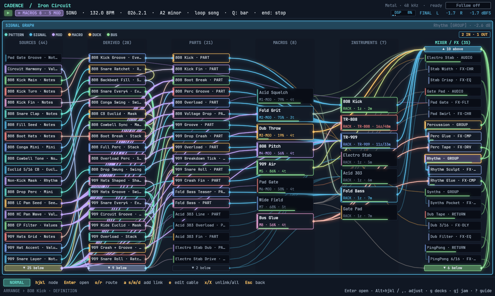
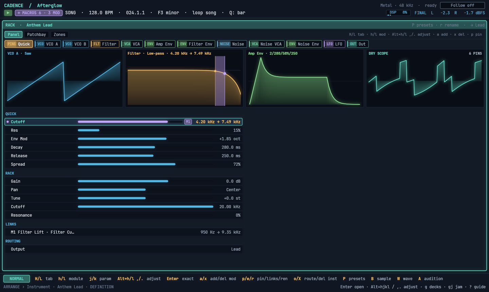
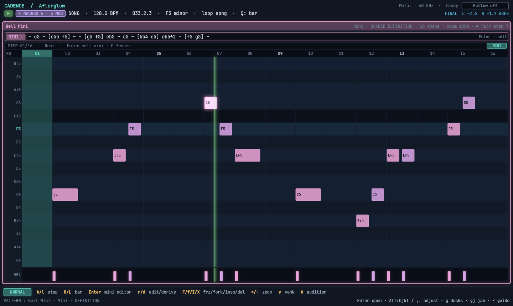
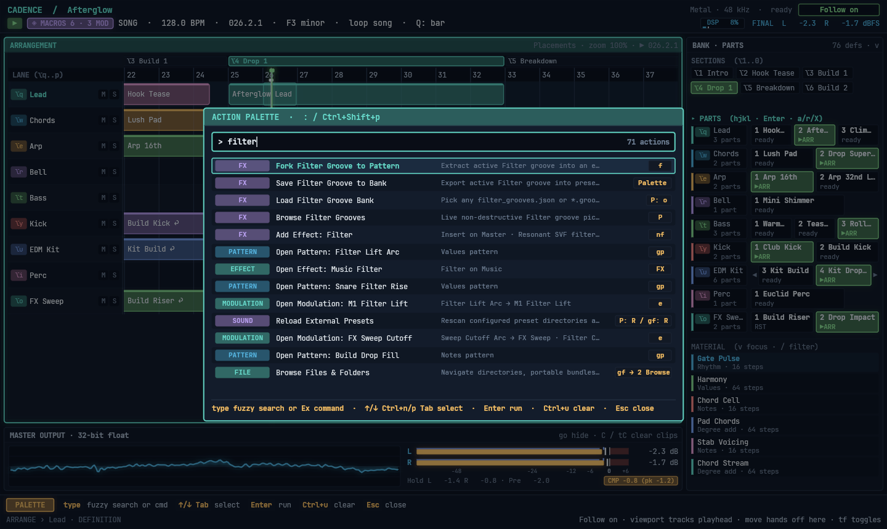
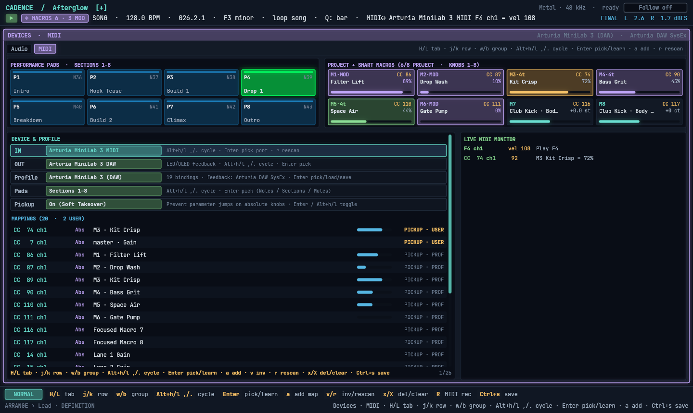
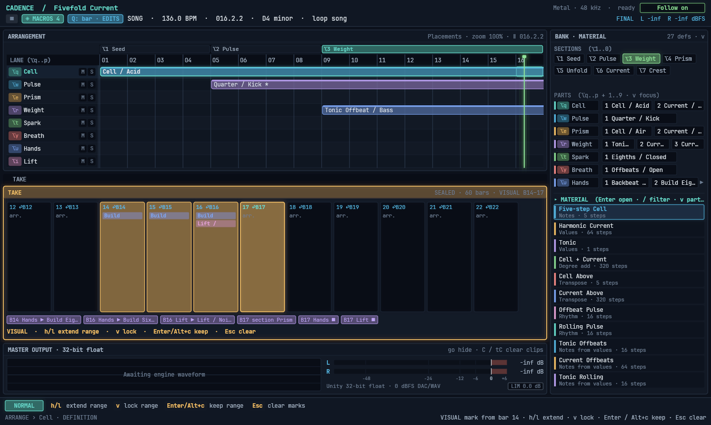
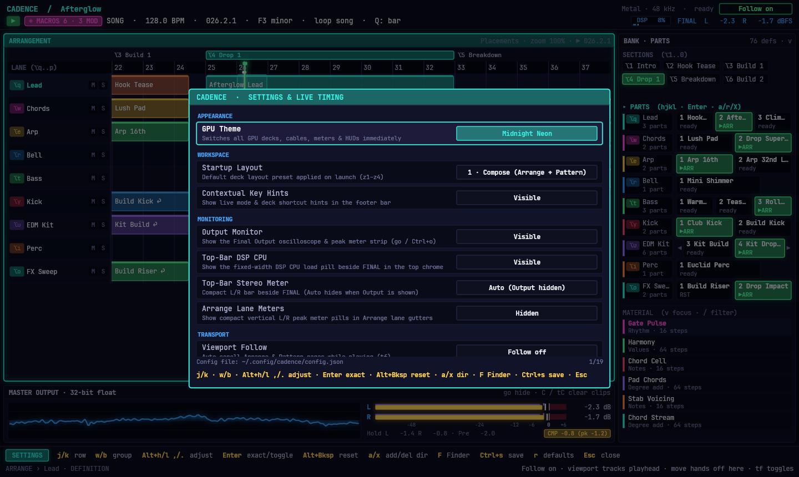

# Cadence

**A keyboard-driven musical studio in one native binary — where synths, drum kits, studio effects, audio recording, and live performance share one live musical graph.**

Built on a native `wgpu` GPU canvas (`Metal` / `Vulkan` / `DX12`) and a zero-allocation 32-bit float audio engine, Cadence keeps musical relationships alive instead of flattening them into copy-paste clips. Edit one chord in a progression and your pads, stabs, arpeggios, and bassline follow in lockstep while you ride macros, shape effects, and launch live overrides on bar boundaries.

> Documentation & user guide: **[cadence.fm](https://cadence.fm)** (built directly from `docs/`).


---

## Why Cadence

- **For DAW producers** *(Ableton, Logic, FL Studio, Bitwig)* — Arrangement timeline, live lane launching, 24-bit audio recording into project samplers, a 32-bit float mixer with nested group routing, sends, sidechain ducking, project macros, and studio effects — all keyboard-first with zero plugin maze.
- **For hardware & modular musicians** *(Eurorack, Elektron, 808/909/303, trackers)* — A unified Eurorack Modular Rack with patchable audio/CV modules, bipolar attenuverters, 1-sample feedback, multi-zone drum kits with choke groups and per-zone P-locks, rhythmic filter grooves, and 1-key MIDI Learn with controller OLED/LED feedback.
- **For live coders** *(Strudel, TidalCycles, Sonic Pi)* — Composable retained pattern derivations and inline `:mini` notation with fractional sub-step timing and deterministic randomness — playable directly from the keyboard without writing code on stage.

---

## Quick Start

Requires a current stable Rust toolchain. macOS uses `Metal` + `CoreAudio` + `CoreMIDI`; Linux uses `Vulkan` + `ALSA` (`libasound2-dev`). Pass `--silent` to run without an audio device, or `--no-default-features` for headless CLI builds.

```sh
# Play the flagship melodic EDM showcase ("Afterglow")
cargo run --release -- --project examples/demo/project.json

# Or start from a blank canvas
cargo run --release -- --empty
```

### Included Showcases

| Showcase | Style & Length | Highlights |
| --- | --- | --- |
| [**Afterglow**](examples/demo/README.md) | 64 bars · 128 BPM · Modern EDM | Shared harmony driving supersaws, leads, arps, and bass; `EDM Kit` with per-zone P-locks; automated `FX Sweep`; 6 Macros; 5 sidechain ducks. |
| [**Iron Circuit**](examples/iron-circuit/README.md) | 48 bars · 132 BPM · Acid Electro | `TR-808` + `TR-909` multi-zone kits, Detroit chord sampler, 303 acid ladder, wavefolded bass, nested `Group → Group` routing, all 8 FX and 8 Macros. |
| [**Glass Cathedral**](examples/glass-cathedral/README.md) | 32 bars · 108 BPM · Ambient / IDM | Pure synthesis, polymetric `7 × 11` phasing, reverse canons, triplet random arps, `:mini` celesta chimes, and automated spatial sends. |
| [**Fivefold Live**](examples/fivefold-live/README.md) | 60 bars / 62-bar take · Live Acid | Full keyboard performance in Jam Mode (`1–9` sections, `q–i` lane builds, live bar-quantized harmony edit & `:undo`) saved as a replayable take. |
| [**Signal Garden**](examples/material-lab/README.md) | 10 bars · Authoring Lab | Compact composition plus 6 headless key-script sessions exercising derivations, forks vs. frozen snapshots, and placement-local overrides. |
| [**Agent Session**](examples/agent-session/README.md) | JSONL Scripts · Live Control | Typed automation with revision guards (`--script` / `--stdio`) and an introduction to live `--ctl` control. |

---

## What's Inside

### Modeless Keyboard Workflow

Navigation and editing stay strictly separated across every deck, with consistent screen-axis directions so you can sculpt fast without accidental edits:

- **Navigate** with `h/j/k/l` (`H/J/K/L` for tabs and coarse jumps, `w/b` for groups/events).
- **Sculpt & reorder** directly in place with `Alt+h/j/k/l` or one-handed `,`/`.` (`Alt+Backspace` resets, `Enter` enters exact values).
- **Jump anywhere** via `g<key>` / `Ctrl+<key>` decks, `/` search, `?` searchable help, or the **Fuzzy Action Palette** (`:` / `Ctrl+Shift+p`).
- Full reference: [Quick Tour](docs/guide/01-quick-tour.md) · [Decks & Keymap Spec](docs/spec/decks-and-interaction.md).

### Modular Rack & Preset Library

Every instrument is a unified Eurorack **Rack** (`Panel | Patchbay | Zones`) — from single-voice synths and samplers to multi-zone velocity-layered drum kits with choke groups:

- **11 patchable modules:** VCO (unison + 2× through-zero FM), Sampler (RIFF loop/root metadata), Noise, ADSR/Hold-Decay/Multi-Burst Env, LFO, multi-mode Filter (incl. 4-pole `AcidLowPass`), VCA/RingMod, Drive, LoFi, 32-mode physical Resonator, and Out.
- **Patchbay & Quick Panel:** Patch bipolar attenuverter cables (including safe 1-sample `z-1` feedback loops) and pin favorite controls onto the per-instrument Quick Panel.
- **Live Preset Browser (`P`):** Browse external MIT-licensed kits (`TR-808`, `TR-909`, `EDM Kit`), single-voice drums, and synths with live non-destructive audio preview (`Esc` reverts cleanly).
- Full reference: [Instruments, Rack & Assets](docs/guide/03-instruments-and-assets.md).

### Mixing, Studio Effects & Signal Graph

An unclipped 32-bit float console feeds native effects, nested buses, and an interactive patchable overview of the whole project:

- **8 studio effects:** 4-band EQ, rhythmic step-envelope Filter (with browsable/editable groove banks), soft-knee Compressor, lookahead PDC Limiter, 3-mode 2×-oversampled Drive (`Tape` / `HardClip` / `Fold`), Chorus, dual-mode Delay (`PingPong` / `Stereo`), and Hadamard FDN Reverb.
- **Console routing:** Nested `Group → Group` buses, parallel aux sends, kick/part-triggered sidechain ducking, equal-power stereo panning, `+6 dB` fader headroom, and up to 8 song-level **Project Macros** (`gk`) with inverted-range support.
- **Signal Graph (`gG`):** Inspect and edit routing, sends, modulations, macros, and ducks directly on a multi-column cable canvas.
- Full reference: [Mixing, FX & Routing](docs/guide/04-mixing-fx-and-routing.md) · [Macros & Modulation](docs/guide/05-macros-and-modulation.md).

### Retained Patterns & Live Performance

Patterns stay live and composable from first sketch to stage set:

- **Retained pattern algebra & `:mini`:** Derive melodies, chords, arps, Euclidean rhythms, ratchets, swings, and conditional variations from shared sources — or type inline `:mini` notation with fractional sub-step timing.
- **Perform & capture:** Launch lane overrides on bar boundaries from the Bank Launchpad (`gb`) or modal **Jam Mode** (`gj`), batch multi-gesture drops in **Stage Mode** (`S`), fork from the playhead (`'`), and explicitly arm crash-safe performance **Takes** (`tr` / `gt`) to mark and keep ranges back into the arrangement.
- Full reference: [Patterns & Algebra](docs/guide/02-patterns-and-algebra.md) · [Live Performance & Takes](docs/guide/07-performing-and-takes.md).

### Audio Recording, Hardware MIDI & Themes

- **Audio Devices & 24-Bit Recording (`gd` / `ta`):** Select hardware input/output devices, sample rate, buffer size, and live monitoring (`Off | Auto | On`), and record 24-bit WAV takes straight into a project Sampler, Part, and Placement.
- **Hardware MIDI:** Hot-plug ports, 1-key MIDI Learn (`M`), live Note/CC/Macro recording (`R`), soft-pickup takeover, and built-in profiles (including bi-directional Arturia MiniLab 3 DAW feedback).
- **File Hub & Themes (`gf` / `g,`):** Portable bundles, parallel per-channel WAV stem export, clean-room ReBirth `.rbs` import, native OS file dialogs, embedded `JetBrains Mono` typography, and 3 GPU themes (`Cadence Dark`, `Midnight Neon`, `Studio Light`).
- Full reference: [Audio Devices, Recording & MIDI](docs/guide/06-devices-audio-and-midi.md).

---

## Visual Tour

All captures below are `1440×860` Metal GPU renders driven by live 48 kHz engine telemetry across *Afterglow*, *Iron Circuit*, and *Fivefold Live*.

| Interactive Signal Graph (`gG` · *Iron Circuit*) | 32-Bit Float Mixer Console (`gm` · *Afterglow*) |
| --- | --- |
|  |  |

| Eurorack Quick Panel (`gi` · *Afterglow*) | Eurorack Patchbay & `z-1` Feedback (`gi` · *Iron Circuit*) |
| --- | --- |
|  |  |

| `TR-808` 2D Zones Map (`gi` · *Iron Circuit*) | Project Macros Deck (`gk` · *Iron Circuit*) |
| --- | --- |
|  |  |

<details>
<summary>More screenshots (10 more views: Preset Browser, Filter PCF, :mini Roll, Action Palette, Audio &amp; MIDI Devices, Jam HUD, Take Deck, Light &amp; Neon themes)</summary>

| 6-Category Live Preset Browser (`P` · *Iron Circuit*) | Rhythmic `Filter` & Response Curve (*Iron Circuit*) |
| --- | --- |
|  |  |

| Inline `:mini` Editor & Sub-Step Roll (`gp` · *Afterglow*) | Fuzzy Action Palette (`:` / `Ctrl+Shift+p` · *Afterglow*) |
| --- | --- |
|  |  |

| `Devices · Audio` Interface & Input Meters (`gd`) | `Devices · MIDI` Controller & RGB Pads (`gd`) |
| --- | --- |
|  |  |

| Live Jam Mode HUD & Bank Launchpad (`gj` · *Afterglow*) | Armed Take Deck & Visual Range (`gt` · *Fivefold Live*) |
| --- | --- |
|  |  |

| `Studio Light` Theme (`g,` · *Afterglow*) | Settings & `Midnight Neon` Theme (`g,` · *Afterglow*) |
| --- | --- |
|  |  |

</details>

---

## Essential Shortcuts

Press **`?`** anywhere in Cadence for the tabbed, `/` searchable keymap reference (or see the full [Decks, Keymap & Interaction Spec](docs/spec/decks-and-interaction.md)).

| Keys | Action |
| --- | --- |
| `h/j/k/l` · `H/J/K/L` · `w/b` | Navigate & switch tabs/groups (never mutates audio) |
| `Alt+h/j/k/l` · `,`/`.` · `Alt+Backspace` | Sculpt, move, or reorder focused item · one-hand adjust · reset |
| `Enter` / `i` *(on Pattern Notes)* | Open link, exact value entry, or `:mini` editor · `i` Step Insert |
| `:` or `Ctrl+Shift+p` | Fuzzy Action Palette (with live Ex command passthrough) |
| `Space` / `Home` / `\` / `tr` | Play/pause · stop · toggle loop · arm/disarm performance Take |
| `ta` / `tA` / `ti` | Toggle 24-bit WAV recording · Record dialog · cycle input monitor |
| `ga` `gp` `gb` `gm` `gi` `gk` `gt` `gG` `gd` `go` | Jump to any deck (`Ctrl+a/p/b/m/i/k/t/g/d/o`) |
| `gP` `gf` `B` `P` `g,` `n` | Song Properties · File Hub · Samples · Presets · Settings · New |
| `gj` / `S` / `Alt+c` / `Alt+x` | Jam Mode · Stage Mode · Keep override · Release override |
| `M` / `R` / `z1`..`z4` / `zz` | MIDI Learn · Live MIDI Rec · Workspace layouts · Zoom deck |

---

## Headless CLI & Live Control

Cadence runs headlessly for CI validation, deterministic WAV and parallel stem export, kit baking, `.rbs` import, and live external scripting over a local Unix `--ctl` socket:

```sh
# Validate score integrity and sample readiness
cadence --project examples/demo/project.json --check

# Render deterministic 48 kHz WAV + telemetry report, or parallel per-channel stems
cadence --project examples/demo/project.json --render afterglow.wav --render-report report.json
cadence --project examples/demo/project.json --stems afterglow-stems/

# Clean-room import a ReBirth RB-338 .rbs song
cadence --import-rbs song.rbs

# Launch GUI with live --ctl socket and control/inspect from another terminal
cadence --project examples/iron-circuit/project.json --ctl
cadence ctl state --compact
cadence ctl cmd "bpm 134" --compact
cadence ctl listen --bars 17..25 --solo "Acid 303,808 Kit" --out /tmp/acid-check.wav
```

See [CLI, Scripting & Live Control](docs/guide/08-cli-scripting-and-live-ctl.md) and [Protocols & Persistence](docs/spec/protocols.md) for full details.

---

## Documentation & Contributing

- **User Guide ([cadence.fm](https://cadence.fm)):** [Overview](docs/guide/README.md) · [Quick Tour](docs/guide/01-quick-tour.md) · [Patterns & Algebra](docs/guide/02-patterns-and-algebra.md) · [Instruments & Assets](docs/guide/03-instruments-and-assets.md) · [Mixing, FX & Routing](docs/guide/04-mixing-fx-and-routing.md) · [Macros & Modulation](docs/guide/05-macros-and-modulation.md) · [Audio & MIDI](docs/guide/06-devices-audio-and-midi.md) · [Live & Takes](docs/guide/07-performing-and-takes.md) · [CLI & `--ctl`](docs/guide/08-cli-scripting-and-live-ctl.md)
- **Architecture & Specs:** [ARCHITECTURE.md](ARCHITECTURE.md) · [Decks & Keymap](docs/spec/decks-and-interaction.md) · [Material & Timing](docs/spec/material-and-timing.md) · [DSP & Audio Engine](docs/spec/dsp-and-audio-engine.md) · [Protocols](docs/spec/protocols.md) · [Design Decisions](docs/design-decisions.md)
- **Development:** [CONTRIBUTING.md](CONTRIBUTING.md) · [Verification & Testing](docs/verification.md) · [Issues & Roadmap](https://github.com/cadencefm/cadence/issues) · [MIT License](LICENSE)
