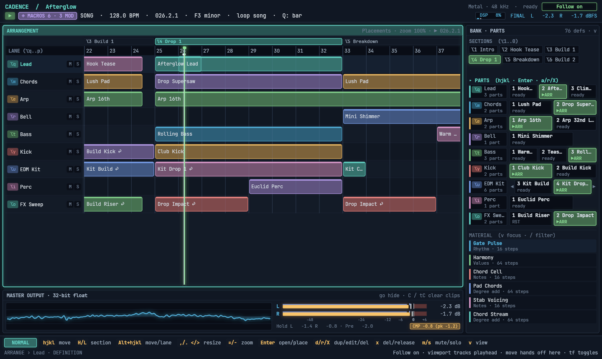
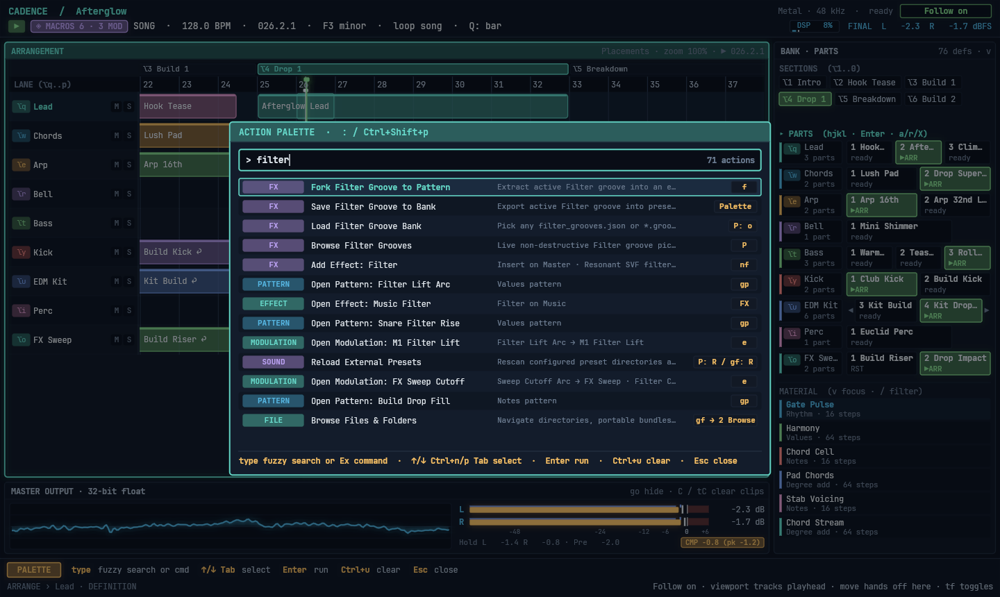
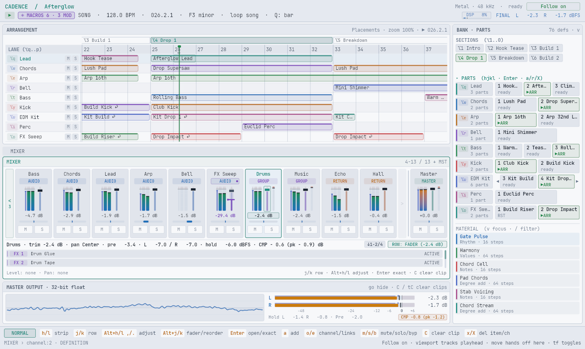

# Chapter 1 · Quick Tour: First 10 Minutes

> [Guide Home](README.md) · **Chapter 1** · Next: [Patterns, Algebra & Inline `:mini`](02-patterns-and-algebra.md)

This chapter gets you listening, navigating decks, switching themes, controlling transport, and building your first living 3-part groove from scratch—in under ten minutes.

---

## 1. Launch a Showcase Project

Start Cadence with the built-in **Afterglow** demo or open any showcase directly:

```sh
# Built-in demo (Afterglow)
cargo run --release

# Or open an explicit showcase project
cargo run --release -- --project examples/demo/project.json
cargo run --release -- --project examples/iron-circuit/project.json
```

Press **`Space`** to start playback and **`Space`** again to pause. Press **`Home`** (or **`ts`**) to stop and return to bar 1.



### Discover Everything Without Leaving the App
- Press **`:`** or **`Ctrl+Shift+p`** anywhere to open the **Fuzzy Action Palette**—search any deck, layout, workflow, FX, theme, section, pattern, or instrument by name (`↑`/`↓`/`Tab` select, `Enter` run, `Esc` close). Power users can also type any Ex command directly (e.g., `bpm 132`, `derive Moving add Motif Harmony`) and run it from the live top **`▶ Run command:`** slot!
- Press **`?`** (or **`Ctrl+Shift+/`**) anywhere to open the **tabbed, searchable Help reference** (`H`/`L`, `h`/`l`, or `Tab`/`Shift-Tab` switch tabs across *All*, *Navigate*, *Compose*, *Mini & Algebra*, *Sound & FX*, *Live & Jam*, and *Files & CLI*; press **`/`** to filter live, `Enter` to lock the filter for `j`/`k` scrolling, and `Esc` to clear the filter then close).
- Open the Action Palette (`:` / `Ctrl+Shift+p`) and run **Interactive Tutorial** (or `:tutorial`) to walk through the built-in 10-step guided tour (`j`/`k` picks a lesson, `Enter` prefills its command into the Action Palette so you can inspect or run it).
- Press **`gP`** (or **`Ctrl+Shift+i`**) to open **Song Properties**—edit song Title, Tempo (BPM), Key Root, Scale (all **13** named scales), Length (Bars), End Rule, and Live Timing on the normal `u` undo stack without memorizing `:key` or `:bpm` commands.
- Press **`g,`** (or **`Ctrl+,`**) to configure **Global Settings**—focus **GPU Theme** with `j`/`k`, cycle live between **Cadence Dark**, **Midnight Neon**, and **Studio Light** with **`Alt+h`/`l`** or **`,`/`.`**, and press **`Ctrl+s`** to save (see [Chapter 6 · Audio Devices, Live Recording & Hardware MIDI](06-devices-audio-and-midi.md#4-global-settings--gpu-themes-g--ctrl) for all settings and themes).





---

## 2. The Unified Modeless Keyboard Grammar

Every deck and modal in Cadence follows the exact same four-tier spatial grammar—zero accidental edits while browsing, and direct in-place manipulation without toggling a general edit mode:

| Tier / Mode | Keys | What It Does |
|---|---|---|
| **1. Navigate** | **`h j k l`** *(+ Arrows)* · **`w / b`** | Strictly move and select along screen axes—**never mutates audio**. `w`/`b` jumps parameter groups, sections, active notes, breakpoints, or attached Patchbay cables. |
| **2. Coarse Nav & Tabs** | **`H J K L`** | Switch deck tabs (`Panel \| Patchbay \| Zones` on Rack, `Audio \| MIDI` on Devices, modal tabs), jump sections, bars (`±16`), or Mixer pages—**never mutates audio**. |
| **3. Direct 2D Manipulate** | **`Alt+h j k l`** *(fine)* · **`Alt+H J K L`** *(coarse)* | Directly sculpt knobs, faders, pitch/gate, placement bars/lanes, curve breakpoints, or reorder inserts/zones/pins/bindings along their visual axis with coalesced single-gesture undo (`u` / `Ctrl+z`). |
| **4. One-Hand Scalar Adjust** | **`, / .`** *(fine `−`/`+`)* · **`< / >`** *(coarse)* · **`Alt+Backspace`** *(reset)* | Adjust any focused scalar one-handed right beneath `k`/`l`; press **`Enter`** for exact **Value Entry** (`ValueInput`). |
| **`Step Insert`** | **`i`** *(on Pattern Notes)* · **`Esc`** → `Normal` | Piano-keyboard step entry (`1–8` scale degrees, `z–,` 13-key chromatic notes, `Shift` accent, `<`/`>` octave, `.` rest) preserving sibling voices on existing chords. |
| **`Jam`** | **`gj`** or **`Ctrl+Shift+j`** *(toggles on/off)* | Modal live-performance keyboard: `1–0` sections, `q–p` lane layers, `z–,` 13-key piano, `<`/`>` octave, **`Tab`/`Shift-Tab`** bank paging when >10 lanes/sections. |

### Universal `/` Search
Across the **Sample Browser (`B`/`gS`)**, **Preset Browser (`P`)**, **Groove Browser (`P` on Filter)**, **File Hub (`gf`)**, **Pickers**, and **Help (`?`)**, pressing **`/`** enters live search:
- Type to filter immediately (arrows `↑`/`↓` step matches while typing; `Ctrl+u` clears).
- Press **`Enter`** (or `Tab`) to lock the filter and return to `j`/`k` list navigation.
- Press **`Esc`** once to clear an active filter, and **`Esc`** again to close the overlay.

---

## 3. Navigate Decks & Layouts

Cadence organizes everything into **decks**. Pinned decks stay anchored (wide decks across the top, tall decks docked on the right), while your **working deck** opens below Arrange and automatically follows your selection until you pin it (`zp`).

### Jump to Any Deck (`g` prefix or `Ctrl+<key>`)

| `g` Prefix | Direct `Ctrl` | Destination |
|---|---|---|
| `ga` / `gp` / `gb` / `gm` | `Ctrl+a` / `Ctrl+p` / `Ctrl+b` / `Ctrl+m` | **Arrange** · **Pattern** · **Bank Launchpad** · **Mixer** |
| `gi` / `gk` / `gt` / `gG` | `Ctrl+i` / `Ctrl+k` / `Ctrl+t` / `Ctrl+g` | **Instrument Rack** · **Project Macros** · **Take Deck** · **Signal Graph** |
| `gd` / `go` | `Ctrl+d` / `Ctrl+o` | **Devices (`Audio \| MIDI`)** · Toggle 32-bit float **Output** monitor |
| `gj` / `gf` / `gP` / `g,` / `gS` (`B`) | `Ctrl+Shift+j/f/i/,/b` | **Jam** · **File Hub** · **Song Properties** · **Settings** · **Sample Browser** |
| `gs` / `gg` / `ge` | — | Follow upstream **Source** pattern · jump to start / end of focused deck |

### Arrange Your Workspace (`z` prefix / `Ctrl+w`)

| Keys | Effect |
|---|---|
| `z1` | **Compose** preset (Arrange + Pattern) |
| `z2` | **Perform** preset (Arrange + Bank Launchpad + Output) |
| `z3` | **Sound Design** preset (Pattern + Instrument + Output) |
| `z4` | **Mix** preset (Arrange + Mixer + Output) |
| `zz` | Zoom the focused deck full-screen (press `zz` again to restore) |
| `zp` · `zx` · `zo` | **Pin/unpin** working deck · **Close** focused deck · **Only** (close others) |
| `zh` `zj` `zk` `zl` | Move focus directionally between visible decks |
| `z=` `z-` `z0` *(or `Ctrl+=`/`-`/`0`)* | Zoom Arrange or Pattern timeline horizontally / reset to 100% |
| `Tab` · `Enter` · `Esc` | Cycle visible decks · open/launch/enter exact value · unwind trail (`Backspace` also steps back) |

---

## 4. Transport, Loops, Recording & Timing (`t` prefix)

| Keys | Command | What It Does |
|---|---|---|
| `Space` | — | Play / pause transport |
| `Home` or `ts` | `:stop` | Stop and rewind to bar 1 |
| `\` | `:loop` | Toggle the song/region loop on or off |
| `tl` | `:loop SECTION` | Loop the section under the Arrange cursor |
| `tx` | `:loop clear` | Clear remembered loop brackets and return to linear song playback |
| `tf` | `:follow` | Toggle viewport follow (auto-pauses when you scroll manually; `tf` resumes) |
| `tc` / `tp` / `tg` | `:cue` / `:play` | Cue transport to Arrange cursor (paused / playing) or jump to an exact bar (`tg`) |
| `ta` / `tA` / `ti` | `:rec ...` | **Toggle 24-bit WAV audio recording (`ta`)** · open **Record Audio** dialog (`tA`) · cycle live input monitor `Off\|Auto\|On` (`ti`) |
| `tr` | `:take toggle` | **Arm / disarm Take recording** (default **OFF**; Chrome shows `TAKE ARM` / `● REC TAKE`; enable `Auto-Record Takes` in `g,` for always-on capture) |
| `tR` | `:restart` | Restart the current loop from its start boundary |
| `te` | `:end loop\|stop\|continue` | Cycle what happens at the end of the song |
| `tq` / `tQ` | `:quantize ...` | Cycle launch quantization boundary / pick a `Cycle <PATTERN>` boundary |
| `tE` | `:quantize edits now\|launch` | Toggle whether live edits land immediately or wait for the launch boundary |
| `tb` / `tC` | `:bounce ...` | Resample focused part, pattern, bar range, or Rack zone to WAV (`tb`) · clear all clipped meters (`tC`) |

---

## 5. Build a Living 3-Part Groove from `--empty`

Every musical object in Cadence can be created through **cancellable modal forms (`n` / `Ctrl+Shift+n`)**—which validate and commit once with zero partial state—or through the **Fuzzy Action Palette (`:` / `Ctrl+Shift+p`)**, which also runs typed Ex commands directly from its top passthrough slot.

Launch an empty workspace:

```sh
cargo run --release -- --empty
```

Press **`Space`** whenever you want to hear your groove come alive as you build it, and press **`gP`** anytime to set your song's title, tempo, key, and scale.

### Step 1 · Create Independent Material (Motif + Harmony + Derivation)

We will build a 5-step melodic motif, a 4-bar (64-step) harmonic degree curve, and a live `AddDegrees` derivation that shifts the motif through the harmony without copying a single note.

| Step | Modal Form Workflow | Equivalent Ex Command (via `:` Palette) |
|---|---|---|
| 1a. Five-step motif | Press **`n`** → **`n`** (*Notes*), name `Motif`, length `5`, `Enter`. Press **`i`** (*Step Insert*) and type `1 3 5 8 7` (or sculpt directly with `Alt+j`/`k` pitch, `Alt+h`/`l` gate, `,`/`.` vel), then `Esc`. | `:pattern notes Motif 0 2 4 7 6` *(zero-based offsets → degrees 1, 3, 5, 8, 7)* |
| 1b. 64-step harmony | Press **`n`** → **`d`** (*Degrees*), name `Harmony`, period `64`, `Enter`. Navigate to offsets `0`, `24`, `32`, `56`, and nudge directly with **`Alt+j`/`k`** or **`,`/`.`** (or press **`Enter`** for exact **Value Entry**). | `:pattern degrees Harmony 64 0:0 24:-2 32:2 56:-1` |
| 1c. Live derivation | Inside Pattern deck press **`d`** (or **`n`** → **`a`** *Derive pattern*), choose **AddDegrees**, name `Moving`, pick `Motif` + `Harmony`. | `:derive Moving add Motif Harmony` |

### Step 2 · Create Instruments, Parts, Lanes & Placements

Now attach sounds and schedule them on the timeline—plus register a launchable bass part on the Bank launchpad.

| Step | Modal Form Workflow | Equivalent Ex Command (via `:` Palette) |
|---|---|---|
| 2a. Lead synth Rack | **`n`** → **`i`** (*Instrument*), name `Lead`, choose **`pulse-lead`** (or **Init Synth**; creates its `Lead` Audio channel automatically; press `gi` then **`P`** anytime to audition presets live across all 6 categories!). | `:instrument Lead pulse-lead` *(or `:new synth Lead`)* |
| 2b. Bind material → sound | **`n`** → **`b`** (*Part*), name `LeadPart`, pattern `Moving`, instrument `Lead`. | `:part LeadPart Moving Lead` |
| 2c. Create lane | **`n`** → **`l`** (*Lane*), name `LeadLane`. | `:lane LeadLane` |
| 2d. Place on timeline | **`n`** → **`o`** (*Placement*), part `LeadPart`, lane `LeadLane`, bar `1`, length `8` bars, phase `Song`. | `:place LeadPart LeadLane 1 8 song` |
| 2e. Quick 1-step bass part | **`n`** → **`p`** (*Placed part*) creates Pattern + Instrument + Part + Lane + Placement in one atomic form! | `:part new Bass sub-bass 0 . . . 0 . 4 .` |
| 2f. Add drums (`TR-808` Rack kit) | **`n`** → **`i`** → `Drums` → **`tr-808`** (or **`tr-808-synth`** live synth kit), then **`n`** → **`m`** (*Mini*) + **`n`** → **`b`** + **`n`** → **`o`**. | `:kit Drums tr-808`<br>`:mini Beat 16 c2 ~ f#2 ~ c#2 ~ f#2 ~ c2 ~ f#2 c2 c#2 ~ a#2 ~`<br>`:part DrumPart Beat Drums`<br>`:lane DrumLane`<br>`:place DrumPart DrumLane 1 8 song` |
| 2g. Add to Bank launchpad | Open **`gb`** (Bank Launchpad) to launch lane parts live. | `:lane LeadLane add LeadPart song` |

### Step 3 · Watch Relationships Work Live

1. Press **`Space`** to hear the 5-step motif shift across the 64-step harmony above your bass and 808 beat.
2. Open `Harmony` via **`Ctrl+Shift+p`** → `Open Pattern: Harmony` (or press **`gp`** and follow `gs` from `Moving`).
3. Move to step 33 (offset `32`) with `h`/`l` or `w`/`b`, and nudge the harmony value directly with **`Alt+j`/`k`** or **`,`/`.`** (or press **`Enter`**, type `4`, and confirm). Every bar of `Moving` updates instantaneously while `Motif` stays untouched.
4. Run **`:inspect Moving`** from the Action Palette to view its dependency tree and consumers.
5. Save your song with **`Ctrl+s`** (or `:w my-groove.json`). Undo any step anytime with **`u`** (`Ctrl+z`) and redo with **`U`** (`Ctrl+Shift+z` / `Ctrl+r`).

---

> **Next:** Learn all 22 retained `PatternKind` operations, scoped editing, and inline `:mini` notation in [Chapter 2 · Patterns, Algebra & Inline `:mini`](02-patterns-and-algebra.md).
