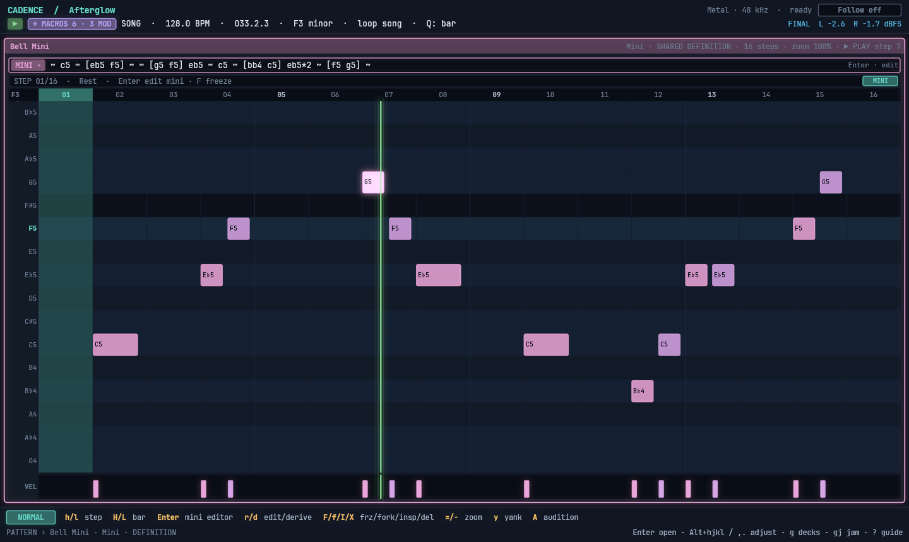

# Chapter 2 · Patterns, Algebra & Inline `:mini`

> Previous: [Quick Tour](01-quick-tour.md) · **Chapter 2** · Next: [Modular Rack Instruments & Assets](03-instruments-and-assets.md)

Cadence never forces you to bake musical ideas into disconnected clips. This chapter explains the four core song entities, how shared vs. scoped edits work, all **22 `PatternKind` operations**, the value curve editor, and the complete inline **`:mini`** notation language.

---

## 1. The Four Musical Entities

| Entity | Role | Key Properties |
|---|---|---|
| **Pattern** | Live musical definition—independent of sound or song position. | One of 22 `PatternKind`s (literal notes, rhythms, value curves, inline `:mini`, Euclidean rhythms, or retained derivations). |
| **Part** | Joins one **Pattern** to one **Instrument**. | `transpose` (semitones), `velocity_scale`, and per-note **Parameter Links / P-locks** (`:link PART PARAM VALUE_PAT`). |
| **Placement** | Schedules one **Part** onto a **Lane** for a bar span. | `start_step`, `length_steps`, **Phase** (`Song` or `Restart`), `offset_steps`, and optional step-level **local exceptions**. |
| **Lane** | Arrangement track & live performance channel. | Holds non-overlapping **Placements** plus a **launchpad part list** (`:lane LANE add PART`) for live overrides. |

### Phase Modes: `Song` vs. `Restart`
- **`Song` (default):** Evaluates the pattern against the global song clock (`song_step + offset_steps`). A 5-step motif or 64-step harmony stays phase-aligned across breaks, muting, and separate placements.
- **`Restart`:** Resets pattern time to `0 + offset_steps` at the placement's start step—ideal for drum fills, intro phrases, or turnarounds that must begin from step 1 wherever you place them.

---

## 2. Shared Edits, Local Exceptions, `'` *"From Here"*, Fork & Freeze

Because patterns are shared by reference, Cadence gives you five explicit ways to decide **who hears an edit**:

| Scope | How to Invoke | What Changes |
|---|---|---|
| **Shared definition** *(default)* | Edit normally inside `gp` (Pattern deck) | Updates the pattern everywhere—all placements and downstream derivations update together. |
| **Placement-local exception** | Press **`o`** on a Placement deck or run **`:local [ID]`**; clear a step with **`Backspace`** or **`:inherit`** | Overrides individual steps for *this placement only* while staying linked to upstream sources on every other step. |
| **Scoped *"From here"* fork** | Press **`'`** (apostrophe) in Arrange or Pattern, then make one pattern edit | Forks the edited pattern (plus any dependent derived patterns & parts) and splits/retargets placements from the current bar onward—earlier bars stay untouched, all in one undoable transaction. |
| **Explicit fork** | Press **`f`** on a Pattern or Placement deck or run **`:fork NAME [SOURCE]`** | Creates a new independent copy of the pattern. Derived forks *keep their upstream source links* so shared harmonic edits still reach them. |
| **Freeze** | Press **`F`** on a Derived/Mini/Generator pattern or run **`:freeze NAME START_STEP LENGTH [SOURCE]`** | Evaluates any derived, Euclidean, seeded, or `:mini` pattern across `[START_STEP, START_STEP + LENGTH)` and bakes the result into a literal `Notes`, `Rhythm`, or `Values` pattern. |

---

## 3. All 22 `PatternKind` Operations

Cadence provides **6 source kinds** and **16 retained derivation operators** (`6 + 16 = 22`). Every derivation is evaluated lazily from its inputs and can be chained up to 32 levels deep.

### A. Source Patterns (6)

| `PatternKind` | Modal `n` | Ex Command | Description |
|---|---|---|---|
| **`Notes`** | `nn` | `:pattern notes NAME TOK...` | Literal step/chord sequence (degrees, MIDI names like `C4`, chords `0,2,4` up to 6 tones, `.` rests). |
| **`Rhythm`** | `nr` | `:pattern rhythm NAME x..x...` | Boolean trigger grid (`x`/`X`/`1`/`+` on, `.`/`~`/`-`/`0` off). |
| **`Values`** *(Degrees / Normalized)* | `nd` / `nv` | `:pattern degrees\|values NAME PERIOD [hold\|ramp] STEP:VAL...` | Sparse breakpoint curve in `Degrees` or `Normalized` (`0..1`) with `Hold` or `Ramp` interpolation. |
| **`SeededValues`** *(Degrees / Normalized)* | `ng` / `ns` | `:pattern seed\|seed-degrees NAME PERIOD SEED MIN MAX` | Deterministic hash-based value sequence reproducible across runs and platforms. |
| **`Mini`** | `nm` | `:mini [NAME [STEPS]] <CODE...>`<br>`:pattern mini NAME STEPS <CODE...>` | Strudel/Tidal-inspired inline mini-notation with fractional sub-step timing. |
| **`Euclidean`** | `ne` | `:pattern euclid NAME PULSES STEPS [ROT]` | Bjorklund Euclidean rhythm `E(pulses, steps, rotation)`. |

### B. Harmony & Pitch Derivations (5)

| `PatternKind` | `:derive` Op | Syntax | Description |
|---|---|---|---|
| **`AddDegrees`** | `add` | `:derive NAME add NOTES DEGREES` | Shifts a note pattern's scale degrees by a `Degrees` value pattern on its own independent clock. |
| **`Mask`** | `mask` | `:derive NAME mask NOTES RHYTHM` | Gates a note pattern so notes only sound where `Rhythm` triggers. |
| **`Transpose`** | `transpose` | `:derive NAME transpose SOURCE SEMITONES` | Chromatically transposes any note pattern by signed semitones. |
| **`NotesFromValues`** | `from` | `:derive NAME from DEGREES RHYTHM [OFFSET VEL GATE]` | Combines a `Degrees` curve and a `Rhythm` trigger stream into a live note pattern. |
| **`RangeFold`** | `fold` | `:derive NAME fold SOURCE LOW_MIDI HIGH_MIDI` | Octave-folds out-of-range notes cleanly into `[LOW_MIDI, HIGH_MIDI]` (keeps basslines or leads in their sweet spot). |

### C. Time, Groove & Articulation Derivations (6)

| `PatternKind` | `:derive` Op | Syntax | Description |
|---|---|---|---|
| **`TimeScale`** | `fast` / `slow` | `:derive NAME fast SOURCE NUM [DEN]`<br>`:derive NAME slow SOURCE DEN [NUM]` | Rational time-scaling (`num > den` speeds up into triplets/subdivisions; `num < den` stretches). |
| **`Swing`** | `swing` | `:derive NAME swing SOURCE AMOUNT` | Sub-step 16th-note swing (`0.0..=0.45`, e.g. `20%`), delaying odd 16th steps cleanly. |
| **`Ratchet`** | `ratchet` | `:derive NAME ratchet SOURCE COUNT` | Subdivides every active hit into `count` (`1..=8`) evenly spaced sub-step retriggers. |
| **`Shift`** | `shift` | `:derive NAME shift SOURCE STEPS` | Rotates/shifts any pattern in time by signed 16th-steps. |
| **`Reverse`** | `reverse` | `:derive NAME reverse SOURCE` | Mirrors any pattern backwards over its natural period. |
| **`Arp`** | `arp` | `:derive NAME arp SOURCE up\|down\|updown\|random [RATE]` | Arpeggiates held chord tones at `rate` (`1..=4`) sub-step notes per step. |

### D. Probability, Form & Dynamics Derivations (5)

| `PatternKind` | `:derive` Op | Syntax | Description |
|---|---|---|---|
| **`Chance`** | `chance` | `:derive NAME chance SOURCE PROB [SEED]` | Deterministic per-hit probability gate (`0..1` or `0%..100%`) using a pure seeded hash. |
| **`Every`** | `every` | `:derive NAME every INTERVAL BASE ALT` | Plays `BASE` normally and switches to `ALT` every `INTERVAL`-th cycle (bar/phrase turnarounds). |
| **`Concat`** | `concat` | `:derive NAME concat P1 P2 ...` | Sequences multiple patterns end-to-end as a longer live form. |
| **`Stack`** | `stack` | `:derive NAME stack P1 P2 ...` | Layers multiple patterns simultaneously, merging sub-step events in exact time order. |
| **`Shape`** | `shape` | `:derive NAME shape SOURCE VELOCITY [GATE]` | Shapes a note pattern's velocity (and optionally gate length) from normalized `Values` curves. |

---

## 4. Editing Patterns & Value Curves (`gp` / `Ctrl+p`)

Open any pattern in the **Pattern deck (`gp` / `Ctrl+p`)**. Pattern editing follows Cadence's modeless 4-tier grammar: **`hjkl` strictly navigates**, **`Alt+hjkl` and `,`/`.` sculpt directly in place**, and **`i` opens `Step Insert`** for piano-keyboard entry on editable `Notes` patterns.

### 2D Polyphonic Notes & Rhythm Controls
- **Navigate (never mutates notes):**
  - **`h`/`l`** step · **`H`/`L`** (or `PgUp`/`PgDn`) jump 16 steps (1 bar) · **`0`/`$`/`G`** first/last step · **`w`/`b`** jump active notes/hits · **`=`/`-`** quick zoom.
  - **`j`/`k`** select stacked chord voices vertically (sorted visually from lowest pitch `0` to highest `N-1`; the status bar shows `Voice 2/4 · A♭4 · len 1.50 · vel 88%`).
- **Direct Modeless Sculpting on `Notes` (or `:local` Placement scope):**
  - **`Alt+j`/`k`** nudge pitch `±1` degree (**`Alt+J`/`K`** `±1` octave) · **`[`/`]`** (and **`#`**) flat/sharp accidental.
  - **`Alt+h`/`l`** gate length `±0.25` steps (**`Alt+H`/`L`** `±1.0`, range `0.05..64.0`).
  - **`,`/`.`** velocity `±5%` (**`<`/`>`** `±15%`).
  - **`c`/`C`** cycle `StepCondition` · **`o`** stack chord voice (up to 6 simultaneous voices) · **`m`** toggle step rest/active (preserving pitch/chord) · **`x`** delete focused voice · **`X`** clear step · **`Backspace`** (in Placement scope) re-inherit step from definition.
- **Direct Editing on `Rhythm`:** **`Enter`** or **`x`** toggles the hit directly under the cursor.
- **Piano Step Entry (`Step Insert` via `i` on `Notes`; `Esc` → `Normal`):**
  - **`1–8`** enters scale degrees; **`z s x d c v g b h n j m ,`** plays and writes chromatic notes (`Shift` accents to `1.0` velocity); **`<`/`>`** shifts octave; **`.`** writes a rest; `Left`/`Right` steps cursor.
  - When overwriting a voice inside an existing chord stack, **`Step Insert` preserves all sibling chord voices** cleanly!
- **Derive / Edit / Inspect:** **`n`** opens the create menu, **`d`** opens the Derive form targeting the current pattern, **`r`** edits the current pattern definition/length/rename in-place (works on `Notes`, `Mini`, `Euclidean`, `SeededValues`, and all derived patterns), **`A`** toggles pattern audition, **`f`** forks, **`F`** freezes derived/generator patterns to literal, **`;`** repeats the last single-step edit, and on derived patterns **`j`/`k`** highlights upstream source chips right in the `SOURCES:` bar while **`Enter`** / **`gs`** opens the selected source directly.
- **Clipboard (`[N]y`, `p`, `P`):** Press `y` to yank the step under the cursor—or type a count like `4y` to yank a 4-step span—then `p` to paste after/at cursor or `P` to paste before. Works seamlessly across `Notes`, `Rhythm`, and `Values` patterns.

### Value Curve Editor (`Degrees` & `Normalized`)
- **Navigate:** **`[count]h`/`l`** steps across time offsets · **`H`/`L`** jumps 1 bar · **`w`/`b`** jumps between authored breakpoints · **`0`/`$`/`G`** first/last step.
- **Direct Sculpting:** **`Alt+j`/`k`** and **`,`/`.`** nudge value fine (`±0.01` / `±1` deg) · **`Alt+J`/`K`** and **`<`/`>`** coarse (`±0.10` / `±7` deg) · **`Alt+h`/`l`** slide breakpoint in time `±1` step (**`Alt+H`/`L`** `±4` steps) · **`Enter`** opens unified live-validated **Value Entry** (`0.5` or `50%` for Normalized; signed integers for Degrees) · **`m`** toggles `Hold ↔ Ramp` · **`x`** deletes breakpoint · **`e`** inspects or jumps to downstream Modulation/Link consumers.
- **Direct edit from anywhere (even mid-set):** **`:value [PATTERN] STEP VALUE|off`** (1-based step) or **`:value-mode [PATTERN] hold|ramp|toggle`**.

---

## 5. Dedicated Mini-Notation Editor & Syntax Reference

Cadence includes a pure, deterministic Strudel/Tidal-inspired mini-notation engine with true fractional sub-step timing—every triplet, quintuplet, Euclidean hit, and ratchet renders directly onto the Pattern roll and audio engine with zero rounding loss.



### Dedicated Live-Validated Mini-Notation Editor (`Enter` on `Mini`)
- **Open editor:** Select any `Mini` pattern in `gp` and press **`Enter`** (or run **Edit Mini-Notation** from the `:` / `Ctrl+Shift+p` Action Palette) to launch the dedicated **`MINI EDITOR`** modal.
- **Live feedback on every keystroke:** Parses immediately via `cadence_core::mini::parse_mini`, showing a real-time green valid status with **Cycle 1 event count and resolved note preview** (e.g., `C5 E♭5 F5 G5 …`), or highlighting exact syntax errors before you commit.
- **Controls:** Type code directly · **`Ctrl+u`** clear · **`Enter`** commits when valid (single undo entry) · **`Esc`** cancels cleanly.
- **Create or script by name:** Press **`n` → `m`** to create via modal form, **`r`** on `gp` to edit name/step length in-place, or run `:mini LeadLine 16 c4 [e4 g4] ~ <a4 b4>` via the Action Palette or `cadence ctl cmd` (defaults to 16 steps if omitted).

### Complete Syntax Reference

| Syntax | Meaning | Example |
|---|---|---|
| `c4`, `eb3`, `f#5`, `bb2` | Absolute MIDI note names (`s` or `#` sharp, `b` flat; octave defaults to `4`) | `c4 eb4 g4 bb4` |
| `1`, `3`, `-2`, `5#`, `3b`, `0` | Scale degrees relative to project key (`1` = tonic, `0` = leading tone below tonic) | `1 3 5 7b` |
| `~` or `.` | Rest (empty slot) | `c4 ~ e4 .` |
| `[a b c]` | Recursive subdivision (fits items evenly inside one slot) | `[c4 [e4 g4]]` |
| `[c4,e4,g4]` or `c4,e4,g4` | Simultaneous chord (up to 6 notes: 1 main + 5 chord tones) | `[c4,eb4,g4]!` |
| `<a b c>` | Cycle alternation (advances one choice per pattern cycle) | `<c4 f4 g4 eb4>` |
| `*N` | Repeat `N` times (`1..=16`) within the item's span | `eb5*2` · `c4*4` |
| `/N` | Slow down (`1..=16`): item plays once every `N` cycles | `[c5 g5]/2` |
| `@N` | Weight / elongate (`0.125..=32.0`) relative to sibling slots | `c4@3 eb4@1` |
| `(k,n)` / `(k,n,r)` | Euclidean distribution (`0 <= k <= n <= 64`, optional rotation `r`) | `c2(5,16)` · `f#2(7,16,2)` |
| `?` / `?p` | Deterministic probability (`?` = 50%, `?0.7` = 70% hit chance) | `g5?0.6` |
| `!` | Accent (`velocity = 0.98` vs. default `0.80`) | `c#3!` |

Modifiers chain cleanly in any order—for instance, `c4(3,8)*2?0.8!` distributes 3 pulses across 8 slots, doubles each pulse into a two-hit ratchet, gates each hit at 80% deterministic probability, and accents every surviving hit.

### Real Recipes from the Showcase Projects

- **Afterglow (`Bell Mini`, 16 steps)** — syncopated sub-step grace notes and a 32nd-note double tap (`eb5*2`):
  ```text
  :mini "Bell Mini" 16 ~ c5 ~ [eb5 f5] ~ ~ [g5 f5] eb5 ~ c5 ~ [bb4 c5] eb5*2 ~ [f5 g5] ~
  ```
- **Iron Circuit (`808 Conga Mini`, 16 steps)** — triggering `TR-808` multi-zone Rack pads (`B2`=Low Conga, `C3`=Mid Conga, `C#3`=High Conga accented `!`, `D3`=Claves, `F2`=Rimshot):
  ```text
  :mini "808 Conga Mini" 16 ~ ~ b2 ~ ~ c3 ~ f2 c#3! ~ ~ b2 ~ d3 ~ c3
  ```
- **Iron Circuit (`808 Drop Perc`, 16 steps)** — denser electro percussion with cowbell (`g#2`) and maracas (`d#3`):
  ```text
  :mini "808 Drop Perc" 16 b2 ~ g#2 d3 ~ c3 g#2 ~ c#3! d3 b2 ~ d3 g#2 c3 ~
  ```
- **Glass Cathedral (`Cathedral Bells`, 16 steps)** — cascading sub-step triplets (`[c5 e5 g5]`) and pairs over a gentle ambient clock:
  ```text
  :mini "Cathedral Bells" 16 d5 ~ [a5 c6] ~ ~ f5 [e5 d5] ~ a4 ~ [c5 e5 g5] ~ ~ [f5 a5] ~ ~
  ```

---

> **Next:** Build custom modular voices, patch bipolar cables with `z-1` feedback, layer 32-zone kits, and explore the MIT preset/asset library in [Chapter 3 · Modular Rack Instruments, Patchbay, Zones & Assets](03-instruments-and-assets.md).
