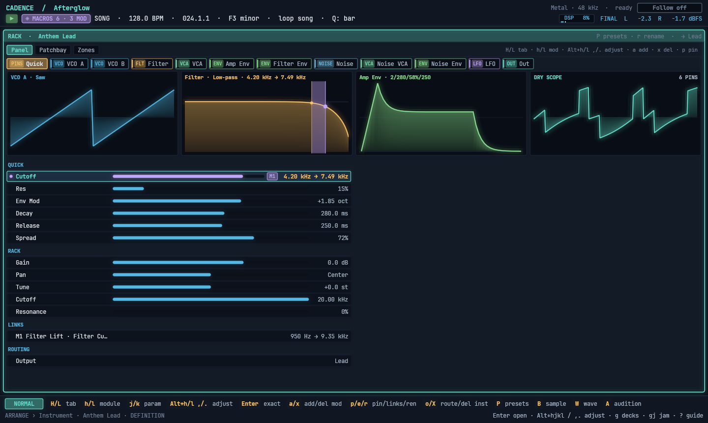
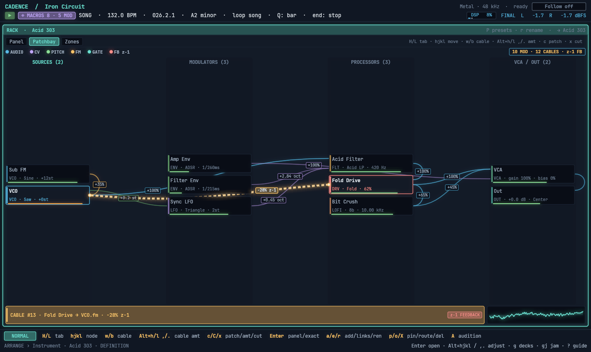
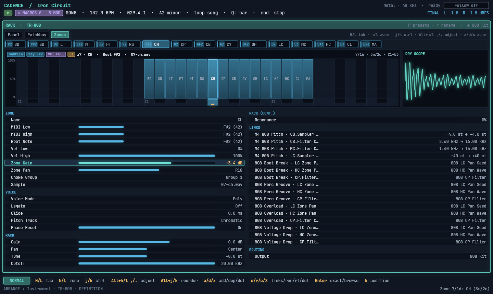
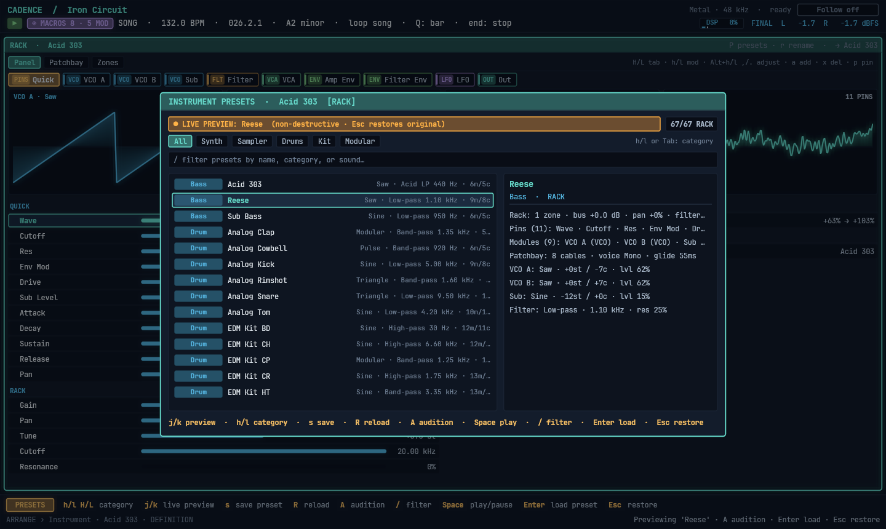

# Chapter 3 · Modular Rack Instruments, Patchbay, Zones & Assets

> Previous: [Patterns & Algebra](02-patterns-and-algebra.md) · **Chapter 3** · Next: [Mixing, FX & Signal Graph](04-mixing-fx-and-routing.md)

Every instrument in Cadence (`Project` v1, `InstrumentPreset` v1) is powered by one **unified Eurorack Modular Rack** (`Rack → Zones → Modules [Panel] + Patchbay`)—combining analog/FM synthesis, stereo sampling with automatic RIFF loop metadata, bit-crushing/wavefolding, 32-mode physical modal resonators, bipolar audio-rate CV/FM patching with deterministic `z-1` feedback, and 32-zone note/velocity-layered drum kits inside a single orthogonal zero-allocation voice engine.

---

## 1. One Unified Rack Architecture (`Rack → Zones → Modules + Patchbay`)

Instead of separating synths, samplers, and drum machines into incompatible engines, every Cadence instrument is a **`Rack`**:

- **1-Zone Synths & Samplers:** A classic dual-oscillator synth, an `Acid 303` ladder lead, a single-file stereo sampler, or an experimental FM/feedback modular voice is simply a 1-zone Rack whose zone spans the full keyboard (`0..127`).
- **Multi-Zone Kits & Layered Instruments:** A drum machine (`TR-808`, `TR-909`, `EDM Kit` — either baked samples or pure synthesized kits!) or velocity-layered multisample is an N-zone Rack (up to **32 zones** and **8 choke groups**) where *every individual zone* contains its own complete modular graph (sample playback, analog/FM/modal synthesis, or both side-by-side!).
- **4 Neutral Bare Templates (`RackTemplate`):** Start fresh with zero disk dependencies from **`Init Synth`**, **`Blank Sampler`**, **`Blank Kit`**, or **`Blank Modular`**, or load any external MIT `v1` preset from `presets/`.

### Creating Instruments (`n → i`, `:new`, `:instrument`, `:kit`, `:sampler`)

```text
:new synth Lead                            # Bare Init Synth template (VCO -> Filter -> VCA -> Out)
:new sampler Stab                          # Bare Blank Sampler template
:new kit Drums                             # Bare Blank Kit template
:new modular Patch                         # Minimal [Out] modular canvas (also `:new rack Patch`)

:instrument Lead pulse-lead                # Load any v1 catalog preset (synth, drums, kit, or modular)
:instrument Stab sampler stab.wav          # Sampler Rack loaded directly from an audio file
:instrument Drums kit tr-808               # Multi-zone kit from preset (`tr-808`, `tr-808-synth`, or `folder DIR`)
:kit Drums tr-909-synth                    # Synthesized 11-zone TR-909 Rack kit
:sampler Vocal samples/vox.wav             # Shorthand for a Sampler Rack
```

### Universal 3-Tab Instrument Deck Controls (`gi` / `Ctrl+i`)

Every instrument opens onto the **3-tab Instrument Deck**—**`Panel` | `Patchbay` | `Zones`**—obeying Cadence's 4-tier keyboard grammar:

- **Switch Tabs:** **`H`/`L`** (or **`:page panel|patchbay|zones`** / **`:tab ...`**)
- **Universal Actions:**
  - **`P`**: open the unified **6-Category Preset Browser** with instant non-destructive audio preview on scroll (also includes Save Preset & `R` reload)
  - **`r`**: rename the focused instrument (or focused module/pin/zone)
  - **`A`**: audition a note (or the focused zone at its root MIDI note)
  - **`B`**: open the **Sample Browser** to assign a WAV/FLAC/MP3/Ogg/AIFF/WavPack file to the active zone (auto-inserting `Sampler → Out.In` if the zone has no Sampler module yet)
  - **`o`**: route output channel
  - **`M`**: arm 1-key MIDI Learn on the focused control or cable attenuverter (see [Chapter 6](06-devices-audio-and-midi.md))
  - **`X`**: delete instrument (confirmation-guarded)
- **Direct Sculpting (no edit-mode toggle):**
  - **`Alt+h`/`l`** or **`,`/`.`**: fine adjust · **`Alt+H`/`L`** or **`<`/`>`**: coarse adjust · **`Alt+Backspace`**: reset to default
  - **`Enter`**: open unified instant-validated **Value Entry** (`1200hz`, `-3dB`, `50%`, `L35`, `+2.5 oct`) — or open the Sample Browser / link picker on link rows
  - **`e`**: inspect or bind Project Macros (`M1–M8`) & Modulations targeting the focused control

---

## 2. `Panel` Tab — Quick Faceplate, 11 Orthogonal Modules & 12 Visualizers

The **`Panel`** tab gives you instant studio ergonomics without diving into cables unless you want to:

- **Horizontal Module Pill Strip:** Cycles with **`h`/`l`** across **`Quick`** (your curated `panel_pins` performance faceplate—up to **16** pinned Rack, Zone, Module, or Cable controls) followed by every module in the active zone. Walk controls vertically with **`j`/`k`** (`w`/`b` jump groups), and reorder pins on `Quick` with **`Alt+j`/`k`**.
- **GPU Visualizers (`12` Dedicated Painters):** `Quick` shows `PinnedOverview` (oscillator waveform, modulated filter response curve, primary envelope contour, and Dry Scope together); selecting any individual module pill switches to its dedicated real-time visualizer (VCO waveform + unison/FM state, Sampler 512-bin peak waveform + trim/loop markers, Noise filter tilt, Multi-Burst Env contour, LFO wave, Filter response + modulation band, Drive transfer curve, LoFi quantized staircase, Resonator 32-mode physical spectrum, VCA/RingMod transfer, or Out stereo spread/scope).
- **Direct Panel Workflows:** **`a`** opens the **Add Module** picker (`:mod add`), **`x`** removes the focused module (the singular mandatory `Out` module is always protected), **`p`** pins or unpins the focused control on the `Quick` faceplate (`:pin` / `:unpin`), and **`Alt+h`/`l`** / **`,`/`.`** / **`Enter`** sculpt values directly.



### All 11 Orthogonal Eurorack Modules (`1..=24` Modules per Zone)

Every zone executes its modules at full `f64` audio rate inside zero-allocation `ModularVoice`, strictly composing `cadence_core::dsp::*`:

| # | Module | Patchbay Column | Accepted `InPort`s | DSP Highlights & Key Parameters |
|---|---|---|---|---|
| 1 | **`Vco`** | `SOURCES` | `PitchCv`, `FmIn`, `PwCv` | Bandlimited PolyBLEP/PolyBLAMP (`Sine`, `Triangle`, `Saw`, `Pulse` with DC-compensated PWM), up to **7-voice stereo unison** (`unison_detune`, `unison_width`), `Chromatic`/`Fixed` pitch tracking, `±48 st` / `±100 ct` tuning, and **2× `Halfband2x`-oversampled through-zero linear FM** (`step_vco_bank_fm_2x`) via `FmIn`. |
| 2 | **`Sampler`** | `SOURCES` | `PitchCv`, `TrigIn` | Pure-Rust stereo sample player (**PCM/Float WAV, Ogg-in-RIFF WAV, FLAC, Ogg Vorbis, MP3, AIFF, WavPack `.wv`**) with 4-point Catmull-Rom cubic Hermite interpolation (`SamplerVoice`), automatic RIFF `smpl`/`inst` root & loop metadata (`Off`/`Forward`/`PingPong`, `loop_xfade`), start/end trim, `one_shot`, audio-rate `PitchCv`, and external `TrigIn` retriggering. |
| 3 | **`Noise`** | `SOURCES` | *(none)* | Sample-rate-invariant `White` (`NoiseGen`) or Paul Kellet 7-pole `Pink` (`PinkFilter`) noise with dedicated TPT `highpass` (`20..18k Hz`), `lowpass` (`20..20k Hz`), and `level`—freely patchable pre- or post-filter. |
| 4 | **`Env`** | `MODULATORS` | `TrigIn` | `ModularEnv` supporting both **`Adsr`** and **`HoldDecay`** modes, `Gate`/`OneShot` trigger modes, **pre-delay** (`0..500 ms`), and **1..=8 multi-bursts** (`2..50 ms` spacing for authentic TR-909 claps & flams), plus Acid accent decay snap and click-free `3.5 ms` choke fades. |
| 5 | **`Lfo`** | `MODULATORS` | *(none)* | `Sine`, `Triangle`, `Saw`, `Square`, or `SampleHold`; free rate (`0.01..40 Hz`) or tempo-synced across 12 rhythmic divisions (`1/64..4/1`), key retrigger, and bipolar (`[-1, 1]`) vs unipolar (`[0, 1]`) polarity. |
| 6 | **`Filter`** | `PROCESSORS` | `In`, `Cv` | 5 modes: 2-pole ZDF SVF (`LowPass`, `BandPass`, `HighPass`), 1-pole `6 dB/oct` **`LowPass6`**, and 4-pole `24 dB/oct` nonlinear diode ladder **`AcidLowPass`** (with velocity accent `vel_amount` & bass compensation), plus `drive`, `key_track`, `mix`, and audio-rate octave `Cv`. |
| 7 | **`Drive`** | `PROCESSORS` | `In`, `Cv` | Stereo multi-circuit waveshaper (`Tape`, `HardClip`, West-Coast `Fold` with 2× `Halfband2x` oversampling), `asymmetry` (`-1..+1`), post-`tone` LPF, `output` trim, `mix`, DC blocker, and audio-rate `Cv`. |
| 8 | **`LoFi`** | `PROCESSORS` | `In` | Continuous mid-tread bit-depth quantizer (`bits`: `2..24`, transparently bypassed `>= 23.95`), phase-accumulating clock decimator (`sample_rate`: `500..48k Hz`), and dry/wet `mix`. |
| 9 | **`Resonator`** | `PROCESSORS` | `In`, `PitchCv`, `Cv` | Sample-rate-invariant 32-mode physical modal bank (`String`, `Bar`, `Membrane`, `Plate`; up to **4** per zone) with `Chromatic`/`Fixed` pitch (`PitchCv`), dispersion/inharmonicity (`structure`), exact `-60 dB` RT60 (`decay`), frequency damping (`brightness`, modulatable via `Cv`), strike `position`, and `mix`—plus `z-1` `Drive` feedback for realistic cymbals, plucked strings, bars, and drums. |
| 10 | **`Vca`** | `VCA / OUT` | `In`, `Cv` | Gain (`0..2`) + bias (`0..1`). Acts as a classic envelope VCA (`Env → Vca.Cv`, `bias = 0`), a parallel mixer, or a **4-quadrant audio-rate Ring Modulator** (`Vco → Vca.Cv`). |
| 11 | **`Out`** | `VCA / OUT` | `In`, `Cv` | Singular mandatory terminal sink for every zone (`gain_db` `-36..+12 dB`, `pan`, M/S stereo `spread`, optional `Cv`, DC blocker, and transparent voice safety guard). |

---

## 3. `Patchbay` Tab — Multi-Column Cables, Bipolar Attenuverters & `z-1` Feedback

Switch to **`Patchbay`** (`H`/`L` or `:page patchbay`) to wire your voice directly across four color-coded signal columns—**`SOURCES`** → **`MODULATORS`** → **`PROCESSORS`** → **`VCA / OUT`**—using up to **64 patch cables per zone**.



### Bipolar Attenuverter Cables & `z-1` Feedback Safety
- **Every cable is a first-class modulatable parameter:** Audio (`In`: `-200%..+200%`), `PitchCv` (`±48 st`), `FmIn` (`±100%`), `PwCv` (`±45%`), `TrigIn` (`-2..+2`), `Filter.Cv` (`±6 oct`), `Vca.Cv` (`±200%`), `Resonator.Cv` (`±100%`), and `Drive`/`Out.Cv` (`±100%`). Negative depths invert polarity for inverted filter sweeps, counter-phase audio cancellation, or negative FM feedback!
- **Cycle-safe `z-1` 1-sample feedback:** Patch any downstream module back upstream (e.g., `Fold Drive → VCO.fm -28%` or `Plate → Drive → Plate`) without deadlocks or crashes. Cadence's Kahn DAG compiler automatically flags back-edges with a **1-sample delay (`z-1`)**, soft-bounds feedback energy, and renders feedback cables as glowing **arc-length-dashed Bezier curves** badged **`z-1`**.

### Patchbay Keyboard Controls

| Key | Action |
|---|---|
| `h`/`j`/`k`/`l` | Navigate 2D across Patchbay columns and module cards |
| `w`/`b` or `[`/`]` | Cycle through cables attached to the focused module (and back to module focus) |
| `Alt+h`/`l` or `,`/`.` (`Alt+H`/`L` or `<`/`>`) | Nudge selected cable attenuverter fine / coarse (`Alt+Backspace` resets to default) |
| `c` | Patch a new cable from the focused module (opens target `module.port` picker → exact attenuverter `ValueInput`) |
| `C` or `Enter` *(on cable)* | Select/edit cable amount via exact **`ValueInput`** |
| `x` | Disconnect the selected cable (or remove the focused module when no cable is selected; never `Out`) |
| `a` | Add a new module to the active zone |
| `p` / `e` | Pin cable to Quick Panel / bind Macro or Modulation to cable attenuverter |
| `Enter` *(on module)* | Jump straight to that module's **`Panel`** controls & visualizer |

### Modular Rack Ex Commands (`:mod`, `:patch`, `:unpatch`, `:pin`, `:unpin`)

```text
:mod add vco "Sub FM"                  # Add a module to the active zone
:mod add resonator "Bronze Plate"      # Kinds: vco, sampler, noise, env, lfo, filter, vca, drive, lofi, resonator
:mod rename "Sub FM" "FM Osc"          # Rename a module by ID or name
:mod del "FM Osc"                      # Remove module and sever attached cables (protects Out)

:patch "FM Osc" VCO.fm 35%             # Connect cable with explicit port & bipolar depth
:patch "Fold Drive" VCO.fm -28%        # Cross-column feedback cable (auto-compiled with z-1 delay!)
:patch VCO "Acid Filter"               # Omit .port to infer the default compatible port
:unpatch c13                           # Cut cable by ID (or `:unpatch "Fold Drive" VCO.fm`)

:pin                                   # Pin/unpin the currently focused control on the Quick Panel
:pin "Acid Filter".cutoff "Cutoff"     # Pin any Rack/Zone/Module/Cable target with custom label
:pin c2 "FM Depth"                     # Pin a Patchbay cable attenuverter right onto Quick!
:unpin 1                               # Remove Quick Panel pin by 1-based index, param, or label
```

---

## 4. `Zones` Tab — Multi-Zone Kits, Key/Vel Splits & Unified Addressing

Switch to **`Zones`** (`H`/`L` or `:page zones`) to build drum machines (`TR-808`, `TR-909`, `EDM Kit`) or multi-layered chromatic instruments with up to **32 zones** (`0..127` MIDI ranges, `0%..100%` velocity windows) and **8 choke groups** (e.g., Closed Hat choking Open Hat). Every zone owns its own independent Eurorack module graph—so one kit can freely combine sampled hits, pure analog/FM/modal synth pads, and hybrid layered zones!



### Navigating & Editing `Zones`
- **`h`/`l`**: move left/right across the scrollable horizontal **Zone pill strip** and synchronized **2D Key×Velocity piano-roll zone map** at the top of the deck (synced cleanly with `Panel` and `Patchbay`, so switching tabs inspects the selected zone's modules and cables!)
- **`j`/`k`** (`w`/`b` group jump): walk Zone, Voice, and Rack inspector controls below (key range, root MIDI, velocity window, zone gain/pan, choke group, sample path, links, routing)
- **`Alt+h`/`l` & `,`/`.`** (`Alt+H`/`L` & `<`/`>` coarse, `Alt+Backspace` reset): adjust the focused zone/voice/rack control directly (`Enter` opens exact `ValueInput` or Sample Browser)
- **`Alt+j`/`k`**: reorder the active Zone in the strip
- **`a` / `d` / `x` / `r`**: open `"Add Zone…"` picker / duplicate zone / delete focused zone (at least 1 zone always remains) / rename zone
- **`B` / `A` / `e`**: assign a sample via Sample Browser / audition the active zone at its root MIDI note / bind Macro or Modulation links

### Unified Parameter Addressing (`Rack`, `Zone`, `Module`, `Cable`)
Every continuous Rack bus control (`gain`, `pan`, `tune`, `cutoff`, `resonance`), Zone control (`gain`, `pan`, `glide`, `root_midi`, etc.), Module parameter (all 62 `ModuleParam`s), and Patchbay Cable attenuverter (`c<id>` / `cable.<id>`) is addressed through one orthogonal `ParamAddress` system across `:param`, `:mod`, `:link` P-locks, Project Macros, and MIDI Learn:

```text
:param cutoff 1200hz                        # Shorthand: checks panel_pins -> unique module -> zone/rack
:param "Acid Filter".cutoff 920hz           # Module parameter on a 1-zone Rack
:param c5 +2.75                             # Patchbay cable attenuverter by cable ID
:param rack.cutoff 14khz                    # Rack-level master bus filter (`rack.` or `bus.`)
:param TR-808.BD.cutoff 1200hz              # Global zone/module path (`INST.ZONE.PARAM`)
:param TR-808.z1.gain -2dB                  # Address zone by stable 1-based zone ID (`z1..z32`)
:param BD.decay 420ms                       # Short zone form while TR-808 deck is focused
:mod "Hat Air" TR-808.OH.cutoff Lfo1        # Automate a single pad's filter
:link DrumPart CH.tune GrooveVals           # Per-note P-lock on Closed Hat pitch
:macro 4 bind TR-808.BD.tune 0.3 0.75       # Bind a Project Macro to a single kit zone
```

### `:zone` Management Commands

| Command | Effect |
|---|---|
| `:zone add [NAME] [MIDI] [synth\|sample PATH]` | Add a new synth or sample zone (auto-picks next free MIDI note if omitted) |
| `:zone dup [NAME]` · `:zone del` | Duplicate or remove the focused zone |
| `:zone select NAME\|IDX` · `:zone next\|prev` | Select the active zone |
| `:zone sample PATH` | Load an audio file into the active zone's `Sampler` module (auto-inserting `Sampler → Out.In` & applying RIFF `smpl`/`inst` bounds) |
| `:zone preset NAME\|PATH` | Load a single-zone `v1` Rack preset into the focused zone |
| `:zone import DIR` | Auto-build a multi-zone Rack from a folder (using RIFF `inst` & filename MIDI hints) |
| `:zone name NAME` · `:zone choke none\|1..8` | Rename zone or assign choke group |
| `:zone range LOW HIGH [ROOT]` · `:zone vel LOW HIGH` | Set MIDI key split (`C2` or `36`) and velocity layer (`0%..100%`) |
| `:zone set FIELD VALUE` | Set any zone field (`low_midi`, `root_midi`, `choke`, `gain`, `pan`) or module param |

### Bounce / Resample to Sampler or Rack Zone (`tb` / `:bounce`)
Resample any Part, Pattern, or Arrangement bar range offline at studio quality into your project's `samples/` folder and load it immediately—either as a brand-new Sampler Rack (`BounceTarget::NewSampler`) or straight into a multi-zone Rack's active zone (`BounceTarget::RackZone`):

- Press **`tb`** in Arrange/Pattern to bounce the current selection to a new Sampler Rack, or press **`tb`** while a multi-zone **Instrument Rack** deck is focused to bounce directly into its active zone!
- Explicit Ex syntax:
  ```text
  :bounce part LeadPart "Lead Resample" --part
  :bounce bars 1..2 zone TR-808 C3 "Layered Clap"
  ```

---

## 5. 6-Category Preset Browser (`P`), External MIT Catalog, File Hub & Bundles

### Unified 6-Category Preset Browser (`P`) with Instant Non-Destructive Preview
Press **`P`** on any Instrument Rack deck (or run **Browse Instrument Presets** in the `:` / `Ctrl+Shift+p` Action Palette) to explore every sound in your catalog effortlessly:

- **6 Category Filter Tabs:** Cycle **`All` | `Synth` | `Sampler` | `Drums` | `Kit` | `Modular`** with **`h`/`l`**, **`H`/`L`**, or **`Tab`/`Shift-Tab`**, alongside all **4 neutral bare templates** (`Init Synth`, `Blank Sampler`, `Blank Kit`, `Blank Modular`) plus in-browser Save Preset and `R` catalog reload.
- **Instant Preview on Scroll:** Moving with **`j`/`k`** (or `↑`/`↓`) swaps the audio engine to each highlighted Rack non-destructively from a full `Project` snapshot (so zone modulations, P-locks, and macro bindings are preserved cleanly during preview).
- **Search, Audition, Commit or Restore:** Press **`/`** to filter (`Enter` locks filter for `j`/`k`, `Esc` clears filter), **`A`** to audition, **`Space`** to play/pause while scrolling, **`Enter`** to commit the chosen preset as a **single undoable transaction**, or **`Esc`** to restore your exact original Rack with **zero undo entries** and unchanged `dirty()` state.



### External MIT `v1` `PresetCatalog` (Zero Compiled-In Patches)
Cadence compiles **zero hardcoded sound patches** into the binary. All **63** factory presets are editable MIT **`v1` `InstrumentPreset`** JSON files discovered dynamically on disk:

- **`presets/synth/` (11)** — `acid-303`, `brass-pad`, `closed-hat`, `kick`, `open-hat`, `pluck`, `pulse-lead`, `reese`, `snare`, `sub-bass`, `warm-pad`
- **`presets/drums/` (46)** — standalone analog/FM drum patches (`analog-kick`, `analog-snare`, `analog-clap`, `analog-cowbell`, `analog-rim`, `analog-tom`, `fm-hat`, `fm-cymbal`) plus all **38** individual synthesized `tr-808-*`, `tr-909-*`, and `edm-kit-*` drum voices loadable into any single zone or standalone track
- **`presets/kits/` (6)** — multi-zone `v1` Rack kits in both baked-sample (`tr-808`, `tr-909`, `edm-kit`, reproducibly rendered with 1:1 loudness parity from `factory-sources/{tr-808,tr-909,edm-kit}/project.json` via `cadence --render-kit`) and pure synthesized (`tr-808-synth`, `tr-909-synth`, `edm-kit-synth`) flavors (see [Chapter 8](08-cli-scripting-and-live-ctl.md))
- **`presets/filter_grooves.json`** — clean-room MIT factory bank of 24 rhythmic filter grooves (`00..=23`) across 6 categories (`Pulses`, `Grooves`, `Syncopation`, `Swells`, `32nd Gates`, `Polyrhythms`), extensible up to 128 grooves (`00..=127`) via user-supplied or saved custom banks in `<project_dir>/presets/filter_grooves.json` or `~/.config/cadence/presets/filter_grooves.json`

### Sample Browser, File Hub & Portable Bundles
- **Sample Browser (`B`, `gS`, `Ctrl+Shift+b`, or `Enter` on `Sample` rows):** Universal **`/`** instant filter (`Enter` locks filter for `j`/`k` list navigation, `Ctrl+u` clears, `Esc` clears filter then closes), off-thread audition (`A`), assign (`Enter`, auto-inserting a `Sampler → Out.In` module if the active zone has none and importing RIFF `smpl`/`inst` root/loop metadata), reload/rescan (`r`/`R`).
- **File Hub (`gf`, `Ctrl+Shift+f/o/s/e`):** 5-tab workspace (**`H`/`L`**, **`Tab`/`Shift-Tab`**, or **`1–5`** switch between **Quick Open** [New Blank Project, Recent, Bundled Examples, Live Takes], **Browse** [dedicated folder browser with parent cursor memory, **`Backspace`** up, **`~`** home, **`.`** project dir], **Save & Bundle**, **Import** [Preset Library, MIDI profiles & clean-room ReBirth `.rbs`], and **Export Audio** [WAV/Stems]). Quick-saving an existing project with **`Ctrl+s`** writes immediately without opening the dialog. Loading an instrument preset, MIDI profile, or take from File Hub **auto-closes File Hub** cleanly. Press **`/`** to search across Quick + current folder or filter Browse/Import, **`F`** in any tab to open a native OS Finder/file dialog, or **`R`** on Import to refresh the preset catalog.
- **Portable Bundles (`:bundle DIR`):** Writes `DIR/project.json` and copies every audio file referenced by any `Sampler` module across every Rack zone into `DIR/samples/` with clean relative paths—ready to share or archive anywhere.
- **Diagnostics & Custom Paths:** Run **`:assets`** to inspect sample readiness and missing files, **`:reload-samples`** / **`:reload-presets`** to refresh assets from disk, or open **Settings (`g,` / `Ctrl+,`)** to manage persistent **`sample_dirs`** and **`preset_dirs`** (`a` type path, `F` native folder picker, `x` delete, `Ctrl+s` save). You can also pass repeatable `--sample-dir` and `--preset-dir` flags on the CLI.

---

> **Next:** Shape, route, and meter your mix in 32-bit float with all 8 native studio effects and the interactive Signal Graph in [Chapter 4 · Mixing, Studio FX & Signal Graph](04-mixing-fx-and-routing.md).
