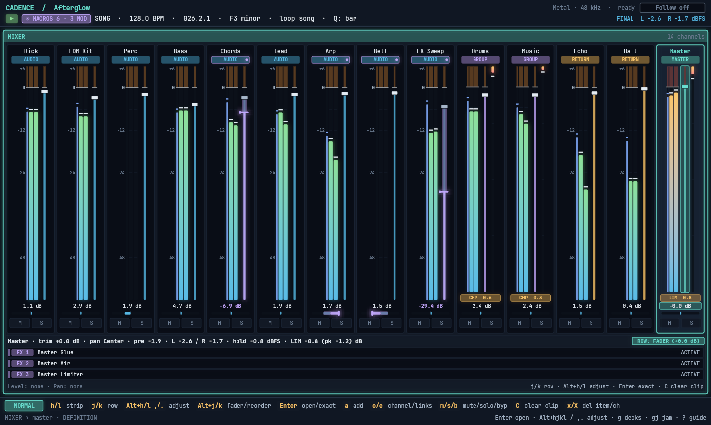
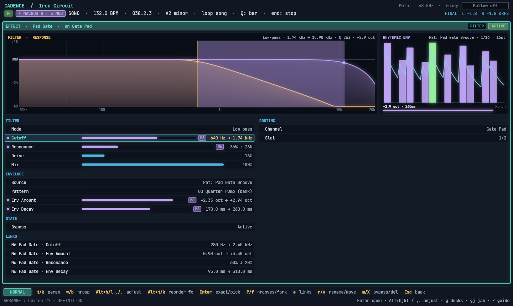
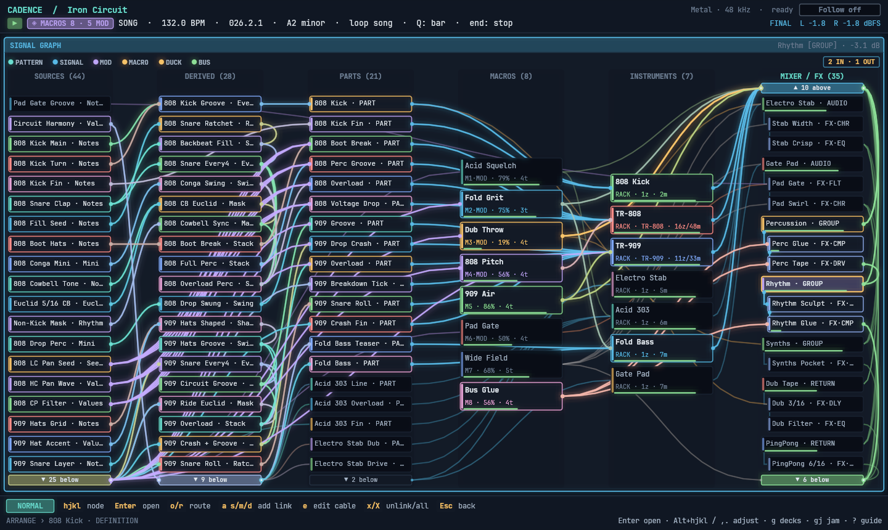

# Chapter 4 · Mixing, Studio FX & Interactive Signal Graph

> Previous: [Modular Rack Instruments & Assets](03-instruments-and-assets.md) · **Chapter 4** · Next: [Project Macros & Modulation](05-macros-and-modulation.md)

Cadence's audio engine runs an **unclipped 32-bit float signal chain** with zero hidden post-master soft-clipping, `+6 dB` studio console headroom, nested `Group → Group` DAG routing, **8 zero-allocation native studio effects**, and an interactive 5/6-column **Signal Graph** patchbay.

---

## 1. 32-Bit Float Console & Metering (`gm` / `Ctrl+m` & `go` / `Ctrl+o`)

Press **`gm`** (or **`Ctrl+m`**, or **`z4`** for the Mix layout) to open the Mixer Console, and **`go`** (`Ctrl+o`) to toggle the bottom Output oscilloscope and peak monitor.



### How Metering Works
- **Scale & `0 dB` Hairline:** Every strip meters **`-60..+6 dBFS`** with a crisp **`0 dB` hairline** reference.
- **Pre-Fader & Post-Fader:** Narrow input bars show pre-fader level feeding your insert chain, alongside wide stereo post-fader peak and peak-hold meters.
- **`HOT (32f)` vs. `!CLIP`:** Internal 32-bit float Audio, Group, and Return buses have virtually unlimited transient headroom. When an internal bus crosses `0 dBFS` (`> 1.0`), Cadence informs you with **`HOT (32f)`**—never silently distorting it. True digital clipping (**`!CLIP`**) fires strictly when **Master post-fader exceeds `1.0` (`0 dBFS`)** at the final DAC / 16-bit WAV boundary (or if any non-finite sample occurs anywhere). Clear latched peak/clip indicators with **`C`** (selected strip), **`tC`** (all strips), or **`:clips clear [all]`**.
- **Top-Down Gain Reduction (GR) Micro-Meters:** Any channel hosting an active `Compressor` (`CMP`) or `Limiter` (`LIM`) displays a live top-down gain-reduction meter directly on its strip.

### `+6 dB` Headroom, Pan Law & Clean Gain Staging
- **Channel Fader (`-inf..+6.0 dB`):** Linear gain spans `0.0..=2.0` (`+6.0 dB` boost headroom above unity, with exact `0.0 dB` unity at the 75% console detent).
- **Equal-Power Stereo Balance Panning:** Stereo mixer channels use unity-normalized equal-power stereo balance (`[1.0, 1.0]` exact center pass-through with true analog-console L/R attenuation across `L100..C..R100`), while mono voices use `-3.01 dB` constant-power panning.
- **Three Independent Level Layers:** Static channel trim (`:param trim +3dB`), automated **`ChannelGain`** modulation (a `0..1` multiplicative level envelope), and triggered sidechain **`Duck`** envelopes multiply cleanly—pulling down a strip fader preserves every volume ride and sidechain pump without fighting automation.

### Mixer Console Keys (`gm` / `Ctrl+m`) — Modeless Direct Mixing

Every Mixer strip presents its vertical detail slots below the fader strip in canonical top-to-bottom order: **`Fader` → `Pan` → `Inserts` → `Sends` → `Output` → `Ducks`** (omitting unfocusable `Output` on Return/Master). Navigate with **`h`/`j`/`k`/`l`** (never mutating audio) and sculpt directly with **`Alt+h`/`j`/`k`/`l`** or **`,`/`.`**!

| Keys | Action |
|---|---|
| `h`/`l` · `H`/`L` (`PgUp`/`PgDn`) · `0`/`$`/`G` | Select channel strip · page strips · jump first / Master |
| `j`/`k` | Focus vertical slot on the selected strip (`Fader`, `Pan`, `Insert`, `Send`, `Output`, `Duck`) |
| `Alt+h`/`l` & `,`/`.` *(coarse: `Alt+H`/`L` & `<`/`>`)* | Directly adjust focused `Fader` (`±0.5` / `±3 dB`), `Pan` (`±5%` / `±25%`), `Send` level, `Duck` depth, or cycle `Output` bus |
| `Alt+j`/`k` | Push `Fader` dB up/down vertically · or **reorder** focused `Insert` FX up/down |
| `Alt+Backspace` | Reset focused `Fader` (`0.0 dB`), `Pan` (center), or `Send` to default |
| `Enter` | Open focused `Insert` FX deck · Output route picker · `EditDuck` · or exact **`ValueInput`** on scalars |
| `o` | Open the full **Channel** inspector deck (`trim`, `pan`, output bus, sends, inserts, ducks) |
| `a` *(or `f` / `d`)* | Contextual Add picker (`c` Channel / `f` Effect / `w` Send / `d` Duck) |
| `m` / `s` · `b` | Mute / solo channel (live flags—never pollute song undo history) · bypass focused `Insert` (`b`) |
| `v` · `e` · `r` · `C` | Move Insert to another channel (`v`) · inspect/bind Macros & Modulations (`e`) · rename (`r`) · clear clip (`C`) |
| `x` / `X` | Remove focused Insert/Send/Duck (`x`) · delete channel (`X`, confirm-guarded) |
| **Channel / Effect Deck:** `j`/`k` · `w`/`b` · `Alt+h`/`l` · `,`/`.` · `Alt+j`/`k` · `m` · `v` | Walk controls/groups (`h`/`l` strictly no-op) · sculpt values directly · reorder Insert (`Alt+j`/`k`) · bypass FX (`m`) · move FX (`v`) |

---

## 2. Nested `Group → Group` Routing, Sends & Sidechain Ducking

Cadence supports up to **16 Audio**, **4 Group**, and **4 Return** channels plus **Master** (with up to 4 inserts and 4 sends per channel, 24 total FX devices, and 16 sidechain ducks).

- **Nested Group DAGs:** Any `Audio` or `Group` channel can route into another `Group` or `Master` (validated acyclic at edit time). For example, *Iron Circuit* routes `808 Kit` + `909 Kit` → **`Percussion` Group** → **`Rhythm` Group** (alongside `Fold Bass`) → **`Master`**.
- **Sends & Automated Send Throws:** Post-fader sends feed `Return` buses (`Echo`, `Hall`, `Dub Tape`). You can automate any send amount with `ModulationTarget::Send` for dub throws and build swells.
- **Triggered Sidechain Ducking:** Any `Part`'s note triggers can duck any target channel (`Audio`, `Group`, `Return`, or `Master`) with configurable depth (`0%..100%`) and exponential recovery time (`ms`).

### Routing & Mixer Ex Commands

```text
:channel audio|group|return NAME           # Create a mixer channel
:channel rename OLD NEW                    # Rename an existing channel
:route "808 Kit" Percussion                # Route Audio -> Group
:route Percussion Rhythm                   # Nested Group -> Group routing
:route-instrument "Acid 303" SynthsCh      # Reassign an instrument's Audio channel
:send "Acid 303" "Dub Tape" 35%            # Set send amount (or `off` to remove)
:duck "Kick Pump" KickPart Music 65% 180ms # Triggered sidechain duck
:param trim +3dB                           # Exact fader trim (in focused Channel deck)
:param pan L25                             # Exact pan (C, L50, R25%, -0.5..+0.5)
```

---

## 3. All 8 Zero-Allocation Native Studio Effects

Insert any effect with **`a`** → **`f`** (or **`f`** in Mixer/Channel deck), **`n → f`**, or **`:fx <kind> [CHANNEL]`** (e.g., `:fx filter "Gate Pad"`, `:fx limiter Master`). Manage inserts with `:fx bypass ID_OR_NAME`, `:fx delete ID_OR_NAME`, and `:fx move ID_OR_NAME CHANNEL SLOT`.

| Effect (`:fx`) | Modes / Architecture | Key Parameters |
|---|---|---|
| **`eq`** | 4-stage zero-alloc studio EQ with live frequency response plot | `hpf` (Hz), `low` (dB), `mid` (dB), `mid_hz` (Hz), `mid_q` (Q), `high` (dB) |
| **`filter`** | Stereo resonant multi-mode filter (`LowPass`, `BandPass`, `HighPass`, `AcidLowPass`, `LowPass6`) + built-in rhythmic **Pattern-Controlled Filter (`FilterEnv`)** | `mode`, `cutoff`, `resonance`, `drive`, `mix`, `env_pattern` (`00..=127` bank slots), `env_amount` (`-4..+4` oct), `env_decay` (`15..1500 ms`), plus `:param source <PATTERN\|factory>`, **`P`** Groove Browser (incl. Save to Bank), **`f`** Fork to Pattern |
| **`comp`** / `compressor` | Stereo-linked feed-forward soft-knee (6 dB) bus/master compressor + transfer curve & live GR meter | `threshold` (dB), `ratio`, `attack` (ms), `release` (ms), `makeup` (dB), `mix` |
| **`limiter`** | Stereo-linked lookahead (`1.5 ms`, full PDC latency compensation) brickwall peak limiter (2 dB soft knee) | `ceiling` (dB), `input_drive` (dB), `release` (ms), `mix` |
| **`drive`** | Multi-circuit stereo waveshaper: **`Tape`** (warm saturation), **`HardClip`** (aggressive diode/fuzz), **`Fold`** (West-Coast wavefolder, 2× `Halfband2x` oversampled) | `drive_mode`, `drive`, `asymmetry`, `tone` (Hz), `output` (dB), `mix` |
| **`chorus`** | Dual-tap stereo modulated chorus | `rate` (Hz), `depth`, `width`, `mix` |
| **`delay`** | Tempo-synced stereo delay (`0.5..=32.0` 16th-steps) in **`PingPong`** or **`Stereo`** mode | `delay_mode`, `time` (steps), `feedback`, `mix` |
| **`reverb`** | Algorithmic stereo 8×8 Hadamard FDN hall/room reverb | `size`, `decay` (s), `damping` (Hz), `predelay` (ms), `width`, `mix` |

### Rhythmic `Filter` (Pattern-Controlled Filter / PCF)
When `env_amount` is `0`, `Filter` acts as a clean static/modulated studio filter. Dial `env_amount` positive or negative (`-4.0..=+4.0` octaves) to turn it into a tempo-locked rhythmic filter:
- **Extensible Groove Bank (`00..=127`, 24 Clean-Room Factory Grooves):** Ships with 24 original MIT grooves (`00..=23`) in `presets/filter_grooves.json` spanning `Pulses`, `Grooves`, `Syncopation`, `Swells`, `32nd Gates`, and `Polyrhythms` (8th, 16th, and 32nd-note resolutions, odd lengths, per-step velocity accents, and snappy vs. smooth wah contours). Drop a custom bank (up to 128 grooves, `00..=127`) into `<project_dir>/presets/filter_grooves.json` or `~/.config/cadence/presets/filter_grooves.json` to override or extend it; stepping with `Alt+h`/`l` or `,`/`.` cycles strictly over loaded IDs, and missing IDs degrade gracefully to a neutral 1-step pulse without aliasing.
- **Filter Groove Browser (`P` or `Enter` on `Pattern`):** Open the live Groove Picker from any Filter deck (or Action Palette: **`Browse Filter Grooves`**) with **`/`** live search, step-bar + coupled-ODE envelope contour preview, non-destructive live audio audition while scrolling, single-undo commit on **`Enter`**, zero-trace restore on **`Esc`**, and Save-to-Bank (`presets/filter_grooves.json`) with instant audio-engine reload.
- **Fork to Pattern (`f`):** Press **`f`** (or Action Palette: **`Fork Filter Groove to Pattern`**) to extract any bank groove into an editable project `Pattern` (preserving exact step velocities, 8th/16th/32nd resolution, and `Hold`/`Ramp` attack contour) and bind `env_pattern_id` in one undoable step.
- **Bind Any Project Pattern:** Inside the Filter deck, cycle `Source` or run **`:param source <PATTERN_NAME>`** to drive the filter envelope directly from any `Notes`, `Rhythm`, `Euclidean`, `Mini`, or normalized `Values` pattern in your project (`:param source factory` returns to the loaded groove bank).



---

## 4. Interactive Signal Graph (`gG` / `Ctrl+g`)

Press **`gG`** (`Ctrl+g`) to inspect and patch your entire song as a live, interactive left-to-right DAG:

1. **`SOURCES`** — root literal/mini/Euclidean/value patterns
2. **`DERIVED`** — retained pattern-algebra derivations
3. **`PARTS`** — material-to-instrument parts
4. *(Optional **`MACROS`** column when Project Macros are configured)*
5. **`INSTRUMENTS`** — Unified Modular `Rack` instruments (displaying `RACK` badges + zone/module counts like `16z/48m`)
6. **`MIXER / FX`** — Audio, Group, Return, and Master buses **plus every insert FX node**



Selecting any node illuminates its complete **upstream and downstream signal path** across all 6 cable types (Pattern, Signal, Routing, Modulation, Macro, Sidechain) and displays live peak/hot/clip telemetry on every audio node.

### Direct Undo-Safe Cable Patching in `gG`

| Key | Action |
|---|---|
| `h`/`j`/`k`/`l` | Move across columns and nodes (`0`/`gg` top, `G`/`End` bottom of column) |
| `Enter` | Open the selected Pattern, Part, Macro, Instrument, Channel, or Effect deck |
| `o` | Re-route selected Instrument → Audio channel, or Channel/Effect → Group/Master bus |
| `a` *(or `s` / `m` / `d`)* | Add a connection (or quick-add a **Send**, **Modulation**, or **Sidechain Duck** pre-filled from the selected node) |
| `e` | Edit an attached Send, Modulation, or Duck cable (opens a picker if multiple cables touch the node) |
| `x` / `X` | Unlink one cable (picker if multiple) / unlink **all** removable cables on the selected node |
| `zz` | Zoom the Signal Graph full-screen |

---

> **Next:** Wire multi-target performance Macros and continuous & per-note automation in [Chapter 5 · Project Macros & Modulation](05-macros-and-modulation.md).
