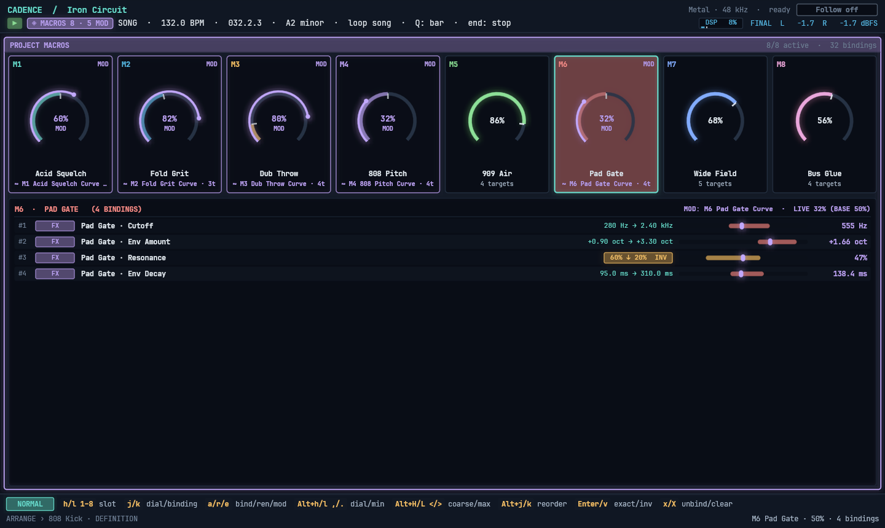

# Chapter 5 · Project Macros & Modulation

> Previous: [Mixing, FX & Signal Graph](04-mixing-fx-and-routing.md) · **Chapter 5** · Next: [Audio Devices, Recording & Hardware MIDI](06-devices-audio-and-midi.md)

Cadence connects sound design and dynamic performance through two complementary modulation layers: **8 Assignable Project Macros (`M1–M8`)** for multi-target song-wide sweeps, and **Global Modulations (`:mod`) & Per-Note P-Locks (`:link`)** for sample-accurate continuous and note-onset automation across every Rack, Zone, Module, Cable, Effect, Send, and Mixer parameter.

---

## 1. Project Macros (`gk` / `Ctrl+k`, `M1–M8`)

Press **`gk`** (or **`Ctrl+k`**, or run **`:macro`**) to open the **Project Macros Deck**. Each project provides **8 assignable macros (`M1` through `M8`)** in a single horizontal strip above a scrollable Bindings table, and each macro fans out to up to **16 simultaneous targets** across:

- Any **Rack bus**, **Zone**, **Module**, or **Patchbay Cable attenuverter** parameter (`Rack`, `Zone`, `Module`, `Cable`)
- Individual multi-zone kit targets (`KIT.ZONE.PARAM` or `KIT.ZONE.MODULE.PARAM`)
- Any of the 8 Studio **`Effect`** parameters
- **`Channel`** gain/pan and **`Send`** amounts

Each target mapping defines its own **`min`** and **`max`** normalized range (`0.0..=1.0` or `0%..=100%`)—displayed inside `gk` in each target's **native units** (Hz, dB, ms, %, pan). Setting **`min > max`** (or pressing **`v`** on a binding row) creates an **inverted sweep** (for instance, opening a synth cutoff while pulling a reverb send dry on the same macro turn!).



### Macros Deck Controls (`gk` / `Ctrl+k`)

| Focus & Keys | Action |
|---|---|
| `h`/`l` · `1–8` · `0`/`$`/`G` | Select Macro slot `M1`–`M8` across the horizontal dial strip |
| `j`/`k` | Move vertically between the **Dial** header and scrollable **Binding rows** (never mutates values) |
| **Dial:** `Alt+h`/`l` & `,`/`.` *(coarse: `Alt+H`/`L` & `<`/`>`)* | Nudge macro dial fine (`±2%`) · coarse (`±10%`) · **`Alt+Backspace`** resets to `0%` |
| **Dial:** `Enter` · `a` · `r` · `e` · `x` / `X` | Exact **`ValueInput`** (`0..1` or `0%..100%`) · add binding picker (`a`) · rename slot (`r`) · edit/jump driving Modulation (`e`) · unbind all (`x`) / clear slot (`X`) |
| **Binding:** `Alt+h`/`l` & `,`/`.` · `Alt+H`/`L` & `<`/`>` | Adjust binding **`min`** (`±2%`) · adjust binding **`max`** (`±2%`) |
| **Binding:** `Alt+j`/`k` · `Enter` · `v` · `x` | Reorder binding row · jump to target deck · invert `min ↔ max` · unbind row |
| **Anywhere on `gk`:** `M` / `R` | Arm 1-key MIDI Learn on the focused slot · toggle real-time Note+CC/Macro recording |

### `:macro` Ex Commands

```text
:macro 1 name "Acid Squelch"
:macro 1 bind instrument "Acid 303" cutoff 0.18 0.92
:macro 1 bind instrument "Acid 303" c5 0.15 0.95       # Bind a Patchbay cable attenuverter!
:macro 1 bind effect "303 Diode" drive 0.10 0.78
:macro 1 bind send "Acid 303" "Dub Tape" 0.00 0.65
:macro 1 bind channel "Acid 303" pan 0.50 0.75
:macro 1 bind zone TR-808.BD cutoff 0.25 0.90          # Explicit zone syntax
:macro 1 bind TR-808.BD.cutoff 0.25 0.90               # Dotted zone/module shorthand
:macro 2 bind effect "Sky Hall" mix 0.70 0.15          # Inverted range (70% -> 15%)
:macro 1 60%                                           # Set static macro position
:macro 1 unbind 2                                      # Remove 1-based target #2 (or `all`)
:macro 1 clear                                         # Remove the entire macro slot
```

### Static vs. Automated Macros & Exact Compilation Precedence

You can turn a macro by hand or MIDI **or** automate any macro slot over time with a `Values` pattern (`:mod "Squelch Ride" macro 1 SquelchCurve`). Both the real-time audio compiler and every GPU visualizer evaluate controls in this exact deterministic order:

1. **Static Macros** (`M1` → `M8` ascending) — applied to bound targets, *skipping* any macro slot that has a `ModulationTarget::Macro` driving it.
2. **Automated Macro Fan-Out** (`M1` → `M8` ascending) — fans each automated macro's current value across every automatable target range.
3. **Direct `Modulation`** — always overrides Macro fan-out on that specific target parameter.

> **Multiplicative `ChannelGain` Rule:** Direct `ModulationTarget::ChannelGain` compiles as a multiplicative scale (`0.0..=1.0`) on top of the channel's strip/macro trim—never replacing your mixer fader—so mixing trim adjustments and volume rides always work together cleanly.

---

## 2. Global Modulations (`:mod`) & Per-Note P-Locks (`:link`)

### Global Modulations (`:mod` or `n → y`)
Drive any automatable parameter on the song clock using a `Values` (`Hold` or `Ramp`) or `SeededValues` pattern:

```text
:mod "Lead Sweep" instrument Lead cutoff FilterCurve
:mod "FM Swell" instrument Lead c2 FmCurve         # Automate a Patchbay cable attenuverter!
:mod "BD Punch" TR-808.BD.cutoff KickSweep         # Dotted zone/module shorthand
:mod "BD Decay" zone TR-808.BD decay KickDecay     # Explicit zone form
:mod "Echo Throw" send Lead Echo ThrowCurve        # Automated Return send throw
:mod "Dub Ride" channel "Acid 303" send:Echo ThrowCurve # Alternate channel send form
:mod "Auto Pan" channel Chords pan PanLfo
:mod "Filter Lift" macro 1 LiftCurve               # Automate Project Macro M1
```

> **Note:** `:mod add|del|rename ...` manages Eurorack modules inside the active Rack zone (see [Chapter 3](03-instruments-and-assets.md)), whereas `:mod NAME <target> ...` creates a song-level global Modulation.

### Per-Note Parameter Links / P-Locks (`:link` / `:unlink`)
Attach a normalized `Values` or `SeededValues` pattern directly to a **Part** so each note samples and locks its own parameter value at note onset (using the placement's own `Song`/`Restart` clock!):

```text
:link AcidPart cutoff AccentCurve                  # Rack module/pin per-note P-lock
:link AcidPart c5 AccentEnvDepth                   # Per-note P-lock on a Patchbay cable!
:link DrumPart TR-808.OH.decay HatDecayCurve       # Per-zone Rack kit P-lock
:link DrumPart OH.decay HatDecayCurve              # Short zone form for the part's kit
:unlink AcidPart cutoff
```

Switch any modulation or P-lock curve between stepped **Hold** and smooth linear **Ramp** right in the Pattern deck with **`m`** (or **`:value-mode <PATTERN> hold|ramp|toggle`**), or bind any Macro or continuous parameter straight to hardware knobs via 1-key MIDI Learn (`M`) in [Chapter 6](06-devices-audio-and-midi.md).

---

> **Next:** Configure your audio interface, 24-bit WAV recording, hardware MIDI controllers, and GPU themes/settings in [Chapter 6 · Audio Devices, Recording & Hardware MIDI](06-devices-audio-and-midi.md).
