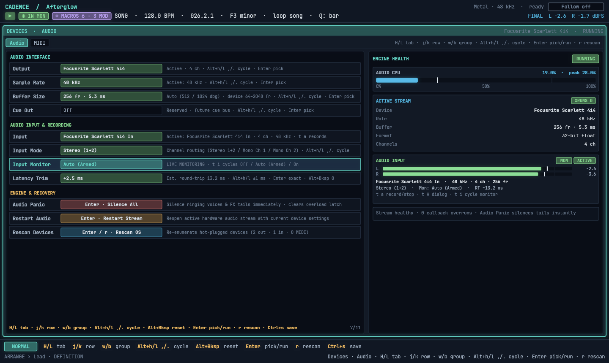
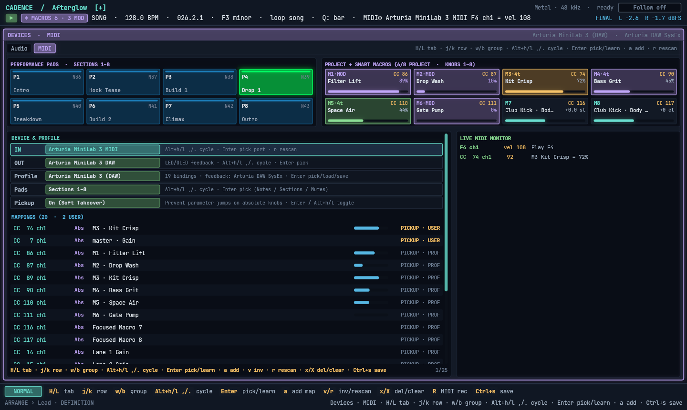
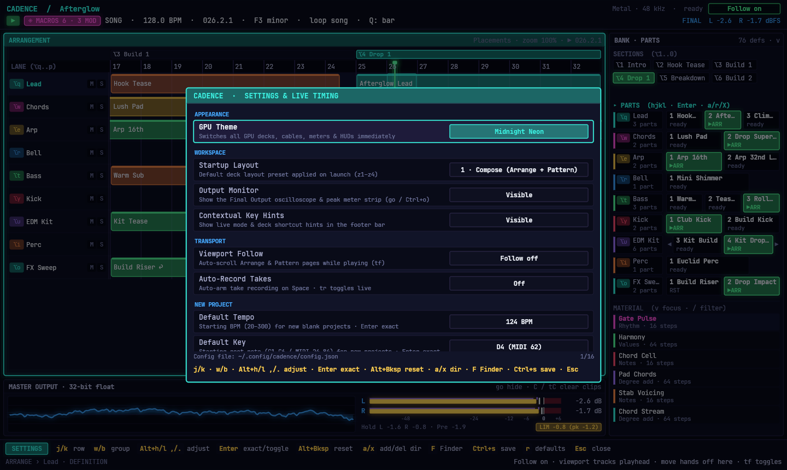

# Chapter 6 · Audio Devices, Live Recording & Hardware MIDI

> Previous: [Project Macros & Modulation](05-macros-and-modulation.md) · **Chapter 6** · Next: [Live Performance & Armed Takes](07-performing-and-takes.md)

Cadence puts your audio interface, live 24-bit audio recording, hardware MIDI controllers, and global studio settings inside two dedicated, zero-friction surfaces: the unified **`Devices` (`Audio | MIDI`)** deck (`gd` / `Ctrl+d`) and **Global Settings** (`g,` / `Ctrl+,`), both persisted cleanly to your user `config.json`.

---

## 1. `Devices · Audio` Tab (`gd` / `Ctrl+d` / `:audio`)

Press **`gd`** or **`Ctrl+d`** (or run **`:audio`** to open directly on the `Audio` tab) to configure hardware audio output, input capture, latency, and engine health without restarting Cadence. Switch between the **`Audio`** and **`MIDI`** tabs anytime with **`H`/`L`**.



### Live Engine Health & Active Stream Panel
The right-hand health panel monitors your real-time audio callback continuously:
- **`ENGINE HEALTH`:** Live callback **`AUDIO CPU`** load and peak CPU marker, stream status (`RUNNING`, `SILENT`, `OVERLOADED`, `FAILED`), and **`XRUNS`** buffer overrun counter.
- **`ACTIVE STREAM`:** Active hardware device, sample rate, callback buffer size + exact buffer latency (`ms`), sample format (`32-bit float`), and channel count.
- **`AUDIO INPUT`:** Live stereo L/R input peak and peak-hold meters (`dBFS`), `MON` / `ACTIVE` / `CLIP` / `SILENCE` indicators, active routing mode, and estimated round-trip latency (`ms`).

### Audio Configuration Rows (`j`/`k` navigate · `w`/`b` jump groups)

| Group | Row | Values & Behavior |
|---|---|---|
| **`AUDIO INTERFACE`** | **`Output`** | `System Default` or any detected OS audio output device (`Alt+h`/`l` or `,`/`.` cycle; `Enter` opens device picker; `Alt+Backspace` resets to System Default). |
| | **`Sample Rate`** | `Auto (Device)` or discrete `44.1 / 48 / 88.2 / 96 / 176.4 / 192 kHz`. |
| | **`Buffer Size`** | `Auto` (`512` frames release / `1024` debug) or discrete `64 / 128 / 256 / 512 / 1024 / 2048` frames, displaying exact callback latency (`ms`) and device min/max range. |
| | **`Cue Out`** | Reserved device selector for a future independent cue bus (`Off` by default). |
| **`AUDIO INPUT & RECORDING`** | **`Input`** | `None` (no OS microphone/input stream opened) or any detected hardware audio input. Changing input settings never interrupts active output playback. |
| | **`Input Mode`** | Channel routing before metering and capture: **`Stereo (1+2)`**, **`Mono (Ch 1)`**, or **`Mono (Ch 2)`**. |
| | **`Input Monitor`** | Software live monitoring policy: **`Off`** *(default — prevents speaker/mic feedback loops)*, **`Auto (Armed)`**, or **`On`** (also cycled globally anytime with **`ti`**; lights the top Chrome `● IN MON` badge when active). |
| | **`Latency Trim`** | Manual recording alignment offset (`-250.0..=+250.0 ms`, `Alt+h`/`l` fine `±1 ms`, `Enter` exact `ValueInput`, `Alt+Backspace` resets to `0.0 ms`) applied on top of measured hardware round-trip buffer latency. |
| **`ENGINE & RECOVERY`** | **`Audio Panic`** | Immediately silences all ringing voices, synths, and FX tails and clears any overload latch (`Enter` or `:panic` / `:audio panic`). |
| | **`Restart Audio`** | Reopens the active hardware audio stream with your current device settings (`Enter` or `:audio restart`). |
| | **`Rescan Devices`** | Re-enumerates hot-plugged USB/Thunderbolt audio interfaces and MIDI ports (`Enter`, **`r`**, or `:audio rescan`). |

Press **`Ctrl+s`** in `Devices` to save your Audio & MIDI device preferences to `config.json`.

### Audio CLI Overrides (Per-Session)
Override saved device settings for a single launch without mutating `config.json`:

```sh
cargo run --release -- --project examples/demo/project.json \
  --audio-device "Scarlett" \
  --buffer-size 256

# Run GUI interactively without opening any OS audio device
cargo run --release -- --project examples/demo/project.json --silent
```

---

## 2. Live 24-Bit WAV Audio Recording (`ta` / `tA` / `ti` / `:rec`)

Record vocals, hardware synths, guitars, drum machines, or external percussion straight into Cadence as **24-bit stereo WAV** files wired automatically into a portable `Sampler` Rack instrument, Part, and Arrangement placement:

1. **Select & check your input in `Devices · Audio` (`Ctrl+d` / `:audio`):** Pick your `Input` device and `Input Mode` (`Stereo (1+2)` / `Mono (Ch 1)` / `Mono (Ch 2)`), watch the live stereo input meters to set clean preamp gain without clipping, and adjust `Latency Trim` if needed. If your hardware input and output run at different sample rates, Cadence converts the stream automatically.
2. **Monitor safely (`ti`):** Press **`ti`** from any deck (or run **`:rec monitor off|auto|on`**) to cycle live input monitoring (`Off` by default to prevent acoustic feedback).
3. **Record immediately (`ta`) or open the Record Audio dialog (`tA`):**
   - **`ta`** starts/stops capture immediately using your current recording settings (**`:rec`**, **`:rec start [NAME]`**, **`:rec stop`**, **`:rec cancel`**).
   - **`tA`** (or **`:rec dialog`**) opens the **Record Audio** workflow dialog to choose:
     - **Timing mode:** **`Synced`** (quantized bar-aligned punch-in/out), **`CountIn`** (bar pre-roll before punch-in), or **`Free`** (unquantized start/stop).
     - **Length:** Fixed bar count (`1..=64` bars via `:rec bars <1..=64> [NAME]`) or manual stop.
     - **Destination:** A brand-new **`Sampler` Rack** (with Part + Placement on the arrangement) or directly into an existing multi-zone Rack slot (**`:rec zone ...`**).
4. **Latency-trimmed portable commit:** Stopping capture waits for the lock-free post-roll compensation tail, trims round-trip latency, writes a clean 24-bit WAV under `<project>/recordings/` (or your session recordings directory for untitled projects), reloads the sample bank, and commits the Sampler Rack + Part + Placement as a **single undoable transaction** (`u` undoes cleanly).

---

## 3. `Devices · MIDI` Tab (`H`/`L`, `M`, `R`)

Cadence treats hardware MIDI controllers as first-class instruments—with hot-plugging, 1-key MIDI Learn, live Note+CC recording, soft-pickup takeover, Focused Smart Macros, and bi-directional LED/OLED feedback.

```sh
cargo run --release -- --list-midi
cargo run --release -- --project examples/demo/project.json \
  --midi-in "MiniLab" --midi-out "MiniLab"
```



The **`MIDI`** tab presents **Performance Pads** (live RGB mirrors), **Project + Smart Macros (`Knobs 1–8`)**, vertical **`DEVICE & PROFILE`** rows (`IN`, `OUT`, `Profile`, `Pads`, `Pickup`) above **`MAPPINGS`**, and a **`LIVE MIDI MONITOR`** log on the right:

| Keys in `Devices · MIDI` | Ex Command | Action |
|---|---|---|
| `H`/`L` | `:audio` / `:midi` | Switch between **`Audio`** and **`MIDI`** tabs |
| `j`/`k` · `w`/`b` | — | Move vertically across `DEVICE & PROFILE` (`IN`, `OUT`, `Profile`, `Pads`, `Pickup`) and `MAPPINGS` |
| `Alt+h`/`l` & `,`/`.` | `:midi profile\|pads\|pickup ...` | Cycle active port, profile (`generic` / `standard_cc` / `minilab3_daw`), pad mode (`notes` / `sections` / `mutes`), soft pickup, or mapping value mode (`Abs`, `Rel±`, `Rel64`, `Trig`, `Tog`, `Mom`) |
| `Enter` / `M` | `:midi learn` | Open port/profile picker, toggle Pickup, or arm/re-learn selected mapping |
| `a` · `v` · `r` | `:midi rescan` | Add mapping (`a`) · toggle invert (`v`) · rescan OS MIDI ports (`r`) |
| `x` / `X` | `:midi unlearn` / `:midi clear` | Delete focused user mapping (`x`) · clear all user mappings (`X`, confirm-guarded) |
| `R` | `:midi rec` | Arm/disarm live MIDI Note, Chord & CC automation recording |
| `Ctrl+s` | — | Persist Audio & MIDI ports, profile, pad mode, pickup, and learned mappings to `config.json` |

### 1-Key MIDI Learn (`M`) & Unlearn (`M` then `x`)
From anywhere in Cadence, focus a target and press **`M`**:
- Focused control inside an **Instrument Rack** (`Panel`, `Patchbay` cable attenuverter, or `Zones`), **Effect**, or **Channel** deck
- Focused slot `M1–M8` inside **Project Macros (`gk`)**
- Selected channel strip inside **Mixer (`gm`)**
- Selected part cell inside **Bank Launchpad (`gb`)**

Cadence arms Learn (and displays `MIDI LEARN` on hardware OLEDs). Move any CC knob, fader, Pitch Bend, or Note pad to bind it immediately and save it globally. Press **`M` then `x`** to unlearn the focused target, or **`Esc`** to cancel.

### Live MIDI Note, Chord & CC Automation Recording (`R`)
Press **`R`** (or `:midi rec`, or your hardware **Record** MMC button) to arm recording:
- **While Stopped (Step Entry):** Play single notes or polyphonic chords (up to 6 tones) on your MIDI keyboard to write directly into the selected literal `Notes` pattern and advance step-by-step.
- **While Playing (`REC · NOTE+CC`):**
  - Notes and chords overdub quantized onto the playing pattern.
  - Twisting **any mapped hardware CC, Pitch Bend, or Project Macro knob** automatically records smooth `Ramp` automation points into a `Values` modulation lane (lazily creating the pattern and `Modulation` if none exists) with 1.5-second gesture undo coalescing—so one knob sweep undoes cleanly with a single **`u`**.

### Built-In Device Profiles, Smart Macros & Bi-Directional Feedback
- **Universal MMC Transport:** Standard MIDI Machine Control SysEx (Play, Stop, Pause, Record) works on every controller out of the box—even on the blank `Generic MIDI` profile.
- **Focused Smart Macros 1–8:** Profiles map 8 encoders to `FocusedMacro 0..7`, which automatically follow whichever Instrument, Effect, or Channel deck you focus (and control Project Macros `M1–M8` when outside an object deck).
- **3 Built-In Profiles** (export/customize any profile with `:midi profile-save my-ctrl.json` and `:midi profile-load my-ctrl.json`):
  1. **`Generic MIDI` (`generic`):** Clean MIDI Learn canvas + MMC + `StandardCcNote` feedback.
  2. **`Standard CC` (`standard_cc`):** Knobs CC 74/71/72/93/73/75/79/78 → Focused Macros 1–8; Faders CC 22–25 → Lanes 1–3 + Master; CCs 105–109 → Loop/Stop/Play/Rec/Tap.
  3. **`Arturia MiniLab 3 (DAW)` (`minilab3_daw`):** Switch the MiniLab 3 to DAW mode (`Shift+Pad 3`) for instant 8-knob Focused Macros, 4 channel/master faders, endless main-encoder scroll/click, Shift+Pads 4–8 transport, **2-line OLED feedback** (live parameter names, native units, value bars, Learn/Rec banners), and **RGB pad & transport LED feedback** via `ArturiaDaw` SysEx.

---

## 4. Global Settings & GPU Themes (`g,` / `Ctrl+,`)

Press **`g,`** (or **`Ctrl+,`**, or run **`:settings`**) to open **Settings & Live Timing**. Navigate rows with **`j`/`k`** (`w`/`b` jump groups), adjust directly with **`Alt+h`/`l`** or **`,`/`.`**, press **`Enter`** for exact values or toggles, **`Alt+Backspace`** to reset a row, **`r`** to restore defaults, and **`Ctrl+s`** to write your user `config.json`.



### Built-In Semantic GPU Themes
Switch **`GPU Theme`** live with zero restart—every deck, Bezier cable, 32-bit float meter, oscilloscope, visualizer, and HUD updates on the very next frame (zero hardcoded colors exist outside the theme palette):
- **`Cadence Dark`** *(default)* — balanced charcoal studio canvas with high-contrast cyan, amber, and violet accents for extended sessions.
- **`Midnight Neon`** *(shown above)* — deep obsidian background with luminous neon-cyan, electric-magenta, and acid-green highlights tailored for dark stages and live clubs.
- **`Studio Light`** *(see [Chapter 1](01-quick-tour.md))* — crisp daylight workstation theme engineered for sunlit studios and projectors.

### Complete Settings Reference

| Group | Settings | Notes |
|---|---|---|
| **`APPEARANCE`** | **`GPU Theme`** | `Cadence Dark` · `Midnight Neon` · `Studio Light` |
| **`WORKSPACE`** | **`Startup Layout`** · **`Output Monitor`** · **`Contextual Key Hints`** | Default launch layout (`z1–z4`), visibility of the 32-bit float Output strip (`go`), and footer key-hint bar |
| **`TRANSPORT`** | **`Viewport Follow`** · **`Auto-Record Takes`** | Default follow mode (`tf`); opt-in automatic take arming on `Space` (default **Off** so everyday playback stays lean; **`tr`** toggles live) |
| **`NEW PROJECT`** | **`Default Tempo`** · **`Default Key`** · **`Default Scale`** | Starting BPM (`20–300`), root note (`C1–C6`), and scale (all 13 named scales) for new blank projects |
| **`LIVE TIMING (PROJECT)`** | **`Launch Quantize`** · **`Live Edit Timing`** · **`Late Tolerance`** | Project-level launch boundary (`c` picks a `Cycle` pattern), immediate vs. quantized live edits (`tE`), and `0–4` step late-hit grace window |
| **`ASSET DIRECTORIES`** | **`Sample Directories (sample_dirs)`** · **`Preset Directories (preset_dirs)`** | Persistent library roots across sessions: **`a`/`Enter`** types a path, **`F`** opens a native OS folder picker, **`x`** removes a directory, and saving automatically rescans the Sample Browser and Preset Catalog |

---

> **Next:** Jam over your arrangement, stage multi-lane drops, commit live improvisations, and work with explicitly armed crash-safe Takes in [Chapter 7 · Live Performance & Armed Takes](07-performing-and-takes.md).
