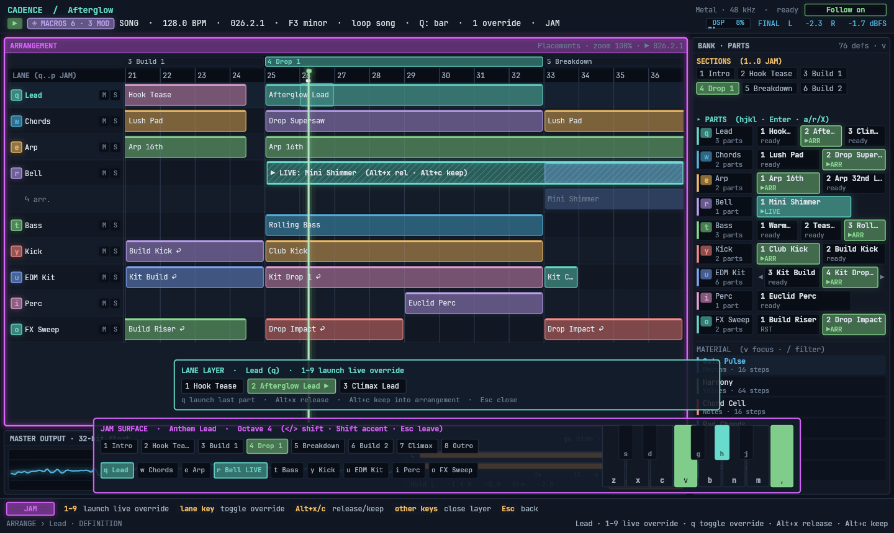
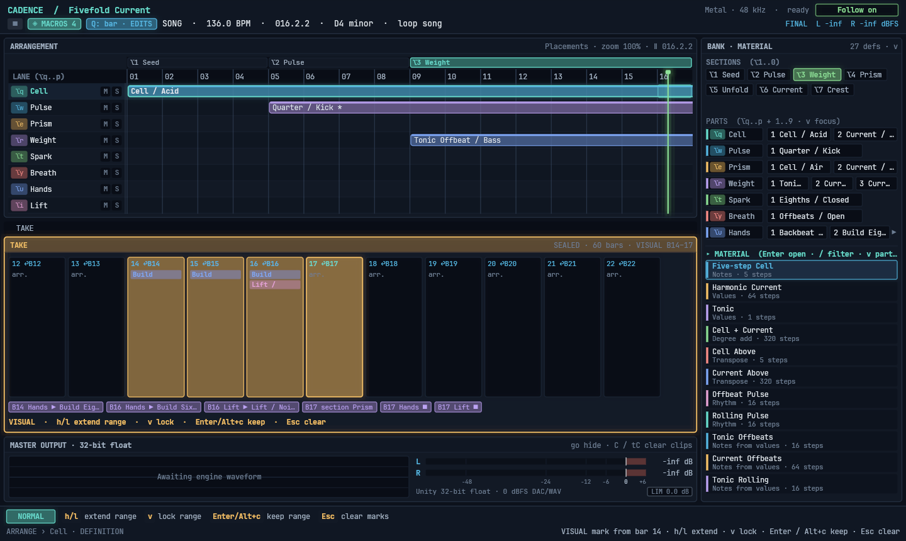

# Chapter 7 · Live Performance & Armed Takes

> Previous: [Audio Devices, Live Recording & Hardware MIDI](06-devices-audio-and-midi.md) · **Chapter 7** · Next: [CLI, Headless Rendering, Formats & Live `--ctl`](08-cli-scripting-and-live-ctl.md)

Cadence lets you trace every evaluated note back to its musical source, jam over your arrangement without losing your song structure, stage synchronized multi-lane transitions, commit live improvisations back into the score atomically, and arm a **crash-safe Take journal** (`tr`) whenever you want to capture a set. *(For live 24-bit WAV audio input recording via `ta` / `tA` / `ti`, see [Chapter 6 · Audio Devices, Live Recording & Hardware MIDI](06-devices-audio-and-midi.md).)*

---

## 1. Evaluated Arrange Views, Placement Editing & Event Provenance (`vp` / `vo` / `vr`)

Inside the **Arrange deck (`ga` / `Ctrl+a`)**, navigate lanes and bars with `h`/`j`/`k`/`l` (**`H`/`L`** or **`w`/`b`** jump sections), manipulate placements directly in `vp` (**`Alt+h`/`l`** move start `±4` steps, **`Alt+H`/`L`** `±16`, **`Alt+j`/`k`** move placement across lanes, **`,`/`.`** shrink/extend length `±4` steps, **`<`/`>`** `±16`, **`d`** duplicate, **`x`** release override else delete, **`Enter`** open detail), and press **`v`** to switch views (or run `:arrange placements|overview|roll`):

| Keys | View | Purpose |
|---|---|---|
| **`vp`** | **Placements** | Bar-level placement blocks and named timeline sections (`n → t` add, `r` edit, `X` delete, `Alt+hjkl` / `,/.` move & resize placements). |
| **`vo`** | **Evaluated Overview** | Multi-lane note overview evaluated directly from live patterns and derivations—zero extra material created. |
| **`vr`** | **Lane Roll** | Full-height pitch roll of the selected lane's evaluated notes. |

### Event Provenance (`Enter` in `vo` / `vr`)
In **Evaluated Overview** or **Lane Roll**, jump from note to note with **`w`/`b`** (sections with **`H`/`L`**, pages with `PgUp`/`PgDn`), then press **`Enter`** (or **`:inspect-event`**) to open **Event Provenance**:
- Shows the exact derivation tree and pattern times that produced that note (e.g., `Motif` + `Harmony` → `Moving` → `LeadPart` at bar 12, step 5).
- **`j`/`k`**: step through upstream sources · **`s`/`Enter`**: jump straight into that source pattern · **`o`**: open a placement-local exception (`:local`) at that occurrence · **`i`**: open the note's instrument.

---

## 2. Performing Over the Arrangement

Your arrangement plays linearly (or loops a section/region) on a single performance clock. Launching a part on a lane creates a **live override** over that lane—everything else keeps playing the arrangement, and **releasing** the lane hands control right back to the arranged song.

### Row-Oriented Bank Launchpad (`gb` / `Ctrl+b`)
Press **`gb`** (`Ctrl+b`) to focus the **Bank** deck (`v` toggles between **Parts Launchpad** and **Material Library**; press **`zz`** to expand full-screen). Lanes run vertically as rows (`j`/`k`) and each lane's launchable parts run horizontally left-to-right (`h`/`l`) in both docked and zoomed views—matching Arrange with zero axis flip. Populate any lane's launchable parts with **`a`** or `:lane LANE add PART [song|restart] [OFFSET]` (and remove with **`X`** or `:lane LANE drop PART`):

| Keys in `gb` (Parts) | Action |
|---|---|
| `j`/`k` · `h`/`l` · `0`/`$`/`G` | Select lane (rows) and part card (columns) · jump first/last lane |
| `Enter` *(or `Shift+Enter`)* | Launch selected part as a live override on the next quantization boundary (`Shift+Enter` immediate `at now`) |
| `A` | Audition part pattern |
| `a` / `r` | Add Part to lane / edit launch phase & offset |
| `x` / `X` | Release lane override back to the arrangement / drop Part from lane |
| `m` / `s` | Toggle lane mute / solo (queued on the launch boundary while playing) |
| `zz` | Toggle full-screen Launchpad Matrix |

### Modal Jam Mode (`gj` / `Ctrl+Shift+j`) & the Universal `Alt` Layer
Press **`gj`** or **`Ctrl+Shift+j`** to toggle modal **Jam Mode**—framed by a glowing electric **violet** deck border and floating performance HUD (`Esc` or `Ctrl+Shift+j` leaves Jam and releases held notes).



- **`1–0` (number row):** Jump to Sections 1–10 in the current bank (looping the section automatically if loop is enabled!).
- **`q w e r t y u i o p` (lane row):** Open a **Lane Layer** for Lanes 1–10:
  - Press **`1–9`** to launch that lane's part override (re-launching the active part restarts it).
  - Press the **same lane key again** to toggle the lane override on/off.
  - Press **`Alt+x`** to release, **`Alt+c`** to keep, or any other key to close the layer and act immediately.
- **`z s x d c v g b h n j m ,` (bottom two rows):** 13-key chromatic piano playing the focused lane's instrument (`Shift` accents to `1.0` velocity; **`<`/`>`** shifts octave `0..8`).
- **`Tab` / `Shift-Tab`:** Page between 10-lane / 10-section banks when a project has more than 10 lanes or sections.
- **`Space`** play/pause · **`\`** toggle loop · **`Backspace`** cancel last queued launch/jump · **`Enter`** fire staged scene · **`:` / `Ctrl+Shift+p`** Action Palette or **`?`** Help without leaving Jam.

**Universal `Alt` Layer:** Jam is simply the `Alt` performance layer locked on. From *any* deck or mode, you always have instant performance access (while `Alt+h/j/k/l` handles direct 2D manipulation):

| Chord | Action |
|---|---|
| `Alt+1`..`Alt+0` | Jump to Section 1–10 |
| `Alt+q`..`Alt+p` | Open Lane 1–10 layer (`1–9` launch, repeat key toggle) |
| `Alt+m` / `Alt+s` | Mute / solo focused lane (or selected channel in Mixer) |
| `Alt+M` / `Alt+S` | Unmute all lanes / clear all lane solos |
| `Alt+x` / `Alt+X` | Release focused lane override / release **all** overrides |
| `Alt+c` / `Alt+C` | **Commit / Keep** focused lane override (or Take selection) / **Keep all** active overrides |
| `Alt+Enter` | Start staging / open finish prompt / fire staged changes |

---

## 3. Quantization Boundaries, Late Tolerance & Live Staging

### Boundaries & Live Timing
Every launch, release, section jump, and lane mute/solo lands cleanly on your chosen **launch boundary**:
- Standard grid: **`now`**, **`beat`**, **`bar`**, **`N bars`** (`2 bars`, `4 bars`, `8 bars`, …)
- Polymetric cycle: **`cycle PATTERN`** — waits for a specific pattern (even a 5-step or 40-step cycle!) to finish its pass cleanly.

Configure boundaries with **`tq`** (cycle choices), **`tQ`** (pick any project pattern for `Cycle`), **`tE`** (toggle whether live edits land `Now` or follow the launch boundary), inside **Song Properties (`gP`)** or **Settings (`g,`)**, or via Ex commands:

```text
:quantize bar                        # Launch on bar boundaries
:quantize 2 bars                     # Launch every 2 bars
:quantize cycle "Harmonic Current"   # Land on a polymetric pattern's exact cycle boundary
:quantize edits launch               # Queue live pattern edits onto the launch boundary
:tolerance 2                         # 2-step late-hit grace window (0..4 steps)
:launch Drums 2 at bar               # Explicit one-off launch override (:launch LANE [PART] [at BOUNDARY])
:release Drums at bar                # Release one lane (or `:release all`)
:cancel [all]                        # Cancel last (or all) pending launches/jumps
```

**Late tolerance (`:tolerance STEPS`):** If you hit a launch key a sixteenth-note *after* a downbeat, Cadence snaps it gracefully within the tolerance window so your groove never misses an entire 4-bar cycle over a few milliseconds of human timing.

### Live Staging (`S` or `Alt+Enter`)
Need to launch three new parts, mute the kick, and jump to the Chorus **all on the exact same downbeat**?
1. Press **`S`** (or **`Alt+Enter`**, or `:stage`) to enter **Staging**.
2. Queue any combination of lane launches, releases, mutes, solos, and a section jump—nothing fires yet (`u` unstages the last gesture).
3. Press **`S`** again (or **`Alt+Enter`** → `Enter`/`S`, or `:stage fire`) to fire every staged change **atomically on one boundary** (`Esc` or `:stage discard` cancels).

---

## 4. Growing Keep, Atomic Keep & `'` *"From Here"*

When a live jam clicks, turn it straight into permanent arrangement structure without stopping playback:

- **Growing Keep (`Alt+c`):** Keeps the focused lane's active override. In Song mode, Cadence writes a placement starting where the override landed and **grows it bar-by-bar with the playhead as a single coalesced undo entry** until you release the lane or stop playback (inside a loop region, it commits across the loop span).
- **Atomic Keep (`Alt+C` or `:keep`):** Writes *every* currently active lane override into the arrangement in **one undoable transaction**.
- **`'` (*"From here"* scoped fork):** Arm `'` right before making a pattern edit during a live set—your edit forks the pattern and dependent parts from the next quantized bar onward, leaving everything earlier in the song completely untouched.

---

## 5. Explicit Take Arming (`tr`) & Crash-Safe Take Deck (`gt` / `Ctrl+t`)

Take recording is **explicitly armed** by default (**OFF** on launch) so everyday playback never fills session storage with throwaway takes. Press **`tr`** (or run **Arm Take Recording** in the Action Palette / `:take arm`) whenever you are ready to capture a live performance—the top Chrome bar displays an amber **`TAKE ARM`** pill while stopped and switches to a glowing red **`● REC TAKE (N)`** pill (or **`● TAKE CAPPED`** if the in-memory cap is reached) as playback streams every landed launch, section jump, flag change, and live edit safely off-thread to `<session_dir>/takes/` as compact `v1` JSONL.

> **Prefer always-on capture?** Open **Settings (`g,`)** and turn on **`Auto-Record Takes`** (`UserConfig::auto_record_takes = true`) to auto-arm take recording whenever you press `Space` (see [Chapter 6](06-devices-audio-and-midi.md)).

Press **`gt`** (`Ctrl+t`) to open the **Take Deck** below Arrange (or `zz` to zoom full-screen):



| Keys in `gt` | Ex Command | Action |
|---|---|---|
| `tr` | `:take arm\|disarm\|toggle` | Arm or disarm live Take recording |
| `h`/`l` · `0`/`$`/`G` | — | Scrub across recorded bars |
| **`v`** (then `h`/`l` · `v`) · `x` / `Esc` | — | **Visual range mark:** anchor start bar, extend with `h`/`l`, press `v` again to lock range · `x` / `Esc` clears marks |
| `Enter` or `Alt+c` | `:keep START_BAR END_BAR` | Keep the marked bar range into your arrangement (auto-forking any patterns edited mid-take!) |
| `Ctrl+s` | `:take save [NAME\|PATH]` | Save a permanent portable `.take.jsonl` into your project's `takes/` folder |
| **`X`** | `:take discard` | Discard the active unsaved take (confirmation-guarded via `Mode::Confirm` when events exist) |
| — | `:take load PATH.take.jsonl` | Reload any saved `.take.jsonl` into the Take Deck to inspect, keep, or export |

### Deterministic Offline Take Rendering
Because a Take stores exact musical transitions rather than raw audio, you can replay and render any saved `.take.jsonl` offline with sample-accurate determinism:

```sh
cargo run --release -- \
  --project examples/fivefold-live/project.json \
  --take examples/fivefold-live/takes/set.take.jsonl \
  --take-tail-bars 2 \
  --render fivefold-set.wav
```

Explore [**Fivefold Live**](https://github.com/cadencefm/cadence/blob/main/examples/fivefold-live/README.md) (`examples/fivefold-live/perform.keys.jsonl`) for a complete scripted performance set and replayable take.

---

> **Next:** Automate builds, render WAVs & stems, import ReBirth `.rbs` songs, bake factory kits, and control a running GUI session live over `--ctl` in [Chapter 8 · CLI, Headless Rendering, Formats & Live `--ctl`](08-cli-scripting-and-live-ctl.md).
