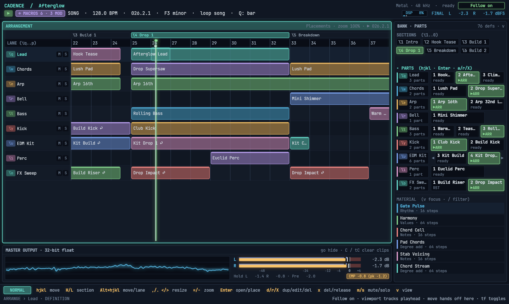

# Cadence

**A keyboard-driven musical studio in one native binary — where synths, drum kits, studio effects, audio recording, and stage performance share one linked musical graph.**

Built on a native `wgpu` GPU canvas (`Metal` / `Vulkan` / `DX12`) and a zero-allocation 32-bit float audio engine, Cadence keeps musical relationships connected instead of flattening them into copy-paste clips. Edit one chord in a progression and your pads, stabs, arpeggios, and bassline follow in lockstep while you ride macros, shape effects, and launch lane overrides on bar boundaries.



---

## Quick Start

Requires a current stable Rust toolchain. macOS uses `Metal` + `CoreAudio` + `CoreMIDI`; Linux uses `Vulkan` + `ALSA` (`libasound2-dev`). Pass `--silent` to run without an audio device, or `--no-default-features` for headless CLI builds.

```sh
git clone https://github.com/cadencefm/cadence.git
cd cadence

# Flagship 64-bar melodic EDM showcase ("Afterglow")
cargo run --release -- --project examples/demo/project.json

# 48-bar Acid Electro & hardware groovebox showcase ("Iron Circuit")
cargo run --release -- --project examples/iron-circuit/project.json

# 32-bar generative ambient / IDM showcase ("Glass Cathedral")
cargo run --release -- --project examples/glass-cathedral/project.json

# Keyboard performance set & replayable take ("Fivefold Live")
cargo run --release -- --project examples/fivefold-live/project.json

# Start from a blank canvas
cargo run --release -- --empty
```

---

## Core Capabilities

- **Direct Keyboard Grammar:** Navigate spatially with `h/j/k/l` (`H/L` coarse/tabs), sculpt values and reorder items directly in place with `Alt+h/j/k/l` or one-handed `,`/`.`, enter exact values with `Enter`, and press `:` / `Ctrl+Shift+p` for the Fuzzy Action Palette or `?` for searchable in-app Help.
- **Unified Eurorack Modular Rack:** Every instrument is a patchable `Rack` (`Panel | Patchbay | Zones`) built from 11 orthogonal modules (`Vco`, `Sampler`, `Noise`, `Env`, `Lfo`, `Filter`, `Vca`/RingMod, `Drive`, `LoFi`, `Resonator`, `Out`) with bipolar attenuverter cables and sample-accurate `z-1` feedback — backed by an external MIT-licensed preset and drumkit library (`TR-808`, `TR-909`, `EDM Kit`, synthesized kits, drums, and synths).
- **Retained Pattern Algebra & Inline `:mini`:** 22 composable pattern operations plus instant-validated `:mini` notation with fractional sub-step timing (`offset ∈ [0.0, 1.0)`).
- **32-Bit Float Mixer & 8 Studio Effects:** Native `Eq`, rhythmic `Filter` (with extensible groove banks), `Compressor`, lookahead PDC `Limiter`, 3-mode `Drive`, `Chorus`, dual-mode `Delay`, and `Reverb`, nested `Group → Group` buses, automated sends, sidechain ducks, and `+6 dB` fader headroom.
- **Live Performance, 24-Bit Recording & MIDI:** Launch lane overrides on bar boundaries, perform in Jam Mode (`gj`), stage multi-gesture drops (`S`), arm crash-safe performance Takes (`tr`), record 24-bit WAV audio straight into project Samplers (`ta`), and map hardware MIDI controllers via 1-key Learn (`M`) with bi-directional feedback.
- **Scriptable & Agent-Ready:** Clean human-readable `v1` JSON projects, presets, and JSONL takes, deterministic WAV + parallel stem export (`--render`, `--stems`, `--render-kit`), clean-room ReBirth `.rbs` import (`--import-rbs`), and a local `--ctl` Unix socket (`cadence ctl`) for controlling a running session.

---

## Explore the Documentation

- **[User Guide](guide/README.md)** — Guided walkthrough from your first 10 minutes through sound design, mixing, hardware MIDI, audio recording, performance takes, and CLI scripting.
- **[Decks, Keymap & Interaction Spec](spec/decks-and-interaction.md)** — Direct keybinding contract, directional tiers, canonical verbs, deck layouts, and modal overlay behavior.
- **[Material & Timing Spec](spec/material-and-timing.md)** — Formal `Project` v1 graph, 22 `PatternKind` operations, `:mini` syntax, fractional sub-step timing, and launch/keep semantics.
- **[DSP & Audio Engine Spec](spec/dsp-and-audio-engine.md)** — Pure `cadence-core::dsp` signal math, 11-module Rack runtime, 64-frame sub-block mixer, PDC, and real-time audio invariants.
- **[Protocols & Persistence Spec](spec/protocols.md)** — JSON schemas, `--script` / `--stdio` JSONL actions, `--ctl` remote-control Unix socket protocol, and audio/preset/bundle formats.
- **[Design Decisions](design-decisions.md)** & **[Verification & Testing](verification.md)** — Architectural rationale and automated verification pyramid.
- **[Source Code on GitHub](https://github.com/cadencefm/cadence)** — MIT-licensed 6-crate Rust workspace.
