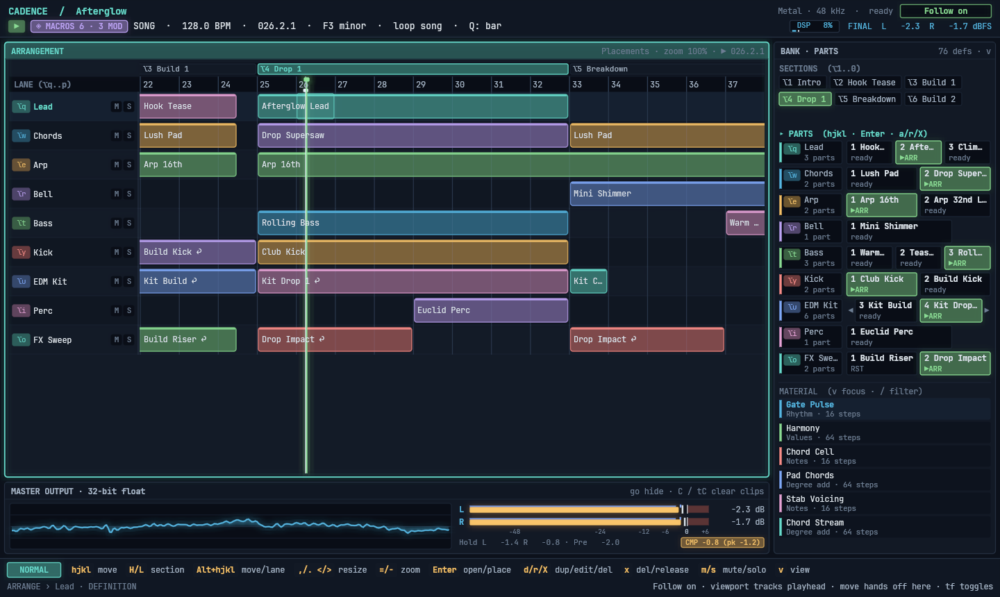

# Afterglow — Flagship Modern EDM Showcase

**64 bars · 128 BPM · F natural minor · 2:00 full arrangement**

*Afterglow* is Cadence's flagship demo composition — showing how small, clean musical cells compose through retained pattern algebra, inline mini-notation, a 100% MIT `Rack` drum kit with per-zone P-locks, a dedicated automated `FX Sweep` riser/downlifter lane, 6 playable & automated Project Macros, 5 sidechain ducks, and 20 studio bus & mastering FX into a punchy, club-ready modern melodic EDM track.



## Play & Perform

```sh
# Open Afterglow in Cadence's GPU instrument
cargo run --release -- --project examples/demo/project.json

# Verify project & repo-relative MIT sample assets
cargo run --release -- --project examples/demo/project.json --sample-roots-only --check

# Render full 48 kHz stereo WAV
cargo run --release -- --project examples/demo/project.json --render afterglow.wav

# Rebuild project.json from the reproducible Rust score & inspect section loudness
cargo run --release --example build-demo -- --analyze
```

Once open:
- Press **`Space`** to play from Bar 1, or press **`⌥4`** (`Drop 1`) / **`⌥7`** (`Climax`) to jump straight into the drops on the next bar boundary!
- Press **`gk`** to open the **Macros Deck** and ride **`M3 Kit Crisp`**, **`M4 Bass Grit`**, **`M5 Space Air`**, or crank **`M6 Gate Pump`** in real time while `M1 Filter Lift` and `M2 Drop Wash` sweep the arrangement!
- Press **`gm`** to inspect the 32-bit float **Mixer Console** (`0 dB` hairline, `+6 dB` headroom, sidechain ducks, and GR meters), or **`gG`** then **`zz`** for the entire 5-column **Signal Graph**!
- Press **`gb`** then **`zz`** for the full-screen 9-lane Ableton-style **Launchpad Matrix** — launch `Drop Supersaw`, `Arp 32nd Lift`, `Kit Build`, `Kit Climax`, `Climax Lead`, `Build Riser`, or `Drop Impact` over the song!
- Press **`gj`** (or **`Ctrl+Shift+j`**) to enter **Jam Mode**, press **`q`** to pop open the Lead lane layer, or play melodies on `z–,`!
- Press **`:open "Bell Mini"`** then **`gp`** to edit the inline `:mini` counter-melody!

## Musical Structure (8 Sections × 8 Bars)

| Section | Bars | Key | Musical Arc |
| --- | --- | --- | --- |
| **1. Intro** | 1–8 | `⌥1` | Warm chorused Fm7–Dbmaj7–Abmaj7–Eb pad + crystalline dotted-8th Arp + breathing Warm Sub |
| **2. Hook Tease** | 9–16 | `⌥2` | Masked vocal-anthem hook enters + sculpted F1 Analog Kick + Tease Bass + swung `EDM Kit` hats, rimshot & backbeat clap |
| **3. Build 1** | 17–24 | `⌥3` | Sub drops out, `FX Sweep` riser + `M1 Filter Lift` & `M2 Drop Wash` surge, driving 8th-note kick + 4-bar festival snare build (quarters → 8ths → 16ths → 32nd ratchet, `0 → +12 st` pitch sweep) → 1-beat vacuum breath & tom/snare drop fill |
| **4. Drop 1** | 25–32 | `⌥4` | `FX Sweep` downlifter + Crash impact into pumping 5-voice wide supersaws, octave-stacked 5-voice anthem hook, F1 Analog Kick (`Kick Sculpt` EQ), rolling sub-locked bass, layered snare/clap, choked hats & stereo tom fills |
| **5. Breakdown** | 33–40 | `⌥5` | Release crash & `FX Sweep` downlifter into hushed Sky Hall pad + shimmering inline `Mini` `Bell Mini` counter-melody, with Warm Sub swelling in bars 37–40 |
| **6. Build 2** | 41–48 | `⌥6` | `M6 Gate Pump` rhythmic `Music Filter` trance-gate + 32nd-note `Arp 32nd Lift` + `FX Sweep` riser + massive 4-bar festival snare build, breath & drop fill |
| **7. Climax** | 49–56 | `⌥7` | Full Drop 2: `FX Sweep` downlifter impact + velocity-halo octave-stacked `Hook Climax` + silvery 8th-note Climax Ride + `Euclidean(5,16)` Tech Perc + 32nd arp |
| **8. Outro** | 57–64 | `⌥8` | Graceful groove wind-down into dotted-8th ping-pong stereo delay & Sky Hall reverb trails dissolving cleanly to silence |

## 6 Project Macros (`M1–M6`)

| Macro | Mode | What It Shapes |
| --- | --- | --- |
| **M1 Filter Lift** | Automated (64-bar arc) | Sweeps `Supersaw`, `Anthem Lead`, and `Glass Arp` cutoffs + `Supersaw` resonance together across builds, drops, and breakdown |
| **M2 Drop Wash** | Automated (64-bar arc) | Swells `Chords`, `Lead`, and `EDM Kit` sends into `Hall` + `Echo` and lifts `Dotted 8th` feedback on build peaks, snapping razor-dry on Drop 1 & Climax |
| **M3 Kit Crisp** | Playable (`72%`) | Shapes `EDM Kit` master cutoff, `CH`/`OH` zone filters, and `Drum Punch` EQ air shelf |
| **M4 Bass Grit** | Playable (`45%`) | Sweeps `Sub Drive` filter cutoff, synth drive, and `Bass Drive` tape saturation & mix |
| **M5 Space Air** | Playable (`44%`) | Expands `Sky Hall` decay, damping, and room size alongside `Shimmer Bell` FM brilliance |
| **M6 Gate Pump** | Automated (Build 2) + playable | Engages the rhythmic `Gate Pulse` step-envelope `Music Filter` (inverted cutoff sweep + envelope depth + resonance) |

## How Simple Cells Create the Whole Track

- **One 4-bar `Harmony` pattern** (`0, -2, +2, -1` in F minor) drives `Pad Chords` (`AddDegrees`), `Drop Stabs` (`AddDegrees` + `Mask`), `Sparkle Arp` & `Arp 32nd` (`Arp(UpDown)` + `Shape`), `Club Bass` (`NotesFromValues` + `RangeFold(36..48)` + `Shape`), and `Warm Sub` (`RangeFold(36..48)`). Edit one chord degree in `Harmony` and every harmonic layer follows in lockstep!
- **MIT `Rack` `EDM Kit` + Per-Zone P-Locks:** 9 stereo-placed kit zones (`SD`, `CP`, `CH`, `OH`, `CR`, `RD`, `LT`, `HT`, `RS`) loaded from repo-relative MIT `../../factory-samples/edm-kit/` WAVs, with hi-hat choke group `1`, `Every(4)` stereo tom turnarounds (`HT → LT`), `Swing(0.14)` → `Chance(0.90)` hats, a 4-bar festival build (`Concat` of `Snare Quarters` → `Snare 8ths Heavy` → `Snare 16ths Heavy` → `Build Q1 16ths` → `Ratchet(2)` 32nd roll → `Build Breath` vacuum → `Build Drop Fill` + `Crescendo` velocity curve), and per-zone `ZoneParam` P-locks pitching `SD` up a full octave (`0 → +12 st`, resetting cleanly on the breath/fill) and opening `SD` filter `4.2 → 18.5 kHz` during builds plus stereo `RS` rim pan motion across drops.
- **Dedicated `FX Sweep` Riser & Downlifter Lane (9 Lanes Total):** A 3-voice unison mono-legato noise + fifth-detuned saw synth driven by `Build Riser` and `Drop Impact` parts plus three 64-bar modulation arcs (`Sweep Cutoff Arc`, `Sweep Pitch Arc` sweeping `+24 st` up into drops and `-12 st` down on impact, and `Sweep Gain Arc`), sculpted with `Sweep Sculpt` EQ, sent into `Hall` + `Echo`, and sidechain-ducked off the kick.
- **Studio Mixing & Mastering (20 FX Devices):** 8 sculpted Synth Racks (F1 Analog Kick, Tech Perc, Sub Drive, widened 5-voice `Supersaw`, octave-stacked 5-voice `Anthem Lead`, Glass Arp, Shimmer Bell, `FX Sweep`) + 1 multi-zone Kit `Rack` (`EDM Kit`) feeding 9 Audio channels → `Drums` (`Compressor` + `Drive(AtomicJet)` + `Eq`) and `Music` (rhythmic `Filter` + `Compressor` + `Eq`) groups + `Echo` (`Delay(PingPong)` dotted-8th + `Eq`) and `Hall` (`Reverb` + `Eq`) returns + sculpted channel inserts (`Kick` `Kick Sculpt` Eq, `Bass` Drive+Eq, `Chords` Chorus+Eq, `Lead` Eq, `FX Sweep` `Sweep Sculpt` Eq) → `Master` (`Compressor` glue + `Eq` + `Limiter` at `-0.8 dBFS` ceiling), with 5 sidechain `Duck` envelopes off the F1 kick (`Kick -> Music`, `Kick -> Bass`, `Kick -> Hall`, `Build Kick -> Music`, `Kick -> FX Sweep`). Run `--render-report` or `build-demo -- --analyze` to inspect loudness, stereo width, and bus telemetry.

## Explore Further

- **Screenshots:** [Arrange & Output](../../docs/screenshots/01-arrange.png) · [32-Bit Float Mixer](../../docs/screenshots/03-mixer.png) · [Anthem Lead Rack Panel](../../docs/screenshots/05-rack-panel.png) · [Bell Mini Roll](../../docs/screenshots/08-pattern-mini.png) · [Jam HUD & Launchpad](../../docs/screenshots/09-jam-perform.png) · [Studio Light](../../docs/screenshots/10-studio-light.png)
- **User Guide:** [Quick Tour](../../docs/guide/01-quick-tour.md) · [Patterns & Algebra](../../docs/guide/02-patterns-and-algebra.md) · [Mixing, FX & Routing](../../docs/guide/04-mixing-fx-and-routing.md) · [Macros & Modulation](../../docs/guide/05-macros-and-modulation.md)
- See [LICENSE.md](LICENSE.md).
