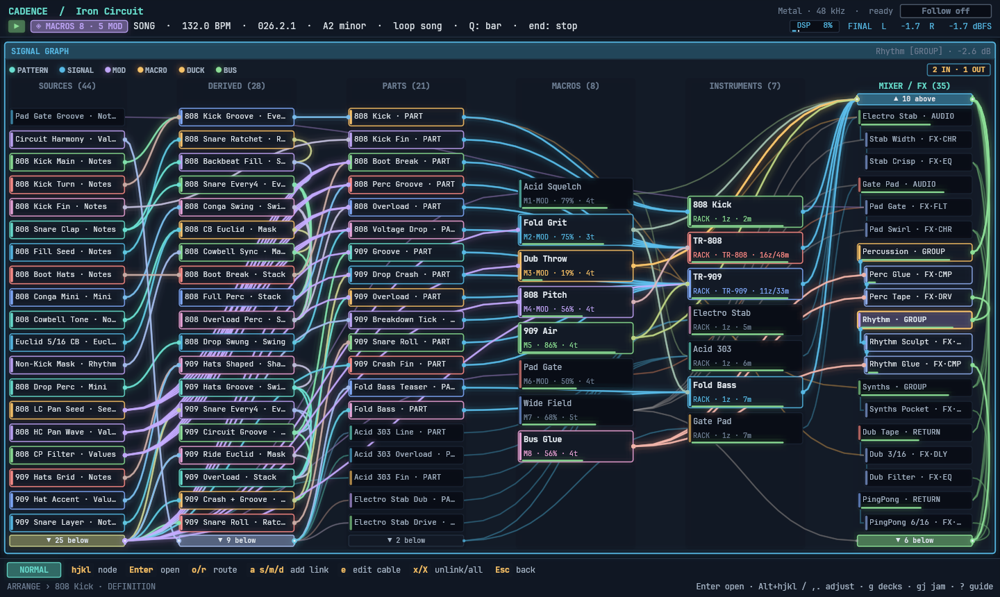

# Iron Circuit — Acid Electro & Hardware Groovebox Showcase

**48 bars · 132 BPM · A natural minor · 1:27 full hardware-groovebox arrangement**

*Iron Circuit* is Cadence's Acid Electro flagship showcase — channeling Drexciya, Aphex Twin's *Analord*, and Underground Resistance through dual sampled `TR-808` + `TR-909` `Rack` kits, a filtered Detroit chord `Sampler` Rack, native `DiodeLadder` 303 squelch, Shock-Port driven electro bass, nested `Group → Group` bus routing, all 8 native effects, and all 8 assignable Project Macros.



## Play & Perform

```sh
# Open Iron Circuit in Cadence's GPU instrument
cargo run --release -- --project examples/iron-circuit/project.json

# Render full 48 kHz stereo WAV + loudness/metering report
cargo run --release -- --project examples/iron-circuit/project.json \
  --render iron-circuit.wav --render-report iron-circuit.report.json

# Rebuild project.json from the reproducible Rust score & inspect section loudness
cargo run --release --example build-iron-circuit -- --analyze
```

Once open:
- Press **`Space`** to play from Bar 1, or jump on bar boundaries with **`⌥1`** (`Boot`) through **`⌥6`** (`Surge & Out`).
- Press **`gG`** then **`zz`** to inspect the nested `Group → Group` Signal Graph (`808 Kit` + `909 Kit` → `Percussion` → `Rhythm` ← `Fold Bass`, `Synths` sidechained off `808 Kick`, and 3 dub/room returns).
- Press **`gb`** then **`zz`** for the 7-lane **Launchpad Matrix**, or **`gk`** to perform with all 8 **Project Macros (`M1..M8`)**!
- Select the `TR-808` (16 zones) or `TR-909` (11 zones) lane and press **`gi`** to open the **Instrument Deck** (`Rack` Panel, Patchbay & Zones Inspector with P-locks and modulation curves), or press **`gm`** for the Mixer Console & `Pad Gate` rhythmic `Filter`.

## Musical Structure (6 Sections × 8 Bars)

| Section | Bars | Key | Musical Arc |
| --- | --- | --- | --- |
| **1. Boot** | 1–8 | `⌥1` | Syncopated TR-808 electro break + dub-echoed brass chord stab + bar-5 Fold Bass teaser |
| **2. Circuit** | 9–16 | `⌥2` | TR-909 crash, swung hats & snare lock in + funky `Drive(ShockPort)` bassline + dark 303 bar-13 entry |
| **3. Acid Line** | 17–24 | `⌥3` | Resonant `Acid 303` lead (native `vel ≥ 0.95` accents + mono slides) + `FilterEnv`-gated electro pad |
| **4. Overload** | 25–32 | `⌥4` | Peak electro climax: 808 Euclidean cowbell, 909 Euclidean ride, screaming 303, dub turnaround throws |
| **5. Voltage Drop** | 33–40 | `⌥5` | Stripped hypnotic breakdown: tuned 808 congas & cowbell, blooming `FilterEnv` pad, 303 riser & 909 snare roll |
| **6. Surge & Out** | 41–48 | `⌥6` | Explosive final groove return → bar-47 impact chord → clean dub/room decay |

## Modern Cadence Capabilities Showcased

- **Unified Modular `Rack` Architecture Across All Roles (7 instruments, 29 MIT repo-relative samples):**
  - **Dual Multi-Zone Kit `Rack`s:** `TR-808` (16 zones, `../../factory-samples/tr-808/`) and `TR-909` (11 zones, `../../factory-samples/tr-909/`) with choke groups, equal-power zone panning, per-zone `ZoneParam` P-locks (conga pan & clap filter), and continuous `909 OH` cutoff modulation.
  - **Standalone `Sampler` `Rack`s:** `Electro Stab` (`../../examples/demo/samples/brass-pad.wav`, filtered/chorused Detroit chord stab) plus dedicated `808 Kick` sampler driving sidechain `Duck` cleanly without false triggers from percussion.
  - **Sculpted Synth `Rack`s:** `Acid 303` (saw into 4-pole nonlinear `DiodeLadder` with mono legato glide & velocity accents), `Fold Bass` (triangle+sine mono bass), and `Gate Pad` (wide 2-voice unison saw/pulse Am9 pad).
- **Nested `Group → Group` DAG Routing (12 channels + Master):**
  - `808 Kit` + `909 Kit` → **`Percussion` Group** (`Compressor` + `Drive(AtomicJet)`) → **`Rhythm` Group** (joined by `Fold Bass`, `Eq` + `Compressor`) → `Master`.
  - `Acid 303` + `Electro Stab` + `Gate Pad` → **`Synths` Group** (`Eq`, sidechain `Duck` off `808 Kick`) → `Master`.
  - **3 Parallel Returns:** `Dub Tape` (`Delay(Stereo)` 3/16 + `Eq`), `PingPong` (`Delay(PingPong)` 6/16), and `Room` (`Reverb`), driven by automated `ModulationTarget::Send` turnaround throws.
- **All 8 Native Effects & Modes (22 devices total):** `Drive(ShockPort)` (`303 Diode` & `West Fold`), `Drive(AtomicJet)` (`Perc Tape` & `Master Tape`), rhythmic `Filter` (`Pad Gate` triggered by custom `env_pattern_id` `"Pad Gate Groove"`), `Chorus`, `Delay(Stereo)` + `Delay(PingPong)`, `Reverb`, `Compressor`, `Eq`, and unity-gain `Master` `Limiter` (`-0.8 dBFS` ceiling).
- **All 8 Assignable Project Macros (`M1..M8`):**
  - `M1 Acid Squelch` *(automated)* — 303 cutoff, resonance, filter env & `ShockPort` drive
  - `M2 Fold Grit` *(automated)* — Fold Bass `ShockPort` drive, tone & synth cutoff
  - `M3 Dub Throw` *(automated)* — `Send` spikes into `PingPong` & `Dub Tape` + dub delay feedback
  - `M4 808 Pitch` *(automated)* — Per-zone `ParamAddress::Zone` cowbell tune/cutoff & conga tuning/filter
  - `M5 909 Air` — 909 `Rack` cutoff/resonance, crisp high EQ & closed hat filter
  - `M6 Pad Gate` *(automated)* — `FilterEnv` cutoff, env amount, env decay & **inverted** resonance
  - `M7 Wide Field` — Chorus width/mix, counter-balanced equal-power channel pan (`Electro Stab` / `Gate Pad`) & room width
  - `M8 Bus Glue` — Percussion comp mix, tape drive, **inverted** Rhythm comp threshold & makeup gain
- **Retained Pattern Algebra:** Single 4-bar `Circuit Harmony` (`Am → F → G → E`) drives `Fold Bass` (`AddDegrees` + `RangeFold(33..45)` + `Mask`), `Electro Stab` (`AddDegrees` + `Mask`), and `Gate Pad` (`AddDegrees`), alongside `Mini` swung congas, `Euclidean(5, 16)` cowbell, `Euclidean(7, 16)` ride, `Ratchet` snare fills/risers, `Swing`, `Every`, `Stack`, `Shape`, `SeededValues`, and `Ramp` automation curves.

## Explore Further

- **Screenshots:** [Signal Graph DAG](../../docs/screenshots/02-signal-graph.png) · [TR-808 2D Zones Map](../../docs/screenshots/04-rack-zones.png) · [Eurorack Patchbay (`z-1` Feedback)](../../docs/screenshots/11-rack-patchbay.png) · [Rhythmic Filter PCF](../../docs/screenshots/06-fx-filter-pcf.png) · [8 Project Macros](../../docs/screenshots/07-macros-deck.png)
- **User Guide:** [Instruments & Assets](../../docs/guide/03-instruments-and-assets.md) · [Mixing, FX & Routing](../../docs/guide/04-mixing-fx-and-routing.md) · [Macros & Modulation](../../docs/guide/05-macros-and-modulation.md)
- See [LICENSE.md](LICENSE.md).
